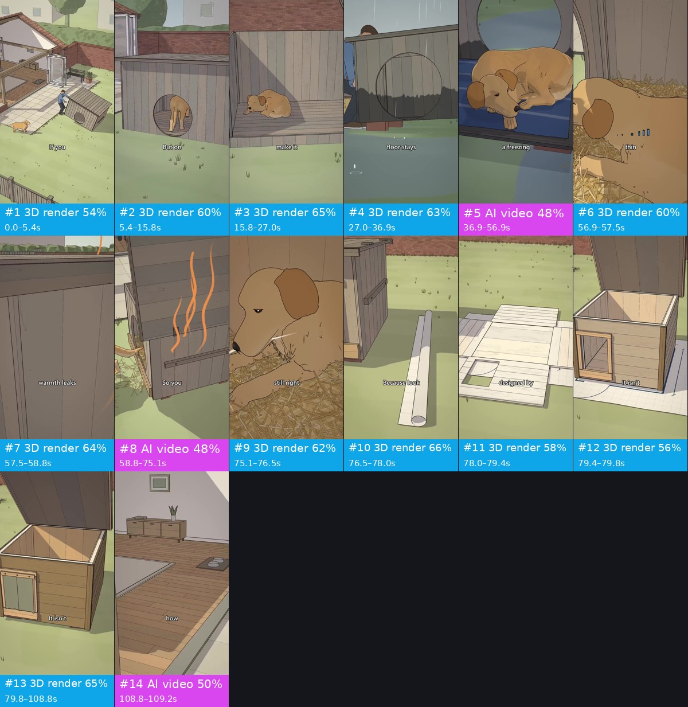
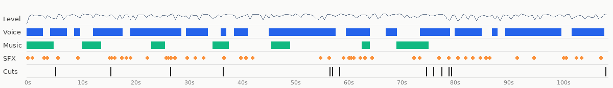

# How this video was made: dog_door.mp4

**In one line**: An explainer that 'builds' the ideal winter dog house one problem at a time: each fix is shown, named, and then broken by the next problem.
**How it was made**: Mixed production: 3D render 66% + AI-generated video 34% (34% of the duration lacks evidence for live action vs AI, to confirm)

- 1:49 · vertical 9:16 · 14 shots, 7.8s each on average
- Confidence 58%, based on: tool measurements + AI assistant reviewed 14 shots
- ⚠️ 15 points are uncertain, see “Open questions”



# Part one · Breakdown: how this video is built

## What makes it work

- **The hook**: 0-5 s: a familiar image (a box with a door in the middle) plus a contrarian line, 'it already has a home… but', sets up the problem chain.
- Problem→fix→name loop ('that's the fit', 'that's the raised floor'…) repeated ~9 times keeps a 109 s Short watchable
- No hard cuts: the camera flies continuously through one garden, so the dog house visibly evolves in place
- Cutaways and visual metaphors (heat aura, damp band, orange heat-leak lines, white wind streaks) make invisible physics visible
- Twist at ~79 s: a charity's two-room design reframes everything built so far

## Production pipeline at a glance

| Stage | What this video uses | Remake approach |
|---|---|---|
| **Base picture** | 3D render 11 shots (66%), AI-generated video 3 shots (34%) | AI in 13 generations |
| **Packaging** | 1 subtitle lines (middle, up to 1 rows): blue text, black outline, line height 6.9%; styled text ×2 (tilted, blue fill, brown fill, multi-colour / gradient): "or", "4"; text label ×199 (10 of them follow an object): "Ifyou", "dog in", "a big", "wooden box", "with a", "door in" …; SFX hits on: text label in ×31, styled text in ×1 | export `packaging/subtitles.srt` for timeline alignment |
| **Sound** | voice（TTS voice-over）, 30 distinct effects (48 hits) | voice: TTS voice-over; effects: add from a library at the listed times |

## Content and structure

**Narrative line**

Keep this line in a remake: same order, same job at each step, with the point refilled from your own cases, numbers and material, so it is more than a change of subject.

| Time | Shots | Job | What it says |
|---|---|---|---|
| 0.0–5.4s | #1 | grab attention | A plain box with a door already counts as a home |
| 5.4–15.8s | #2 | — | Problem 1: too big to warm → make it smaller |
| 15.8–27.0s | #3 | turn | Problem 2: damp from the ground → raise it on bricks |
| 27.0–36.9s | #4 | — | Raised floor works; floor is hard → add a blanket |
| 36.9–56.9s | #5 | turn | Wet blanket freezes → straw; straw escapes → add a 5-inch sill |
| 56.9–57.5s | #6 | add information | Transition beat |
| 57.5–75.1s | #7, #8 | turn | Problem: thin walls leak warmth → Insulation; then wind blows straight in |
| 75.1–76.5s | #9 | add information | Hang a flap |
| 76.5–78.0s | #10 | turn | Flap helps but bed is still behind the door |
| 78.0–79.4s | #11 | — | Charity design: it isn't one room |
| 79.4–79.8s | #12 | add information | Transition beat |
| 79.8–108.8s | #13 | deliver the conclusion | Two-room layout with side door; summer/winter tips; best dog house is yours |
| 108.8–109.2s | #14 | call to action | Sign-off |

**Script** (local speech recognition, unchecked; trust on-screen subtitles for names and homophones)

<details class="ref"><summary>all 27 lines</summary>

| Time | Who | Line | Delivery |
|---|---|---|---|
| 0.1–4.8s | narration | If you put your dog in a big wooden box with a door in the middle, it already has a home. | measured: rate fast (4.4 words/s), wide pitch movement |
| 5.2–9.8s | narration | But on the first cold night, it curls up as tight as it can and shivers. | measured: rate fast (3.5 words/s) |
| 9.8–12.4s | narration | Its own body is the only heater in there. | measured: rate fast (3.4 words/s) |
| 12.8–18.0s | narration | And you gave it a room far too big to warm, so you make it smaller, just big enough to stand up, | measured: rate fast (4.3 words/s), wide pitch movement, higher than this speaker's other lines |
| 18.0–22.2s | narration | turn around and lie down, that's the fit, but the box sits right on the ground, | measured: rate fast (3.8 words/s), lower than this speaker's other lines |
| 22.2–24.9s | narration | it rains and the damp creeps up through the floor. | measured: rate fast (3.7 words/s) |
| 25.4–30.6s | narration | So you lift it onto bricks and the floor stays dry, that's the raised floor, but the floor is hard, | measured: rate fast (3.8 words/s), wide pitch movement |
| 30.6–32.5s | narration | so you give it your softest blanket. | measured: rate fast (3.7 words/s) |
| 32.8–34.7s | narration | And your dog walks in soaking wet. | measured: rate fast (3.7 words/s) |
| 35.0–36.5s | narration | The blanket drinks it all up. | measured: rate fast (3.9 words/s) |
| 36.7–39.2s | narration | And on a freezing night, a wet blanket freezes, | measured: rate fast (3.6 words/s) |
| 39.2–44.9s | narration | so you take it out and fill the bed with straw Dr straw keeps out the cold and the damp, that's the straw, | measured: rate fast (4.1 words/s), wide pitch movement |
| 44.9–50.1s | narration | but every time your dog walks out the straw goes with it, so you raise the bottom of the doorway. | measured: rate fast (3.9 words/s) |
| 50.3–55.8s | narration | About five inches the straw stays in and now it has somewhere to rest its chin, that's the sill, | measured: rate fast (3.5 words/s) |
| 55.8–59.8s | narration | but the walls are thin and the warmth leaks away so you line the walls, | measured: rate fast (3.7 words/s) |
| 59.8–63.1s | narration | the floor and the ceiling with foam and cover it with wood. | measured: rate fast (3.6 words/s) |
| 63.4–67.8s | narration | That's the insulation. Now it really has everything until the wind picks up. | measured: rate normal (3.0 words/s), lower than this speaker's other lines |
| 68.3–74.0s | narration | Do is in the middle, so the wind blows straight in right onto the bed. you hang a flap over the door, it helps. | measured: rate fast (4.2 words/s), wide pitch movement |
| 74.7–80.7s | narration | Bed is still right behind it because look inside a doghouse designed by an animal charity, it isn't one room, | measured: rate fast (3.4 words/s), 0.7s pause before |
| 80.7–85.5s | narration | it's two the door goes at one end and it opens into a little hallway your dog walks in, | measured: rate fast (4.0 words/s) |
| 85.5–87.8s | narration | turns the corner and sleeps behind a wall. | measured: rate fast (3.5 words/s) |
| 87.9–90.9s | narration | For a retriever, the bedroom is only 22 inches by 39. | measured: rate fast (3.6 words/s) |
| 90.9–101.0s | narration | Now the wind hits the wall, not your dog, that's the side door in summer you take the flap off and move the whole house into the shade so if your dog's door is in the middle, | measured: rate fast (3.7 words/s) |
| 101.2–102.8s | narration | Turn it away from the wind. | measured: rate fast (3.8 words/s), wide pitch movement, higher than this speaker's other lines |
| 102.8–105.3s | narration | Hang a flap and swap the blanket for straw. | measured: rate fast (3.6 words/s) |
| 105.3–108.5s | narration | And on the coldest nights, the best dog house is yours. | measured: rate fast (3.5 words/s), wide pitch movement |
| 108.5–109.3s | narration | And that's how. | measured: rate fast (3.5 words/s), wide pitch movement |

</details>

## Shot list

| # | Frame | Time | What it says | Picture | Camera | Made with |
|---|---|---|---|---|---|---|
| 1 |  | 0:00.0 · 5.4s | grab attention: A plain box with a door already counts as a … | Hook: wide high-angle garden; man pushes a big wooden box wi… | smooth move | 3D render |
| 2 |  | 0:05.4 · 10.4s | Problem 1: too big to warm → make it smaller | Push into the box; front wall dissolves into a cutaway; dog … | smooth move | 3D render |
| 3 |  | 0:15.8 · 11.2s | turn: Problem 2: damp from the ground → raise it on bricks | Dog stands in the smaller box; rain starts, damp rises up th… | smooth move | 3D render |
| 4 |  | 0:27.0 · 9.9s | Raised floor works; floor is hard → add a blanket | Rain continues; raised floor stays dry, kinetic 'the raised … | smooth move | 3D render |
| 5 |  | 0:36.9 · 20.0s | turn: Wet blanket freezes → straw; straw escapes → add a 5-i… | Soaking-wet dog walks in and shakes; blanket soaks up the wa… | smooth move | AI-generated video |
| 6 |  | 0:56.9 · 0.5s | add information: Transition beat | Brief beat on the sill/insulation callout; kinetic text pop.… | smooth move | 3D render |
| 7 |  | 0:57.5 · 1.3s | turn: Problem: thin walls leak warmth | Heat shown as orange wavy lines leaking out through the wall… | smooth move | 3D render |
| 8 |  | 0:58.8 · 16.3s | turn: Insulation; then wind blows straight in | Roof lifts off; walls, floor and ceiling lined with foam the… | smooth move | AI-generated video |
| 9 |  | 1:15.1 · 1.4s | add information: Hang a flap | Man hangs a fabric flap over the door. Style: Clean-line 2D … | smooth move | 3D render |
| 10 |  | 1:16.5 · 1.6s | turn: Flap helps but bed is still behind the door | Man walks past the flapped house; camera moves round to a cu… | smooth move | 3D render |
| 11 |  | 1:18.0 · 1.3s | Charity design: it isn't one room | Top-down/cutaway of the charity design: a box with the door … | smooth move | 3D render |
| 12 |  | 1:19.4 · 0.5s | add information: Transition beat | Brief kinetic text beat. Style: Clean-line 2D illustration l… | smooth move | 3D render |
| 13 |  | 1:19.8 · 29.0s | deliver the conclusion: Two-room layout with side door; summ… | Lid open: hallway + bedroom layout; dog walks in, turns the … | handheld shake | 3D render |
| 14 |  | 1:48.8 · 0.4s | call to action: Sign-off | Final frame, end-card text beat. Style: Clean-line 2D illust… | smooth move | AI-generated video |

## Cast, scenes and props

- **Visual style**: Clean-line 2D illustration look (thin dark outlines, cel shading with soft gradients, hatched wood grain and grass), suburban UK-style back garden with brick wall, patio, bifold glass doors; golden re

| Id | Name | Kind | Look | Role | Voice | Shots |
|---|---|---|---|---|---|---|
| A | Retriever | other | golden-orange coat, floppy ears, cel-shaded | protagonist | — | #1–#14 |
| B | Owner | other | short brown hair, light-blue button shirt, dark jeans, brown shoes | builder | — | #1, #3–#5, #9, #10, #13 |
| C | Helper | other | long brown hair, light top, jeans | helps carry the house | — | #13 |

- Character consistency: Retriever, Owner appear across multiple shots; lock an anchor image first and feed it as reference in later shots

**Scenes**

| Scene | Where | When | Set / light | Shots |
|---|---|---|---|---|
| S1 | suburban back garden: lawn, brick wall, patio, bifold glass doors, bench, potted | day / rain / night | soft daylight; grey-blue for rain and night | #1–#13 |
| S2 | inside the house, wooden floor | night | warm interior | #13, #14 |

**Props / products / logos**

- dog house (shots #1–#14): vertical grey-brown boards; evolves: round centre door → smaller → on bricks → sill → insulated → flap → two-room with side door
- striped blue blanket (shots #4, #5)
- straw (shots #5, #13)
- bricks (shots #3, #4)

## Packaging layer (subtitles / styled text / stickers / sound-effect hits)

- 1 subtitle lines (middle, up to 1 rows): blue text, black outline, line height 6.9%
- styled text ×2 (tilted, blue fill, brown fill, multi-colour / gradient): "or", "4"
- text label ×199 (10 of them follow an object): "Ifyou", "dog in", "a big", "wooden box", "with a", "door in" …
- SFX hits on: text label in ×31, styled text in ×1

<details class="ref"><summary>text timeline (120 rows)</summary>

| Time | Kind | Text | Style | In / out | SFX |
|---|---|---|---|---|---|
| 0.00–0.30s | text label | Ifyou | white text, black outline, line height 5.1% (about 98px) | hard out | — |
| 0.30–0.70s | text label | dog in | white text, black outline, line height 5.4% (about 103px) | hard in / hard out | pop |
| 0.70–1.50s | text label | a big | white text, black outline, line height 5.3% (about 102px) | hard in | — |
| 1.50–1.60s | text label | wooden box | white text, black outline, line height 4.3% (about 83px) | hard in / hard out | — |
| 1.60–2.20s | text label | with a | white text, black outline, line height 4.3% (about 83px) | pop / hard out | — |
| 2.20–2.70s | text label | door in | white text, black outline, line height 3.9% (about 75px) | fade out | — |
| 2.90–3.20s | text label | the middle | white text, black outline, line height 3.7% (about 70px) | hard in / hard out | — |
| 3.50–3.80s | text label | it already | white text, black outline, keywords highlighted in yellow, line height 4.8% (about 93px) | hard in | click |
| 4.00–4.10s | text label | has a | white text, black outline, line height 4.1% (about 78px) | hard in / hard out | pop |
| 4.30–4.80s | text label | home | white text, black outline, line height 4.5% (about 87px) | fade in / fade out | — |
| 5.00–5.20s | text label | But on | white text, black outline, line height 4.2% (about 81px) | hard in | — |
| 5.40–5.70s | text label | the first | white text, black outline, line height 5.1% (about 98px) | type-on / hard out | — |
| 6.00–6.60s | text label | cold night | white text, black outline, line height 4.9% (about 94px) | fade in / hard out | ding |
| 7.00–7.10s | text label | it curls | white text, black outline, line height 4.7% (about 90px) | hard in / hard out | — |
| 7.40–7.70s | text label | up as | white text, black outline, line height 4.7% (about 90px) | hard in / hard out | — |
| 7.90–8.20s | text label | it can | white text, black outline, line height 4.1% (about 79px) | hard in / hard out | — |
| 8.50–9.60s | text label | and shivers | white text, black outline, line height 4.5% (about 87px) | fade in / fade out (bounces / changes colour midway) | — |
| 9.80–10.20s | text label | Its own | white text, black outline, line height 4.1% (about 79px) | hard in | click |
| 10.20–10.90s | text label | body is | white text, black outline, line height 5.4% (about 103px) | hard out | — |
| 10.90–11.10s | text label | the only | white text, black outline, line height 5.9% (about 113px) | hard out | — |
| 11.50–11.60s | text label | heater in | white text, black outline, line height 4.7% (about 90px) | hard in / hard out | — |
| 11.90–12.20s | text label | there | white text, black outline, line height 4.1% (about 79px) | hard in / hard out | — |
| 12.50–12.70s | text label | ndyou | white text, black outline, line height 4.5% (about 85px) | hard in / hard out | — |
| 12.90–13.10s | text label | gave it | white text, black outline, line height 4.8% (about 93px) | hard in / hard out | — |
| 13.50–14.60s | text label · follows an object | Ⅲ | green text, green outline, keywords highlighted in grey, line height 4.2% (about 81px) | fade in / fade out (bounces / changes colour midway) | — |
| 13.50–14.10s | text label | far too | white text, black outline, line height 4.1% (about 78px) | fade in / hard out | — |
| 14.30–14.70s | text label | big to | white text, black outline, line height 4.6% (about 89px) | hard in / hard out | — |
| 14.90–15.10s | text label | So you | white text, black outline, line height 5.2% (about 100px) | hard in / hard out | — |
| 15.40–15.70s | text label | make it | white text, black outline, line height 4.5% (about 85px) | hard in | — |
| 15.80–16.10s | text label | smaller | white text, black outline, line height 4.5% (about 87px) | hard out | pop |
| 16.10–16.70s | text label | just big | white text, black outline, line height 5.4% (about 103px) | hard out | ding |
| 16.70–17.20s | text label | enough to | white text, black outline, line height 4.5% (about 85px) | hard in / hard out | pop |
| 17.50–18.30s | text label | stand up | white text, black outline, line height 5.3% (about 101px) | hard in / hard out | — |
| 18.30–18.90s | text label | turn around | white text, black outline, line height 3.8% (about 72px) | hard in / hard out | — |
| 18.90–19.20s | text label | down | white text, black outline, line height 4.6% (about 89px) | hard in / hard out | click |
| 19.20–19.70s | text label | That's the | white text, black outline, line height 4.1% (about 78px) | hard in / hard out | — |
| 19.70–20.10s | text label | fit | white text, black outline, line height 4.1% (about 79px) | hard in / hard out | pop |
| 20.00–21.60s | text label | fit | blue text, black outline, keywords highlighted in grey, line height 10.2% (about 197px) | fade out | — |
| 20.40–20.60s | text label | box sits | white text, black outline, line height 4.3% (about 83px) | hard in / hard out | — |
| 20.60–21.20s | text label | right on | white text, black outline, line height 4.5% (about 87px) | hard in / hard out | — |
| 21.30–22.40s | text label | the ground | white text, black outline, line height 4.7% (about 91px) | slide in | — |
| 22.40–23.00s | text label | It rains | white text, black outline, line height 4.5% (about 87px) | hard in | — |
| 23.00–23.10s | text label | and the | white text, black outline, line height 4.8% (about 92px) | hard in / hard out | — |
| 23.40–23.80s | text label | damp creeps | white text, black outline, line height 4.7% (about 90px) | hard in / fade out | — |
| 24.00–24.10s | text label | up through | white text, black outline, line height 4.4% (about 84px) | hard in / hard out | — |
| 24.40–25.30s | text label | the floor | white text, black outline, line height 4.3% (about 82px) | hard in / hard out | — |
| 24.40–24.60s | text label | M/W | grey text, grey outline, line height 9.2% (about 177px) | hard in / hard out | — |
| 25.30–25.80s | text label | Šo you | white text, black outline, line height 5.7% (about 109px) | hard out | — |
| 25.80–26.10s | text label | onto bricks | white text, black outline, line height 4.4% (about 84px) | hard out | — |
| 26.10–26.60s | text label | and the | white text, black outline, line height 4.1% (about 79px) | hard in / hard out | click |
| 26.60–27.10s | text label | floor stays | white text, black outline, line height 5.5% (about 107px) | hard in / hard out | click |
| 27.10–27.60s | text label | dry | white text, black outline, line height 5.2% (about 99px) | hard out | click |
| 28.00–28.50s | text label | That's the | white text, black outline, line height 3.8% (about 74px) | hard in / hard out | pop |
| 28.50–29.20s | text label | the | white text, black outline, line height 4.7% (about 89px) | fade in / hard out | — |
| 28.50–29.10s | text label | raised floo | blue text, black outline, line height 9.6% (about 184px) | fade in / hard out | — |
| 28.50–28.70s | text label | raised floor | white text, black outline, line height 4.1% (about 78px) | hard in / shrink out | — |
| 29.00–29.10s | text label | But the | white text, black outline, line height 3.9% (about 75px) | hard out | — |
| 29.40–29.70s | subtitle | raid for | blue text, black outline, line height 6.9% (about 132px) | hard out | — |
| 29.40–30.00s | text label | floor is | white text, black outline, line height 4.3% (about 83px) | fade in | — |
| 29.50–29.60s | text label | the | white text, black outline, line height 3.6% (about 69px) | hard in / hard out | — |
| 30.00–30.10s | text label | hard | white text, black outline, line height 4.5% (about 85px) | hard in / hard out | click |
| 30.00–30.10s | styled text | or | blue text, black outline, line height 4.5% (about 85px) | hard in / hard out | — |
| 30.50–30.60s | text label | so you | white text, black outline, line height 6.1% (about 117px) | hard in / hard out | — |
| 31.00–31.10s | text label | give it | white text, black outline, line height 5.3% (about 102px) | hard in / hard out | — |
| 31.30–31.70s | text label | your softest | white text, black outline, line height 4.9% (about 94px) | fade in / fade out | — |
| 32.00–32.90s | text label | blanket | white text, black outline, line height 4.2% (about 81px) | hard out | — |
| 32.90–33.10s | text label | dog walks | white text, black outline, line height 5.1% (about 98px) | hard out | — |
| 33.50–34.20s | text label | in soaking | white text, black outline, line height 5.0% (about 96px) | fade in / fade out | — |
| 34.50–34.60s | text label | wet | white text, black outline, line height 3.8% (about 72px) | hard in / hard out | — |
| 35.00–35.10s | text label | The blanket | white text, black outline, line height 4.1% (about 79px) | hard in / hard out | — |
| 35.00–35.10s | text label | 0 | blue text, bold, line height 1.6% (about 31px) | hard in / hard out | — |
| 35.50–35.60s | text label | drinks it | white text, black outline, line height 3.9% (about 75px) | hard in / hard out | — |
| 35.90–36.10s | text label | all up | white text, black outline, line height 6.5% (about 124px) | hard in / hard out | — |
| 36.40–36.70s | text label | And on | white text, black outline, line height 4.8% (about 92px) | pop / shrink out | — |
| 37.00–37.40s | text label | a freezing | white text, black outline, line height 5.3% (about 102px) | hard in / hard out | pop |
| 37.40–37.90s | text label | night | white text, black outline, line height 4.7% (about 90px) | fade out | — |
| 38.00–39.10s | text label | freezes | white text, black outline, line height 4.0% (about 76px) | — | — |
| 39.40–39.60s | text label | So you | white text, black outline, line height 4.6% (about 89px) | fade in / hard out | — |
| 40.00–40.30s | text label | take it | white text, black outline, line height 4.0% (about 76px) | hard in | — |
| 40.50–40.80s | text label | ou tnd | white text, black outline, line height 4.3% (about 83px) | hard in | pop |
| 40.80–41.10s | text label | bed with | white text, black outline, line height 4.1% (about 79px) | hard out | — |
| 41.50–42.10s | text label | straw | white text, black outline, line height 3.7% (about 71px) | hard in / hard out | — |
| 42.50–42.60s | text label | keeps out | white text, black outline, line height 4.1% (about 78px) | hard in / hard out | pop |
| 43.00–43.10s | text label | the cold | white text, black outline, line height 3.8% (about 74px) | hard in / hard out | — |
| 43.50–43.60s | text label | and the | white text, black outline, line height 4.2% (about 81px) | hard in / hard out | — |
| 44.00–44.20s | text label | damp | white text, black outline, line height 5.0% (about 96px) | hard in / hard out | — |
| 44.40–44.70s | text label | That's the | white text, black outline, line height 3.8% (about 74px) | fade in / hard out | — |
| 44.50–44.60s | text label | th | white text, black outline, line height 3.9% (about 75px) | hard in / hard out | — |
| 44.90–45.20s | text label | straw | white text, black outline, line height 4.3% (about 83px) | hard in / hard out | — |
| 45.00–46.10s | text label | the Straw | blue text, black outline, keywords highlighted in white, line height 8.8% (about 168px) | fade in / slide out | — |
| 45.50–45.60s | text label | But every | white text, black outline, line height 4.6% (about 89px) | hard in / hard out | — |
| 46.00–46.20s | text label | dog walks | white text, black outline, line height 4.7% (about 90px) | hard in | — |
| 46.20–46.70s | text label | onut | white text, black outline, line height 3.7% (about 70px) | hard in / hard out | — |
| 47.00–47.10s | text label | the straw | white text, black outline, line height 4.3% (about 83px) | hard in / hard out | — |
| 47.50–47.60s | text label | goes with | white text, black outline, line height 4.8% (about 93px) | hard in / hard out | — |
| 47.70–48.10s | text label | it | white text, black outline, line height 4.1% (about 79px) | hard in / hard out | — |
| 48.40–48.80s | text label | So you | white text, black outline, line height 5.1% (about 98px) | hard in | — |
| 49.00–50.10s | text label | the doorway | white text, black outline, keywords highlighted in yellow, line height 5.4% (about 103px) | hard in / hard out (bounces / changes colour midway) | — |
| 49.50–52.10s | text label · follows an object | 5 in 13 cm | white text, black outline, keywords highlighted in orange, line height 6.4% (about 122px) | hard out (bounces / changes colour midway) | — |
| 50.30–50.80s | text label | about 5 | white text, black outline, keywords highlighted in yellow, line height 4.6% (about 89px) | fade out | — |
| 50.90–51.30s | text label | inches | white text, black outline, line height 3.9% (about 75px) | — | — |
| 51.50–52.60s | text label | stays in | white text, black outline, line height 4.1% (about 78px) | slide in | — |
| 52.80–53.20s | text label | it has | white text, black outline, line height 4.5% (about 87px) | — | — |
| 53.30–53.60s | text label | somewhere to | white text, black outline, line height 3.9% (about 75px) | hard in / hard out | — |
| 53.60–54.10s | text label | rest its | white text, black outline, line height 4.0% (about 76px) | hard out | — |
| 54.10–54.70s | text label | chin | white text, black outline, line height 4.5% (about 87px) | fade out | — |
| 55.00–55.20s | text label | That's the | white text, black outline, line height 4.3% (about 83px) | hard in / hard out | — |
| 55.50–56.60s | text label | the Sill | black text, keywords highlighted in blue, line height 9.2% (about 177px) | fade in / slide out | — |
| 56.00–57.10s | text label | thin | white text, black outline, line height 4.7% (about 90px) | hard in / slide out | — |
| 56.50–56.60s | text label | d | white text, black outline, line height 2.3% (about 45px) | hard in / hard out | — |
| 57.00–57.10s | styled text | 4 | brown text, keywords highlighted in brown, line height 1.2% (about 22px) | hard in / hard out | whoosh |
| 57.50–57.70s | text label | warmth leaks | white text, black outline, line height 4.4% (about 84px) | hard in / hard out | — |
| 58.00–58.10s | text label | away | white text, black outline, line height 4.2% (about 81px) | hard in / hard out | — |
| 58.50–58.60s | text label | So you | white text, black outline, line height 4.5% (about 87px) | hard in / hard out | — |
| 59.00–59.10s | text label | line the | white text, black outline, line height 5.2% (about 100px) | hard in / hard out | — |
| 59.50–59.70s | text label | walls | white text, black outline, line height 3.8% (about 74px) | hard in | ding |
| 59.80–60.10s | text label | the floor | white text, black outline, line height 4.1% (about 79px) | hard in / hard out | — |
| 60.20–60.80s | text label | and the | white text, black outline, line height 4.2% (about 81px) | hard in / fade out | — |
| 60.90–61.40s | text label | ceiling with | white text, black outline, line height 4.8% (about 92px) | fade in / hard out | click |
| 61.30–61.60s | text label | foam | white text, black outline, line height 4.5% (about 87px) | hard out | click |

</details>

- Remake: import `packaging/subtitles.srt` into your editor and replace the words; styled version in `packaging/overlays.ass`

## Sound

**Voice**

- male-leaning
- Source: TTS voice-over
- Remake: TTS voice-over: CapCut text-to-speech or another TTS tool, with a similar voice and pace

**Sound effects** (48 hits, 30 distinct sounds)

<details class="ref"><summary>all 30 distinct effects (with audio)</summary>

| Sound | Listen | Type | Times used | At | On screen |
|---|---|---|---|---|---|
| F1 | [listen](sfx/sfx_01.wav) | pop | 1 | 0.3s | text label "dog in" appears |
| F2 | [listen](sfx/sfx_02.wav) | whoosh | 2 | 1.1s, 64.9s | text label "really has" appears |
| F3 | [listen](sfx/sfx_03.wav) | click | 1 | 3.3s | text label "it already" appears |
| F4 | [listen](sfx/sfx_04.wav) | pop | 1 | 3.9s | text label "has a" appears |
| F5 | [listen](sfx/sfx_05.wav) | pop | 3 | 5.9s, 16.0s, 16.6s | text label "cold night" appears; text label "just big" appears; text label "enough to" appears |
| F6 | [listen](sfx/sfx_06.wav) | click | 1 | 9.6s | text label "Its own" appears |
| F7 | [listen](sfx/sfx_07.wav) | click | 5 | 15.6s, 26.2s, 60.6s, 61.5s, 101.0s | text label "smaller" appears; text label "and the" appears; text label "foam" appears |
| F8 | [listen](sfx/sfx_08.wav) | whoosh | 1 | 17.9s | — |
| F9 | [listen](sfx/sfx_09.wav) | click | 1 | 18.8s | text label "down" appears |
| F10 | [listen](sfx/sfx_10.wav) | pop | 1 | 19.5s | text label "fit" appears |
| F11 | [listen](sfx/sfx_11.wav) | ding | 1 | 22.7s | — |
| F12 | [listen](sfx/sfx_12.wav) | click | 1 | 26.7s | text label "floor stays" appears |
| F13 | [listen](sfx/sfx_13.wav) | click | 1 | 27.1s | text label "dry" appears |
| F14 | [listen](sfx/sfx_14.wav) | pop | 5 | 27.9s, 59.6s, 62.7s, 79.3s, 82.5s | text label "That's the" appears; text label "walls" appears; text label "It isn't" appears |
| F15 | [listen](sfx/sfx_15.wav) | click | 1 | 30.2s | text label "hard" appears |
| F16 | [listen](sfx/sfx_16.wav) | pop | 1 | 31.8s | — |
| F17 | [listen](sfx/sfx_17.wav) | click | 1 | 33.2s | — |
| F18 | [listen](sfx/sfx_18.wav) | pop | 3 | 37.1s, 73.9s, 92.2s | text label "a freezing" appears |
| F19 | [listen](sfx/sfx_19.wav) | pop | 4 | 40.3s, 72.8s, 103.4s, 104.3s | text label "ou tnd" appears; text label "MMM" appears; text label "for straw" appears |
| F20 | [listen](sfx/sfx_20.wav) | whoosh | 2 | 42.5s, 56.9s | text label "keeps out" appears; styled text "4" appears |
| F21 | [listen](sfx/sfx_21.wav) | click | 2 | 61.0s, 101.4s | text label "ceiling with" appears; text label "away from" appears |
| F22 | [listen](sfx/sfx_22.wav) | ding | 1 | 63.6s | text label "th" appears |
| F23 | [listen](sfx/sfx_23.wav) | pop | 1 | 77.5s | — |
| F24 | [listen](sfx/sfx_24.wav) | pop | 1 | 81.0s | — |
| F25 | [listen](sfx/sfx_25.wav) | whoosh | 1 | 83.9s | text label "hallway" appears |
| F26 | [listen](sfx/sfx_26.wav) | click | 1 | 85.2s | — |
| F27 | [listen](sfx/sfx_27.wav) | other | 1 | 86.3s | text label "and sleeps" appears |
| F28 | [listen](sfx/sfx_28.wav) | whoosh | 1 | 87.1s | text label "behind a" appears |
| F29 | [listen](sfx/sfx_29.wav) | whoosh | 1 | 95.3s | text label "In summer" appears |
| F30 | [listen](sfx/sfx_30.wav) | whoosh | 1 | 107.9s | — |

</details>

- Remake: play each sound, find a similar one in your editor's library and place it at the times under “At”

**Listen to the tracks**

- voice: [stems/vocals.wav](stems/vocals.wav)

<details class="ref"><summary>Sound measurements and evidence</summary>



- Loudness -17.0 dBFS, peak -3.1 dBFS
- sound runs across cuts, laid in post as one bed (background changes 6.8dB at cuts vs 7.4dB within shots)
- Voice on 70% of the duration, pitch about 144.1Hz
- Voice source: TTS voice-over (TTS voice-over 64%, human recording 27%, native dialogue from the AI video model 9%)
  - Voice and background sound run across cuts: the voice-over was laid on separately in post (TTS or a human voice-over)

</details>

## Open questions

- Shot #1 (0.0–5.4s): Tools say 3D render, the image review says AI-generated video; on the AI / live-action axis the fusion follows the tools (eval-calibrated): check the frames to see whether the review's evidence is really visible
- Shot #2 (5.4–15.8s): Tools say 3D render, the image review says AI-generated video; on the AI / live-action axis the fusion follows the tools (eval-calibrated): check the frames to see whether the review's evidence is really visible
- Shot #3 (15.8–27.0s): Tools say 3D render, the image review says AI-generated video; on the AI / live-action axis the fusion follows the tools (eval-calibrated): check the frames to see whether the review's evidence is really visible
- Shot #4 (27.0–36.9s): Tools say 3D render, the image review says AI-generated video; on the AI / live-action axis the fusion follows the tools (eval-calibrated): check the frames to see whether the review's evidence is really visible
- Shot #5 (36.9–56.9s): Live action / stop motion or AI, to confirm: no AIGC label; 24fps-source marks appear in AI video, stop motion and cinema-camera footage alike
- Shot #6 (56.9–57.5s): Tools say 3D render, the image review says AI-generated video; on the AI / live-action axis the fusion follows the tools (eval-calibrated): check the frames to see whether the review's evidence is really visible
- Shot #7 (57.5–58.8s): Tools say 3D render, the image review says AI-generated video; on the AI / live-action axis the fusion follows the tools (eval-calibrated): check the frames to see whether the review's evidence is really visible
- Shot #8 (58.8–75.1s): Live action / stop motion or AI, to confirm: no AIGC label; 24fps-source marks appear in AI video, stop motion and cinema-camera footage alike
- Shot #9 (75.1–76.5s): Tools say 3D render, the image review says AI-generated video; on the AI / live-action axis the fusion follows the tools (eval-calibrated): check the frames to see whether the review's evidence is really visible
- Shot #10 (76.5–78.0s): Tools say 3D render, the image review says AI-generated video; on the AI / live-action axis the fusion follows the tools (eval-calibrated): check the frames to see whether the review's evidence is really visible
- Shot #11 (78.0–79.4s): Tools say 3D render, the image review says AI-generated video; on the AI / live-action axis the fusion follows the tools (eval-calibrated): check the frames to see whether the review's evidence is really visible
- Shot #12 (79.4–79.8s): Tools say 3D render, the image review says AI-generated video; on the AI / live-action axis the fusion follows the tools (eval-calibrated): check the frames to see whether the review's evidence is really visible
- Shot #13 (79.8–108.8s): Tools say 3D render, the image review says AI-generated video; on the AI / live-action axis the fusion follows the tools (eval-calibrated): check the frames to see whether the review's evidence is really visible
- Shot #14 (108.8–109.2s): Live action / stop motion or AI, to confirm: no AIGC label; 24fps-source marks appear in AI video, stop motion and cinema-camera footage alike
- No AI listened to the soundtrack (the review covered the picture only): real voice versus TTS is inferred from the waveform; the effects were found on the separated effects track and their types are estimated from the sound. Play the stems and each effect under “Sound” to check

# Part two · Remake plan

Planned for **MiniMax H3 / H3 Max**: ≤15 s per call, several shots per call, takes reference video (3 clips, ≤15 s in all), ≤9 reference images, first / last frame, native sound. Name another model and the split, lengths and prompts are redone for it.

## Remake it yourself: do it in this order

Copy the method and the rhythm, not the pictures: keep what each part does and fill it with your own content and material.

This is a 3D / animation. Do the steps in this order; the detail for each is in the matching subsection below. 34% of the time is a AI story short; its steps are included.

1. **Write the content**: write yours in the same 13 steps as the original (narrative line under “Content and structure”)
2. **Collect material**: one reference image per recurring character to lock appearance across shots: Retriever, Owner
3. **Generate**: 13 calls (109 s), several shots each. Each shot gets one source frame for composition (subtitles erased, in `remake/refs/`), the swapped-in people, animals and products get reference images, and the prompt lists the shots in order
4. **Adapt the prompts to your model**: each unit's draft is already laid out in MiniMax H3 / H3 Max's shot, tag and audio format; refine it against the model's prompt guide before generating (or run `rea-video plan <folder> --rewrite-prompts`)
5. **Voice**: the original is TTS voice-over; record it yourself or use TTS; 27 lines with their pace in the script table under “Sound”
6. **Edit**: follow the order and lengths in the shot list; the original has 14 shots at 7.8s each; 10 transitions under “Edit”
7. **Subtitles and styled text**: import `packaging/subtitles.srt` and replace the words; timing and style under “Packaging layer”
8. **Sound effects**: 48; place similar ones from a library at the times under “Sound”
9. **Put it together and compare**: hand the shots you made to the agent; it places them on the original timeline, keeps the original where yours are missing, and renders a side-by-side comparison with the original

### AI generation

**13 generations, 109 s in total**

> ⚠️ G1, G2, G3, G4, G5, G6, G7, G8, G9, G10: the prompts are the tool's drafts, already in MiniMax H3 / H3 Max's layout. Check them against the model's conventions and good prompts for similar shots, then put the finals into `remake/prompts.json`; `rea-video plan` then checks the format.

- **How it is generated**: multi-shot from key frames

| Part | Shots | Time | Length | Prepare |
|---|---|---|---|---|
| G1 | #1 | 0.0–5.4s | generate 6s, trim to 5.4s | reference images |
| G2 | #2 | 5.4–15.8s | generate 11s, trim to 10.4s | reference images |
| G3 | #3 | 15.8–27.0s | generate 12s, trim to 11.2s | reference images |
| G4 | #4 | 27.0–36.9s | 9.9s | reference images |
| G5 | #5 | 36.9–56.9s | 20.0s (2 calls) | reference images |
| G6 | #6, #7 | 56.9–58.8s | generate 4s, trim to 1.8s | reference images |
| G7 | #8 | 58.8–75.1s | generate 9s, trim to 8.2s (2 calls) | reference images |
| G8 | #9–#12 | 75.1–79.8s | 4.8s | reference images |
| G9 | #13 | 79.8–108.8s | generate 15s, trim to 14.5s (2 calls) | reference images |
| G10 | #14 | 108.8–109.2s | generate 4s, trim to 0.4s | reference images |

<details class="ref"><summary>Why it is split this way</summary>

- Grouping: consecutive shots share a call where they fit, ≤10s per call, ≤4 shots; a long stretch is cut at a scene change first
- Inputs: the model also takes reference video, but key frames are used here: one key frame per shot fixes composition and look, swapped-in things get their own images
- Audio: the model can generate action sound effects and ambience along with the picture; voice-over is better done as separate TTS and mixed in, so copy and timing stay editable
- Packaging: the text label, subtitle, styled text on the generated shots is post-production packaging: keep it out of the prompts (erased from source references) and lay it back on from the packaging timeline after generation

</details>

<details><summary>Frames to make first (14)</summary>

When swapping people or products, or switching to shot-by-shot image-to-video, prepare each shot's first frame as below:

| Shot | Role | How | Reference images | Save as |
|---|---|---|---|---|
| #1 | first frame | text-to-image (also serves as character anchor image) | `shots/shot_001_first.jpg` (source first frame: composition and style reference) | `remake/redrawn/shot001.png` |
| #2 | first frame | image-to-image / reference edit (lock character look) | anchor frame from shot #1 (locks Retriever look and outfit); `shots/shot_002_first.jpg` (source first frame: shot framing and pose reference) | `remake/redrawn/shot002.png` |
| #3 | first frame | image-to-image / reference edit (lock character look) | anchor frame from shot #1 (locks Retriever look and outfit); `shots/shot_003_first.jpg` (source first frame: shot framing and pose reference) | `remake/redrawn/shot003.png` |
| #4 | first frame | image-to-image / reference edit (lock character look) | anchor frame from shot #1 (locks Retriever look and outfit); `shots/shot_004_first.jpg` (source first frame: shot framing and pose reference) | `remake/redrawn/shot004.png` |
| #5 | first frame | image-to-image / reference edit (lock character look) | anchor frame from shot #1 (locks Retriever look and outfit); `shots/shot_005_first.jpg` (source first frame: shot framing and pose reference) | `remake/redrawn/shot005.png` |
| #6 | first frame | image-to-image / reference edit (lock character look) | anchor frame from shot #1 (locks Retriever look and outfit); `shots/shot_006_first.jpg` (source first frame: shot framing and pose reference) | `remake/redrawn/shot006.png` |
| #7 | first frame | image-to-image / reference edit (lock character look) | anchor frame from shot #1 (locks Retriever look and outfit); `shots/shot_007_first.jpg` (source first frame: shot framing and pose reference) | `remake/redrawn/shot007.png` |
| #8 | first frame | image-to-image / reference edit (lock character look) | anchor frame from shot #1 (locks Retriever look and outfit); `shots/shot_008_first.jpg` (source first frame: shot framing and pose reference) | `remake/redrawn/shot008.png` |
| #9 | first frame | image-to-image / reference edit (lock character look) | anchor frame from shot #1 (locks Retriever look and outfit); `shots/shot_009_first.jpg` (source first frame: shot framing and pose reference) | `remake/redrawn/shot009.png` |
| #10 | first frame | image-to-image / reference edit (lock character look) | anchor frame from shot #1 (locks Retriever look and outfit); `shots/shot_010_first.jpg` (source first frame: shot framing and pose reference) | `remake/redrawn/shot010.png` |
| #11 | first frame | image-to-image / reference edit (lock character look) | anchor frame from shot #1 (locks Retriever look and outfit); `shots/shot_011_first.jpg` (source first frame: shot framing and pose reference) | `remake/redrawn/shot011.png` |
| #12 | first frame | image-to-image / reference edit (lock character look) | anchor frame from shot #1 (locks Retriever look and outfit); `shots/shot_012_first.jpg` (source first frame: shot framing and pose reference) | `remake/redrawn/shot012.png` |
| #13 | first frame | image-to-image / reference edit (lock character look) | anchor frame from shot #1 (locks Retriever look and outfit); `shots/shot_013_first.jpg` (source first frame: shot framing and pose reference) | `remake/redrawn/shot013.png` |
| #14 | first frame | image-to-image / reference edit (lock character look) | anchor frame from shot #1 (locks Retriever look and outfit); `shots/shot_014_first.jpg` (source first frame: shot framing and pose reference) | `remake/redrawn/shot014.png` |

- **#1 first frame (text-to-image (also serves as character anchor image))**
  - Image prompt: Vertical 9:16. medium close-up, subject in the upper middle of the frame, camera push-in. Hook: wide high-angle garden; man pushes a big wooden box with a round door into place as the retriever trots past; push-in as the box swings round to face camera
- **#2 first frame (image-to-image / reference edit (lock character look))**
  - Image prompt: Keep the exact facial features and outfit from shot #1's anchor image: Vertical 9:16. medium close-up, subject in the upper middle of the frame, camera pull-out. Push into the box; front wall dissolves into a cutaway; dog curls up shivering on bare boards (breath puff); glowing heat aura around the dog with a green 'room' outline graphic shows the space is too big; box shrinks to a smaller room, dog stands/turns/lies down
- **#3 first frame (image-to-image / reference edit (lock character look))**
  - Image prompt: Keep the exact facial features and outfit from shot #1's anchor image: Vertical 9:16. medium shot, subject in the upper middle of the frame, camera push-in. Dog stands in the smaller box; rain starts, damp rises up the walls (dark wet band); man lifts the box onto bricks
- **#4 first frame (image-to-image / reference edit (lock character look))**
  - Image prompt: Keep the exact facial features and outfit from shot #1's anchor image: Vertical 9:16. medium close-up, subject in the upper middle of the frame, camera push-in. Rain continues; raised floor stays dry, kinetic 'the raised floor' text pops; man lays a striped blue blanket inside
- **#5 first frame (image-to-image / reference edit (lock character look))**
  - Image prompt: Keep the exact facial features and outfit from shot #1's anchor image: Vertical 9:16. medium close-up, subject centred in frame, camera push-in. Soaking-wet dog walks in and shakes; blanket soaks up the water; night, dog shivers on frozen blanket (breath puff); man pulls the blanket out; straw fills the bed; dog steps in and settles; straw gets dragged out; a sill board is added with a '5 in / 13 cm' dimension callout
- **#6 first frame (image-to-image / reference edit (lock character look))**
  - Image prompt: Keep the exact facial features and outfit from shot #1's anchor image: Vertical 9:16. medium close-up, subject in the upper middle of the frame, camera pull-out. Brief beat on the sill/insulation callout; kinetic text pop
- **#7 first frame (image-to-image / reference edit (lock character look))**
  - Image prompt: Keep the exact facial features and outfit from shot #1's anchor image: Vertical 9:16. medium close-up, subject in the upper middle of the frame, camera push-in. Heat shown as orange wavy lines leaking out through the walls
- **#8 first frame (image-to-image / reference edit (lock character look))**
  - Image prompt: Keep the exact facial features and outfit from shot #1's anchor image: Vertical 9:16. medium close-up, subject in the left of the frame, camera push-in. Roof lifts off; walls, floor and ceiling lined with foam then boards; kinetic 'the insulation' text; wide shot of the garden as white wind streaks pick up and blow straight through the centred door onto the bed
- **#9 first frame (image-to-image / reference edit (lock character look))**
  - Image prompt: Keep the exact facial features and outfit from shot #1's anchor image: Vertical 9:16. medium close-up, subject in the lower middle of the frame, camera push-in. Man hangs a fabric flap over the door
- **#10 first frame (image-to-image / reference edit (lock character look))**
  - Image prompt: Keep the exact facial features and outfit from shot #1's anchor image: Vertical 9:16. medium close-up, subject centred in frame, camera push-in. Man walks past the flapped house; camera moves round to a cutaway diagram with a guide line
- **#11 first frame (image-to-image / reference edit (lock character look))**
  - Image prompt: Keep the exact facial features and outfit from shot #1's anchor image: Vertical 9:16. medium close-up, subject centred in frame, camera push-in. Top-down/cutaway of the charity design: a box with the door at one end
- **#12 first frame (image-to-image / reference edit (lock character look))**
  - Image prompt: Keep the exact facial features and outfit from shot #1's anchor image: Vertical 9:16. close-up, subject centred in frame, camera push-in. Brief kinetic text beat
- **#13 first frame (image-to-image / reference edit (lock character look))**
  - Image prompt: Keep the exact facial features and outfit from shot #1's anchor image: Vertical 9:16. medium close-up, subject centred in frame, camera push-in. Lid open: hallway + bedroom layout; dog walks in, turns the corner, sleeps behind a partition; dimension callouts '22 in / 56 cm' and '39 in / 99 cm'; white wind streaks hit the wall; kinetic 'the side door'; summer: flap off, two people carry the house into the shade; recap of the fixes; ends inside the house with the dog on a wooden floor
- **#14 first frame (image-to-image / reference edit (lock character look))**
  - Image prompt: Keep the exact facial features and outfit from shot #1's anchor image: Vertical 9:16. medium close-up, subject in the upper middle of the frame, camera pull-out. Final frame, end-card text beat

</details>

<details><summary>G1 · shots #1 · 5.4s</summary>

- reference images: source frames of shots #1 (subtitles erased)

Draft prompt (in MiniMax H3 / H3 Max's layout; check it and put the final into remake/prompts.json before generating):

```text
integrated_multimodal_description: Generate the shots below in order in one go, hard cuts between them; each shot takes composition, size and camera from its source frame image. Vertical 9:16; soft frontal light, warm tones, background clearly blurred.
[Shot 1] Hook: wide high-angle garden; man pushes a big wooden box with a round door into place as the retriever trots past; push-in as the box swings round to face camera. (composition: <Picture 1>)
overall_soundscape: Only the natural sounds of the actions on screen.
non_diegetic_music: N/A
```

</details>

<details><summary>G2 · shots #2 · 10.4s</summary>

- reference images: source frames of shots #2 (subtitles erased)

Draft prompt (in MiniMax H3 / H3 Max's layout; check it and put the final into remake/prompts.json before generating):

```text
integrated_multimodal_description: Generate the shots below in order in one go, hard cuts between them; each shot takes composition, size and camera from its source frame image. Vertical 9:16; soft frontal light, warm tones, background clearly blurred.
[Shot 1] Push into the box; front wall dissolves into a cutaway; dog curls up shivering on bare boards (breath puff); glowing heat aura around the dog with a green 'room' outline graphic shows the space is too big; box shrinks to a smaller room, dog stands/turns/lies down. (composition: <Picture 1>)
overall_soundscape: Only the natural sounds of the actions on screen.
non_diegetic_music: N/A
```

</details>

<details><summary>G3 · shots #3 · 11.2s</summary>

- reference images: source frames of shots #3 (subtitles erased)

Draft prompt (in MiniMax H3 / H3 Max's layout; check it and put the final into remake/prompts.json before generating):

```text
integrated_multimodal_description: Generate the shots below in order in one go, hard cuts between them; each shot takes composition, size and camera from its source frame image. Vertical 9:16; soft frontal light, warm tones, background clearly blurred.
[Shot 1] Dog stands in the smaller box; rain starts, damp rises up the walls (dark wet band); man lifts the box onto bricks. (composition: <Picture 1>)
overall_soundscape: Only the natural sounds of the actions on screen.
non_diegetic_music: N/A
```

</details>

<details><summary>G4 · shots #4 · 9.9s</summary>

- reference images: source frames of shots #4 (subtitles erased)

Draft prompt (in MiniMax H3 / H3 Max's layout; check it and put the final into remake/prompts.json before generating):

```text
integrated_multimodal_description: Generate the shots below in order in one go, hard cuts between them; each shot takes composition, size and camera from its source frame image. Vertical 9:16; soft frontal light, warm tones, background clearly blurred.
[Shot 1] Rain continues; raised floor stays dry, kinetic 'the raised floor' text pops; man lays a striped blue blanket inside. (composition: <Picture 1>)
overall_soundscape: Only the natural sounds of the actions on screen.
non_diegetic_music: N/A
```

</details>

<details><summary>G5 · shots #5 · 20.0s</summary>

- reference images: source frames of shots #5 (subtitles erased)

Draft prompt (in MiniMax H3 / H3 Max's layout; check it and put the final into remake/prompts.json before generating):

```text
integrated_multimodal_description: Generate the shots below in order in one go, hard cuts between them; each shot takes composition, size and camera from its source frame image. Vertical 9:16; soft frontal light, warm tones, background clearly blurred.
[Shot 1] Soaking-wet dog walks in and shakes; blanket soaks up the water; night, dog shivers on frozen blanket (breath puff); man pulls the blanket out; straw fills the bed; dog steps in and settles; straw gets dragged out; a sill board is added with a '5 in / 13 cm' dimension callout. (composition: <Picture 1>)
overall_soundscape: Only the natural sounds of the actions on screen.
non_diegetic_music: N/A
```

</details>

<details><summary>G6 · shots #6, #7 · 1.8s</summary>

- reference images: source frames of shots #6, #7 (subtitles erased)

Draft prompt (in MiniMax H3 / H3 Max's layout; check it and put the final into remake/prompts.json before generating):

```text
integrated_multimodal_description: Generate the shots below in order in one go, hard cuts between them; each shot takes composition, size and camera from its source frame image. Vertical 9:16; soft frontal light, warm tones, background clearly blurred.
[Shot 1] Brief beat on the sill/insulation callout; kinetic text pop. (composition: <Picture 1>)
[Shot 2] At 00:00.533, the camera cuts to: Heat shown as orange wavy lines leaking out through the walls. (composition: <Picture 2>)
overall_soundscape: Only the natural sounds of the actions on screen.
non_diegetic_music: N/A
```

</details>

<details><summary>G7 · shots #8 · 16.3s</summary>

- reference images: source frames of shots #8 (subtitles erased)

Draft prompt (in MiniMax H3 / H3 Max's layout; check it and put the final into remake/prompts.json before generating):

```text
integrated_multimodal_description: Generate the shots below in order in one go, hard cuts between them; each shot takes composition, size and camera from its source frame image. Vertical 9:16; soft frontal light, warm tones, background clearly blurred.
[Shot 1] Roof lifts off; walls, floor and ceiling lined with foam then boards; kinetic 'the insulation' text; wide shot of the garden as white wind streaks pick up and blow straight through the centred door onto the bed. (composition: <Picture 1>)
overall_soundscape: Only the natural sounds of the actions on screen.
non_diegetic_music: N/A
```

</details>

<details><summary>G8 · shots #9–#12 · 4.8s</summary>

- reference images: source frames of shots #9, #10, #11, #12 (subtitles erased)

Draft prompt (in MiniMax H3 / H3 Max's layout; check it and put the final into remake/prompts.json before generating):

```text
integrated_multimodal_description: Generate the shots below in order in one go, hard cuts between them; each shot takes composition, size and camera from its source frame image. Vertical 9:16; soft frontal light, warm tones, background clearly blurred.
[Shot 1] Man hangs a fabric flap over the door. (composition: <Picture 1>)
[Shot 2] At 00:01.400, the camera cuts to: Man walks past the flapped house; camera moves round to a cutaway diagram with a guide line. (composition: <Picture 2>)
[Shot 3] At 00:02.967, the camera cuts to: Top-down/cutaway of the charity design: a box with the door at one end. (composition: <Picture 3>)
[Shot 4] At 00:04.300, the camera cuts to: Brief kinetic text beat. (composition: <Picture 4>)
overall_soundscape: Only the natural sounds of the actions on screen.
non_diegetic_music: N/A
```

</details>

<details><summary>G9 · shots #13 · 29.0s</summary>

- reference images: source frames of shots #13 (subtitles erased)

Draft prompt (in MiniMax H3 / H3 Max's layout; check it and put the final into remake/prompts.json before generating):

```text
integrated_multimodal_description: Generate the shots below in order in one go, hard cuts between them; each shot takes composition, size and camera from its source frame image. Vertical 9:16; soft frontal light, warm tones, background clearly blurred.
[Shot 1] Lid open: hallway + bedroom layout; dog walks in, turns the corner, sleeps behind a partition; dimension callouts '22 in / 56 cm' and '39 in / 99 cm'; white wind streaks hit the wall; kinetic 'the side door'; summer: flap off, two people carry the house into the shade; recap of the fixes; ends inside the house with the dog on a wooden floor. (composition: <Picture 1>)
overall_soundscape: Only the natural sounds of the actions on screen.
non_diegetic_music: N/A
```

</details>

<details><summary>G10 · shots #14 · 0.4s</summary>

- reference images: source frames of shots #14 (subtitles erased)

Draft prompt (in MiniMax H3 / H3 Max's layout; check it and put the final into remake/prompts.json before generating):

```text
integrated_multimodal_description: Generate the shots below in order in one go, hard cuts between them; each shot takes composition, size and camera from its source frame image. Vertical 9:16; soft frontal light, warm tones, background clearly blurred.
[Shot 1] Final frame, end-card text beat. (composition: <Picture 1>)
overall_soundscape: Only the natural sounds of the actions on screen.
non_diegetic_music: N/A
```

</details>

<details><summary>Prompt guides for MiniMax H3 / H3 Max</summary>

- https://huggingface.co/MiniMaxAI/MiniMax-H3/raw/main/docs/VIDEO_PROMPT_WRITING_GUIDE_base_en.md
- https://huggingface.co/MiniMaxAI/MiniMax-H3/raw/main/docs/VIDEO_PROMPT_WRITING_GUIDE_ref_en.md
- https://platform.minimax.io/docs/api-reference/video-generation-v2-create
- https://docs.comfy.org/tutorials/video/minimax/minimax-h3-prompt-guide.md

</details>

### Edit

- Cut in the order and lengths of the shot list
- Approach: No hard cuts; morph and fly-through transitions; pace set by the TTS voice-over
- Rhythm: 7.8s per shot; transitions blur transition×2, cut×3, dissolve×2, jump cut×2, spin transition×1, whip pan×1, wipe×2

**Transitions**

| Time | Into shot | Transition |
|---|---|---|
| 4.1–6.8s | #2 | spin transition, 2.7s |
| 15.6–16.1s | #3 | dissolve, 0.5s |
| 26.7–27.3s | #4 | wipe, upwards, 0.5s |
| 36.7–37.2s | #5 | wipe, 0.5s |
| 56.7–56.9s | #6 | blur transition, 0.2s |
| 74.9–75.2s | #9 | blur transition, 0.3s |
| 76.1–76.7s | #10 | whip pan, leftwards, 0.5s |
| 79.1–79.6s | #12 | dissolve, 0.5s |

## Appendix

### Shot by shot

Each shot has two parts: what is visible on screen, and how the tools infer it was made (with the basis); remake prompts last. Folded by default.

<details class="ref"><summary>#1 00:00.000–00:05.400 · 3D render + code / editor overlays (subtitles)</summary>


**Visible on screen** (check against the frames)
- Picture: Hook: wide high-angle garden; man pushes a big wooden box with a round door into place as the retriever trots past; push-in as the box swings round to face camera. Style: Clean-line 2D illustration look (thin dark outlines, cel shading with soft gradients, hatched wood grain and grass), suburban UK-style back garden with brick wall, patio, bifold glass doors; golden retriever + man in blue shirt; dog house of grey-brown vertical boards.
- Framing / light: medium close-up; centred; camera push-in; key light frontal (from the camera side; both sides of the subject about equally bright); soft light (almost no lit / shadow edge); warm tone
- Text track (subtitle/bottom): Ifyou / dog in / a big / wooden box
- [AI assistant review] No hard cuts anywhere in 109 s (frame-difference scan): every scene change is a continuous morph or camera fly-through, the signature of chained image-to-video generations
- [AI assistant review] Geometry is not stable the way a 3D scene is: at 0-2 s the box grows and rotates while the man pushes it; at ~6 s the front wall dissolves into a cutaway; the door hole changes shape and size between scenes

**How it was made, as inferred by the tools** (inferred, not seen)
- Inference: 3D render 54%, code / template render 19%, AI-generated video 12% (fused_agent)
- ⚠️ Disputed: Tools say 3D render, the image review says AI-generated video; on the AI / live-action axis the fusion follows the tools (eval-calibrated): check the frames to see whether the review's evidence is really visible
- Material: rendered by the creator
- Basis (tool measurements, not necessarily visible to the eye):
  - Rendered texture: 33% flat colour blocks, 95% of pixels use only 81 colours, 40% axis-aligned edges
  - Platform transcode (YouTube) has compressed the sensor noise away: noise cues no longer apply, live action vs AI rests on frame rate and picture content

- Remake: 3D render: a video model gives an approximation (see the generation units); for precise multiple angles, model in 3D and render in Blender
  - First-frame image prompt: Vertical 9:16 clean-line 2D illustration, thin dark outlines, soft cel shading, hatched wood grain; Hook: wide high-angle garden; man pushes a big wooden box with a round door into place as the retriever trots past; push-in as the box swings round to face camera.
  - Image-to-video motion prompt: Hook: wide high-angle garden; man pushes a big wooden box with a round door into place as the retriever trots past; push-in as the box swings round to face camera.
  - Full video prompt: Hook: wide high-angle garden; man pushes a big wooden box with a round door into place as the retriever trots past; push-in as the box swings round to face camera.

</details>

<details class="ref"><summary>#2 00:05.400–00:15.834 · 3D render + code / editor overlays (subtitles)</summary>


**Visible on screen** (check against the frames)
- Picture: Push into the box; front wall dissolves into a cutaway; dog curls up shivering on bare boards (breath puff); glowing heat aura around the dog with a green 'room' outline graphic shows the space is too big; box shrinks to a smaller room, dog stands/turns/lies down. Style: Clean-line 2D illustration look (thin dark outlines, cel shading with soft gradients, hatched wood grain and grass), suburban UK-style back garden with brick wall, patio, bifold glass doors; golden retriever + man in blue shirt; dog house of grey-brown vertical boards.
- Framing / light: medium close-up; centred; camera pull-out; key light frontal (from the camera side; both sides of the subject about equally bright); medium-soft; cool tone
- Text on objects in the scene (not subtitles): Ⅲ
- Text track (subtitle/bottom): the first / cold night / it curls / up as
- Text track (text/middle): Ⅲ
- [AI assistant review] No hard cuts anywhere in 109 s (frame-difference scan): every scene change is a continuous morph or camera fly-through, the signature of chained image-to-video generations
- [AI assistant review] Geometry is not stable the way a 3D scene is: at 0-2 s the box grows and rotates while the man pushes it; at ~6 s the front wall dissolves into a cutaway; the door hole changes shape and size between scenes

**How it was made, as inferred by the tools** (inferred, not seen)
- Inference: 3D render 60%, code / template render 21%, AI-generated video 7% (fused_agent)
- ⚠️ Disputed: Tools say 3D render, the image review says AI-generated video; on the AI / live-action axis the fusion follows the tools (eval-calibrated): check the frames to see whether the review's evidence is really visible
- Material: rendered by the creator
- Basis (tool measurements, not necessarily visible to the eye):
  - Rendered texture: 32% flat colour blocks, 95% of pixels use only 64 colours, 46% axis-aligned edges
  - Platform transcode (YouTube) has compressed the sensor noise away: noise cues no longer apply, live action vs AI rests on frame rate and picture content

- Remake: 3D render: a video model gives an approximation (see the generation units); for precise multiple angles, model in 3D and render in Blender
  - First-frame image prompt: Vertical 9:16 clean-line 2D illustration, thin dark outlines, soft cel shading, hatched wood grain; Push into the box; front wall dissolves into a cutaway; dog curls up shivering on bare boards (breath puff); glowing heat aura around the dog with a green 'room' outline graphic shows the space is too big; box shrinks to a smaller room, dog stands/turns/lies down.
  - Image-to-video motion prompt: Push into the box; front wall dissolves into a cutaway; dog curls up shivering on bare boards (breath puff); glowing heat aura around the dog with a green 'room' outline graphic shows the space is too big; box shrinks to a smaller room, dog stands/turns/lies down.
  - Full video prompt: Push into the box; front wall dissolves into a cutaway; dog curls up shivering on bare boards (breath puff); glowing heat aura around the dog with a green 'room' outline graphic shows the space is too big; box shrinks to a smaller room, dog stands/turns/lies down.

</details>

<details class="ref"><summary>#3 00:15.834–00:27.001 · 3D render + code / editor overlays (subtitles, text labels)</summary>


**Visible on screen** (check against the frames)
- Picture: Dog stands in the smaller box; rain starts, damp rises up the walls (dark wet band); man lifts the box onto bricks. Style: Clean-line 2D illustration look (thin dark outlines, cel shading with soft gradients, hatched wood grain and grass), suburban UK-style back garden with brick wall, patio, bifold glass doors; golden retriever + man in blue shirt; dog house of grey-brown vertical boards.
- Framing / light: medium shot; centred; camera push-in; key light frontal (from the camera side; both sides of the subject about equally bright); soft light (wide lit-to-shadow ramp); warm tone
- Text on objects in the scene (not subtitles): fit
- Text track (subtitle/bottom): smaller / just big / enough to / stand up
- Text track (text/bottom): M/W
- Text track (text/middle): the
- Text track (text/middle): fit
- [AI assistant review] No hard cuts anywhere in 109 s (frame-difference scan): every scene change is a continuous morph or camera fly-through, the signature of chained image-to-video generations

**How it was made, as inferred by the tools** (inferred, not seen)
- Inference: 3D render 65%, code / template render 23%, AI-generated video 4% (fused_agent)
- ⚠️ Disputed: Tools say 3D render, the image review says AI-generated video; on the AI / live-action axis the fusion follows the tools (eval-calibrated): check the frames to see whether the review's evidence is really visible
- Material: rendered by the creator
- Basis (tool measurements, not necessarily visible to the eye):
  - Rendered texture: 44% flat colour blocks, 95% of pixels use only 50 colours, 47% axis-aligned edges
  - Platform transcode (YouTube) has compressed the sensor noise away: noise cues no longer apply, live action vs AI rests on frame rate and picture content

- Remake: 3D render: a video model gives an approximation (see the generation units); for precise multiple angles, model in 3D and render in Blender
  - First-frame image prompt: Vertical 9:16 clean-line 2D illustration, thin dark outlines, soft cel shading, hatched wood grain; Dog stands in the smaller box; rain starts, damp rises up the walls (dark wet band); man lifts the box onto bricks.
  - Image-to-video motion prompt: Dog stands in the smaller box; rain starts, damp rises up the walls (dark wet band); man lifts the box onto bricks.
  - Full video prompt: Dog stands in the smaller box; rain starts, damp rises up the walls (dark wet band); man lifts the box onto bricks.

</details>

<details class="ref"><summary>#4 00:27.001–00:36.935 · 3D render + code / editor overlays (subtitles, text labels, styled text)</summary>


**Visible on screen** (check against the frames)
- Picture: Rain continues; raised floor stays dry, kinetic 'the raised floor' text pops; man lays a striped blue blanket inside. Style: Clean-line 2D illustration look (thin dark outlines, cel shading with soft gradients, hatched wood grain and grass), suburban UK-style back garden with brick wall, patio, bifold glass doors; golden retriever + man in blue shirt; dog house of grey-brown vertical boards.
- Framing / light: medium close-up; centred; camera push-in; key light frontal (from the camera side; both sides of the subject about equally bright); soft light (almost no lit / shadow edge); cool tone
- Text on objects in the scene (not subtitles): the, raisd or, raid for
- Text track (subtitle/bottom): dry / That's the / raised floor / But the
- Text track (text/bottom): or
- Text track (subtitle/middle): the / raisd or / raid for
- Text track (text/middle): raised floo
- [AI assistant review] No hard cuts anywhere in 109 s (frame-difference scan): every scene change is a continuous morph or camera fly-through, the signature of chained image-to-video generations

**How it was made, as inferred by the tools** (inferred, not seen)
- Inference: 3D render 63%, code / template render 15%, AI-generated video 9% (fused_agent)
- ⚠️ Disputed: Tools say 3D render, the image review says AI-generated video; on the AI / live-action axis the fusion follows the tools (eval-calibrated): check the frames to see whether the review's evidence is really visible
- Material: rendered by the creator
- Basis (tool measurements, not necessarily visible to the eye):
  - Rendered texture: 45% flat colour blocks, 95% of pixels use only 39 colours, 29% axis-aligned edges
  - Platform transcode (YouTube) has compressed the sensor noise away: noise cues no longer apply, live action vs AI rests on frame rate and picture content

- Remake: 3D render: a video model gives an approximation (see the generation units); for precise multiple angles, model in 3D and render in Blender
  - First-frame image prompt: Vertical 9:16 clean-line 2D illustration, thin dark outlines, soft cel shading, hatched wood grain; Rain continues; raised floor stays dry, kinetic 'the raised floor' text pops; man lays a striped blue blanket inside.
  - Image-to-video motion prompt: Rain continues; raised floor stays dry, kinetic 'the raised floor' text pops; man lays a striped blue blanket inside.
  - Full video prompt: Rain continues; raised floor stays dry, kinetic 'the raised floor' text pops; man lays a striped blue blanket inside.

</details>

<details class="ref"><summary>#5 00:36.935–00:56.935 · AI-generated video + code / editor overlays (subtitles)</summary>


**Visible on screen** (check against the frames)
- Picture: Soaking-wet dog walks in and shakes; blanket soaks up the water; night, dog shivers on frozen blanket (breath puff); man pulls the blanket out; straw fills the bed; dog steps in and settles; straw gets dragged out; a sill board is added with a '5 in / 13 cm' dimension callout. Style: Clean-line 2D illustration look (thin dark outlines, cel shading with soft gradients, hatched wood grain and grass), suburban UK-style back garden with brick wall, patio, bifold glass doors; golden retriever + man in blue shirt; dog house of grey-brown vertical boards.
- Framing / light: medium close-up; centred; camera push-in; key light frontal (from the camera side; both sides of the subject about equally bright); hard light (sharp shadow edge); warm tone
- Text track (subtitle/bottom): a freezing / night / a wet / freezes
- Text track (subtitle/middle): th / the Straw / theeesaw / 5 in 13 cn
- Text track (subtitle/middle): 5 in / 1 / 5 in 13 cm / d
- [AI assistant review] No hard cuts anywhere in 109 s (frame-difference scan): every scene change is a continuous morph or camera fly-through, the signature of chained image-to-video generations
- [AI assistant review] Geometry is not stable the way a 3D scene is: at 0-2 s the box grows and rotates while the man pushes it; at ~6 s the front wall dissolves into a cutaway; the door hole changes shape and size between scenes

**How it was made, as inferred by the tools** (inferred, not seen)
- Inference: AI-generated video 46%, 3D render 28%, 2D animation 15% (fused_agent)
- ⚠️ To confirm: Live action / stop motion or AI, to confirm: no AIGC label; 24fps-source marks appear in AI video, stop motion and cinema-camera footage alike
- Material: AI-generated
- Basis (tool measurements, not necessarily visible to the eye):
  - Rendered texture: 36% flat colour blocks, 95% of pixels use only 68 colours, 25% axis-aligned edges
  - Platform transcode (YouTube) has compressed the sensor noise away: noise cues no longer apply, live action vs AI rests on frame rate and picture content

- Remake: Source is AI-generated: remake it with a video model; which shots share a call and what it is fed (the source clip, keyframes or first / last frames) depend on the chosen model, see the generation units in the remake plan
  - First-frame image prompt: Vertical 9:16 clean-line 2D illustration, thin dark outlines, soft cel shading, hatched wood grain; Soaking-wet dog walks in and shakes; blanket soaks up the water; night, dog shivers on frozen blanket (breath puff); man pulls the blanket out; straw fills the bed; dog steps in and settles; straw gets dragged out; a sill board is added with a '5 in / 13 cm' dimension callout.
  - Image-to-video motion prompt: Soaking-wet dog walks in and shakes; blanket soaks up the water; night, dog shivers on frozen blanket (breath puff); man pulls the blanket out; straw fills the bed; dog steps in and settles; straw gets dragged out; a sill board is added with a '5 in / 13 cm' dimension callout.
  - Full video prompt: Soaking-wet dog walks in and shakes; blanket soaks up the water; night, dog shivers on frozen blanket (breath puff); man pulls the blanket out; straw fills the bed; dog steps in and settles; straw gets dragged out; a sill board is added with a '5 in / 13 cm' dimension callout.

</details>

<details class="ref"><summary>#6 00:56.935–00:57.469 · 3D render + code / editor overlays (text labels, static graphics, styled text)</summary>


**Visible on screen** (check against the frames)
- Picture: Brief beat on the sill/insulation callout; kinetic text pop. Style: Clean-line 2D illustration look (thin dark outlines, cel shading with soft gradients, hatched wood grain and grass), suburban UK-style back garden with brick wall, patio, bifold glass doors; golden retriever + man in blue shirt; dog house of grey-brown vertical boards.
- Framing / light: medium close-up; centred; camera pull-out; key light frontal (from the camera side; both sides of the subject about equally bright); soft light (almost no lit / shadow edge); warm tone
- Text track (text/bottom): thin
- Text track (text/bottom): 4
- [AI assistant review] No hard cuts anywhere in 109 s (frame-difference scan): every scene change is a continuous morph or camera fly-through, the signature of chained image-to-video generations

**How it was made, as inferred by the tools** (inferred, not seen)
- Inference: 3D render 60%, code / template render 16%, AI-generated video 10% (fused_agent)
- ⚠️ Disputed: Tools say 3D render, the image review says AI-generated video; on the AI / live-action axis the fusion follows the tools (eval-calibrated): check the frames to see whether the review's evidence is really visible
- Material: rendered by the creator
- Basis (tool measurements, not necessarily visible to the eye):
  - Rendered texture: 54% flat colour blocks, 95% of pixels use only 38 colours, 24% axis-aligned edges
  - Platform transcode (YouTube) has compressed the sensor noise away: noise cues no longer apply, live action vs AI rests on frame rate and picture content

- Remake: 3D render: a video model gives an approximation (see the generation units); for precise multiple angles, model in 3D and render in Blender
  - First-frame image prompt: Vertical 9:16 clean-line 2D illustration, thin dark outlines, soft cel shading, hatched wood grain; Brief beat on the sill/insulation callout; kinetic text pop.
  - Image-to-video motion prompt: Brief beat on the sill/insulation callout; kinetic text pop.
  - Full video prompt: Brief beat on the sill/insulation callout; kinetic text pop.

</details>

<details class="ref"><summary>#7 00:57.469–00:58.769 · 3D render + code / editor overlays (subtitles)</summary>


**Visible on screen** (check against the frames)
- Picture: Heat shown as orange wavy lines leaking out through the walls. Style: Clean-line 2D illustration look (thin dark outlines, cel shading with soft gradients, hatched wood grain and grass), suburban UK-style back garden with brick wall, patio, bifold glass doors; golden retriever + man in blue shirt; dog house of grey-brown vertical boards.
- Framing / light: medium close-up; centred; camera push-in; key light frontal (from the camera side; both sides of the subject about equally bright); hard light (sharp shadow edge); neutral tone
- Text track (subtitle/bottom): warmth leaks / away / So you
- [AI assistant review] No hard cuts anywhere in 109 s (frame-difference scan): every scene change is a continuous morph or camera fly-through, the signature of chained image-to-video generations

**How it was made, as inferred by the tools** (inferred, not seen)
- Inference: 3D render 64%, code / template render 15%, AI-generated video 8% (fused_agent)
- ⚠️ Disputed: Tools say 3D render, the image review says AI-generated video; on the AI / live-action axis the fusion follows the tools (eval-calibrated): check the frames to see whether the review's evidence is really visible
- Material: rendered by the creator
- Basis (tool measurements, not necessarily visible to the eye):
  - Rendered texture: 34% flat colour blocks, 95% of pixels use only 54 colours, 35% axis-aligned edges
  - Platform transcode (YouTube) has compressed the sensor noise away: noise cues no longer apply, live action vs AI rests on frame rate and picture content

- Remake: 3D render: a video model gives an approximation (see the generation units); for precise multiple angles, model in 3D and render in Blender
  - First-frame image prompt: Vertical 9:16 clean-line 2D illustration, thin dark outlines, soft cel shading, hatched wood grain; Heat shown as orange wavy lines leaking out through the walls.
  - Image-to-video motion prompt: Heat shown as orange wavy lines leaking out through the walls.
  - Full video prompt: Heat shown as orange wavy lines leaking out through the walls.

</details>

<details class="ref"><summary>#8 00:58.769–01:15.069 · AI-generated video + code / editor overlays (subtitles, title)</summary>


**Visible on screen** (check against the frames)
- Picture: Roof lifts off; walls, floor and ceiling lined with foam then boards; kinetic 'the insulation' text; wide shot of the garden as white wind streaks pick up and blow straight through the centred door onto the bed. Style: Clean-line 2D illustration look (thin dark outlines, cel shading with soft gradients, hatched wood grain and grass), suburban UK-style back garden with brick wall, patio, bifold glass doors; golden retriever + man in blue shirt; dog house of grey-brown vertical boards.
- Framing / light: medium close-up; left of centre; camera push-in; key light frontal (from the camera side; both sides of the subject about equally bright); hard light (sharp shadow edge); warm tone
- Text on objects in the scene (not subtitles): th, the, insulation, 1, MMM, O
- Text track (subtitle/bottom): line the / walls / the floor / and the
- Text track (subtitle/middle): th / the / insulation
- Text track (text/middle): the
- Text track (subtitle/middle): 1 / MMM / O
- [AI assistant review] No hard cuts anywhere in 109 s (frame-difference scan): every scene change is a continuous morph or camera fly-through, the signature of chained image-to-video generations

**How it was made, as inferred by the tools** (inferred, not seen)
- Inference: AI-generated video 47%, 3D render 27%, 2D animation 15% (fused_agent)
- ⚠️ To confirm: Live action / stop motion or AI, to confirm: no AIGC label; 24fps-source marks appear in AI video, stop motion and cinema-camera footage alike
- Material: AI-generated
- Basis (tool measurements, not necessarily visible to the eye):
  - Rendered texture: 34% flat colour blocks, 95% of pixels use only 69 colours, 27% axis-aligned edges
  - Platform transcode (YouTube) has compressed the sensor noise away: noise cues no longer apply, live action vs AI rests on frame rate and picture content

- Remake: Source is AI-generated: remake it with a video model; which shots share a call and what it is fed (the source clip, keyframes or first / last frames) depend on the chosen model, see the generation units in the remake plan
  - First-frame image prompt: Vertical 9:16 clean-line 2D illustration, thin dark outlines, soft cel shading, hatched wood grain; Roof lifts off; walls, floor and ceiling lined with foam then boards; kinetic 'the insulation' text; wide shot of the garden as white wind streaks pick up and blow straight through the centred door onto the bed.
  - Image-to-video motion prompt: Roof lifts off; walls, floor and ceiling lined with foam then boards; kinetic 'the insulation' text; wide shot of the garden as white wind streaks pick up and blow straight through the centred door onto the bed.
  - Full video prompt: Roof lifts off; walls, floor and ceiling lined with foam then boards; kinetic 'the insulation' text; wide shot of the garden as white wind streaks pick up and blow straight through the centred door onto the bed.

</details>

<details class="ref"><summary>#9 01:15.069–01:16.469 · 3D render + code / editor overlays (text labels)</summary>


**Visible on screen** (check against the frames)
- Picture: Man hangs a fabric flap over the door. Style: Clean-line 2D illustration look (thin dark outlines, cel shading with soft gradients, hatched wood grain and grass), suburban UK-style back garden with brick wall, patio, bifold glass doors; golden retriever + man in blue shirt; dog house of grey-brown vertical boards.
- Framing / light: medium close-up; centred; camera push-in; key light frontal (from the camera side; both sides of the subject about equally bright); soft light (almost no lit / shadow edge); warm tone
- Text track (text/bottom): behind it
- [AI assistant review] No hard cuts anywhere in 109 s (frame-difference scan): every scene change is a continuous morph or camera fly-through, the signature of chained image-to-video generations

**How it was made, as inferred by the tools** (inferred, not seen)
- Inference: 3D render 62%, code / template render 15%, AI-generated video 9% (fused_agent)
- ⚠️ Disputed: Tools say 3D render, the image review says AI-generated video; on the AI / live-action axis the fusion follows the tools (eval-calibrated): check the frames to see whether the review's evidence is really visible
- Material: rendered by the creator
- Basis (tool measurements, not necessarily visible to the eye):
  - Rendered texture: 50% flat colour blocks, 95% of pixels use only 21 colours, 12% axis-aligned edges
  - Platform transcode (YouTube) has compressed the sensor noise away: noise cues no longer apply, live action vs AI rests on frame rate and picture content

- Remake: 3D render: a video model gives an approximation (see the generation units); for precise multiple angles, model in 3D and render in Blender
  - First-frame image prompt: Vertical 9:16 clean-line 2D illustration, thin dark outlines, soft cel shading, hatched wood grain; Man hangs a fabric flap over the door.
  - Image-to-video motion prompt: Man hangs a fabric flap over the door.
  - Full video prompt: Man hangs a fabric flap over the door.

</details>

<details class="ref"><summary>#10 01:16.469–01:18.036 · 3D render + code / editor overlays (subtitles)</summary>


**Visible on screen** (check against the frames)
- Picture: Man walks past the flapped house; camera moves round to a cutaway diagram with a guide line. Style: Clean-line 2D illustration look (thin dark outlines, cel shading with soft gradients, hatched wood grain and grass), suburban UK-style back garden with brick wall, patio, bifold glass doors; golden retriever + man in blue shirt; dog house of grey-brown vertical boards.
- Framing / light: medium close-up; centred; camera push-in; key light frontal (from the camera side; both sides of the subject about equally bright); soft light (almost no lit / shadow edge); warm tone
- Text track (subtitle/bottom): Because look / inside a / designed by / desnlby
- [AI assistant review] No hard cuts anywhere in 109 s (frame-difference scan): every scene change is a continuous morph or camera fly-through, the signature of chained image-to-video generations

**How it was made, as inferred by the tools** (inferred, not seen)
- Inference: 3D render 66%, code / template render 24%, AI-generated video 3% (fused_agent)
- ⚠️ Disputed: Tools say 3D render, the image review says AI-generated video; on the AI / live-action axis the fusion follows the tools (eval-calibrated): check the frames to see whether the review's evidence is really visible
- Material: rendered by the creator
- Basis (tool measurements, not necessarily visible to the eye):
  - Rendered texture: 41% flat colour blocks, 95% of pixels use only 24 colours, 38% axis-aligned edges
  - Platform transcode (YouTube) has compressed the sensor noise away: noise cues no longer apply, live action vs AI rests on frame rate and picture content

- Remake: 3D render: a video model gives an approximation (see the generation units); for precise multiple angles, model in 3D and render in Blender
  - First-frame image prompt: Vertical 9:16 clean-line 2D illustration, thin dark outlines, soft cel shading, hatched wood grain; Man walks past the flapped house; camera moves round to a cutaway diagram with a guide line.
  - Image-to-video motion prompt: Man walks past the flapped house; camera moves round to a cutaway diagram with a guide line.
  - Full video prompt: Man walks past the flapped house; camera moves round to a cutaway diagram with a guide line.

</details>

<details class="ref"><summary>#11 01:18.036–01:19.369 · 3D render + code / editor overlays (subtitles)</summary>


**Visible on screen** (check against the frames)
- Picture: Top-down/cutaway of the charity design: a box with the door at one end. Style: Clean-line 2D illustration look (thin dark outlines, cel shading with soft gradients, hatched wood grain and grass), suburban UK-style back garden with brick wall, patio, bifold glass doors; golden retriever + man in blue shirt; dog house of grey-brown vertical boards.
- Framing / light: medium close-up; centred; camera push-in; key light frontal (from the camera side; both sides of the subject about equally bright); hard light (sharp shadow edge); warm tone
- Text track (subtitle/bottom): an animal / charity
- [AI assistant review] No hard cuts anywhere in 109 s (frame-difference scan): every scene change is a continuous morph or camera fly-through, the signature of chained image-to-video generations

**How it was made, as inferred by the tools** (inferred, not seen)
- Inference: 3D render 58%, code / template render 14%, AI-generated video 12% (fused_agent)
- ⚠️ Disputed: Tools say 3D render, the image review says AI-generated video; on the AI / live-action axis the fusion follows the tools (eval-calibrated): check the frames to see whether the review's evidence is really visible
- Material: rendered by the creator
- Basis (tool measurements, not necessarily visible to the eye):
  - Rendered texture: 33% flat colour blocks, 95% of pixels use only 47 colours, 24% axis-aligned edges
  - Platform transcode (YouTube) has compressed the sensor noise away: noise cues no longer apply, live action vs AI rests on frame rate and picture content

- Remake: 3D render: a video model gives an approximation (see the generation units); for precise multiple angles, model in 3D and render in Blender
  - First-frame image prompt: Vertical 9:16 clean-line 2D illustration, thin dark outlines, soft cel shading, hatched wood grain; Top-down/cutaway of the charity design: a box with the door at one end.
  - Image-to-video motion prompt: Top-down/cutaway of the charity design: a box with the door at one end.
  - Full video prompt: Top-down/cutaway of the charity design: a box with the door at one end.

</details>

<details class="ref"><summary>#12 01:19.369–01:19.836 · 3D render + code / editor overlays (text labels)</summary>


**Visible on screen** (check against the frames)
- Picture: Brief kinetic text beat. Style: Clean-line 2D illustration look (thin dark outlines, cel shading with soft gradients, hatched wood grain and grass), suburban UK-style back garden with brick wall, patio, bifold glass doors; golden retriever + man in blue shirt; dog house of grey-brown vertical boards.
- Framing / light: close-up; centred; camera push-in; key light frontal (from the camera side; both sides of the subject about equally bright); soft light (almost no lit / shadow edge); warm tone
- Text track (text/bottom): It isn't
- [AI assistant review] No hard cuts anywhere in 109 s (frame-difference scan): every scene change is a continuous morph or camera fly-through, the signature of chained image-to-video generations

**How it was made, as inferred by the tools** (inferred, not seen)
- Inference: 3D render 56%, code / template render 15%, AI-generated video 13% (fused_agent)
- ⚠️ Disputed: Tools say 3D render, the image review says AI-generated video; on the AI / live-action axis the fusion follows the tools (eval-calibrated): check the frames to see whether the review's evidence is really visible
- Material: rendered by the creator
- Basis (tool measurements, not necessarily visible to the eye):
  - Rendered texture: 39% flat colour blocks, 95% of pixels use only 63 colours, 30% axis-aligned edges
  - Platform transcode (YouTube) has compressed the sensor noise away: noise cues no longer apply, live action vs AI rests on frame rate and picture content

- Remake: 3D render: a video model gives an approximation (see the generation units); for precise multiple angles, model in 3D and render in Blender
  - First-frame image prompt: Vertical 9:16 clean-line 2D illustration, thin dark outlines, soft cel shading, hatched wood grain; Brief kinetic text beat.
  - Image-to-video motion prompt: Brief kinetic text beat.
  - Full video prompt: Brief kinetic text beat.

</details>

<details class="ref"><summary>#13 01:19.836–01:48.804 · 3D render + code / editor overlays (subtitles)</summary>


**Visible on screen** (check against the frames)
- Picture: Lid open: hallway + bedroom layout; dog walks in, turns the corner, sleeps behind a partition; dimension callouts '22 in / 56 cm' and '39 in / 99 cm'; white wind streaks hit the wall; kinetic 'the side door'; summer: flap off, two people carry the house into the shade; recap of the fixes; ends inside the house with the dog on a wooden floor. Style: Clean-line 2D illustration look (thin dark outlines, cel shading with soft gradients, hatched wood grain and grass), suburban UK-style back garden with brick wall, patio, bifold glass doors; golden retriever + man in blue shirt; dog house of grey-brown vertical boards.
- Framing / light: medium close-up; centred; camera push-in; key light frontal (from the camera side; both sides of the subject about equally bright); soft light (almost no lit / shadow edge); warm tone
- Text on objects in the scene (not subtitles): 39 in, 99, 99cm, Si, side, the
- Text track (subtitle/bottom): one room / It's two / ssks / goes at
- Text track (subtitle/middle): 22 in / cm 2 2in / the
- Text track (subtitle/middle): 39 in / 99 / 99cm
- Text track (subtitle/middle): Si / side / the
- [AI assistant review] No hard cuts anywhere in 109 s (frame-difference scan): every scene change is a continuous morph or camera fly-through, the signature of chained image-to-video generations
- [AI assistant review] Geometry is not stable the way a 3D scene is: at 0-2 s the box grows and rotates while the man pushes it; at ~6 s the front wall dissolves into a cutaway; the door hole changes shape and size between scenes

**How it was made, as inferred by the tools** (inferred, not seen)
- Inference: 3D render 65%, code / template render 16%, AI-generated video 7% (fused_agent)
- ⚠️ Disputed: Tools say 3D render, the image review says AI-generated video; on the AI / live-action axis the fusion follows the tools (eval-calibrated): check the frames to see whether the review's evidence is really visible
- Material: rendered by the creator
- Basis (tool measurements, not necessarily visible to the eye):
  - Rendered texture: 38% flat colour blocks, 95% of pixels use only 58 colours, 37% axis-aligned edges
  - Platform transcode (YouTube) has compressed the sensor noise away: noise cues no longer apply, live action vs AI rests on frame rate and picture content

- Remake: 3D render: a video model gives an approximation (see the generation units); for precise multiple angles, model in 3D and render in Blender
  - First-frame image prompt: Vertical 9:16 clean-line 2D illustration, thin dark outlines, soft cel shading, hatched wood grain; Lid open: hallway + bedroom layout; dog walks in, turns the corner, sleeps behind a partition; dimension callouts '22 in / 56 cm' and '39 in / 99 cm'; white wind streaks hit the wall; kinetic 'the side door'; summer: flap off, two people carry the house into the shade; recap of the fixes; ends inside the house with the dog on a wooden floor.
  - Image-to-video motion prompt: Lid open: hallway + bedroom layout; dog walks in, turns the corner, sleeps behind a partition; dimension callouts '22 in / 56 cm' and '39 in / 99 cm'; white wind streaks hit the wall; kinetic 'the side door'; summer: flap off, two people carry the house into the shade; recap of the fixes; ends inside the house with the dog on a wooden floor.
  - Full video prompt: Lid open: hallway + bedroom layout; dog walks in, turns the corner, sleeps behind a partition; dimension callouts '22 in / 56 cm' and '39 in / 99 cm'; white wind streaks hit the wall; kinetic 'the side door'; summer: flap off, two people carry the house into the shade; recap of the fixes; ends inside the house with the dog on a wooden floor.

</details>

<details class="ref"><summary>#14 01:48.804–01:49.237 · AI-generated video + code / editor overlays (text labels)</summary>


**Visible on screen** (check against the frames)
- Picture: Final frame, end-card text beat. Style: Clean-line 2D illustration look (thin dark outlines, cel shading with soft gradients, hatched wood grain and grass), suburban UK-style back garden with brick wall, patio, bifold glass doors; golden retriever + man in blue shirt; dog house of grey-brown vertical boards.
- Framing / light: medium close-up; centred; camera pull-out; key light frontal (from the camera side; both sides of the subject about equally bright); soft light (wide lit-to-shadow ramp); neutral tone
- Text track (text/bottom): how
- [AI assistant review] No hard cuts anywhere in 109 s (frame-difference scan): every scene change is a continuous morph or camera fly-through, the signature of chained image-to-video generations

**How it was made, as inferred by the tools** (inferred, not seen)
- Inference: AI-generated video 49%, 3D render 26%, 2D animation 14% (fused_agent)
- ⚠️ To confirm: Live action / stop motion or AI, to confirm: no AIGC label; 24fps-source marks appear in AI video, stop motion and cinema-camera footage alike
- Material: AI-generated
- Basis (tool measurements, not necessarily visible to the eye):
  - Platform transcode (YouTube) has compressed the sensor noise away: noise cues no longer apply, live action vs AI rests on frame rate and picture content

- Remake: Source is AI-generated: remake it with a video model; which shots share a call and what it is fed (the source clip, keyframes or first / last frames) depend on the chosen model, see the generation units in the remake plan
  - First-frame image prompt: Vertical 9:16 clean-line 2D illustration, thin dark outlines, soft cel shading, hatched wood grain; Final frame, end-card text beat.
  - Image-to-video motion prompt: Final frame, end-card text beat.
  - Full video prompt: Final frame, end-card text beat.

</details>

### Metadata clues

- Encoder: `Lavf60.16.100`
- platform: YouTube

### Notes

- Deterministic forensics is reliable on motion, whole-frame pan/zoom, rendered texture and 24→30 fps conversion; telling live action from AI from 3D needs image reading (a VLM or an AI assistant's review), and a look at the frames yourself.
- Platform transcoding usually strips metadata; missing metadata proves nothing.
- The full data is in `breakdown.json`; the package for models starts at `VIDEO.md`.

---

Made with [REA-VIDEO](https://github.com/JuneYaooo/rea-video) · https://github.com/JuneYaooo/rea-video
