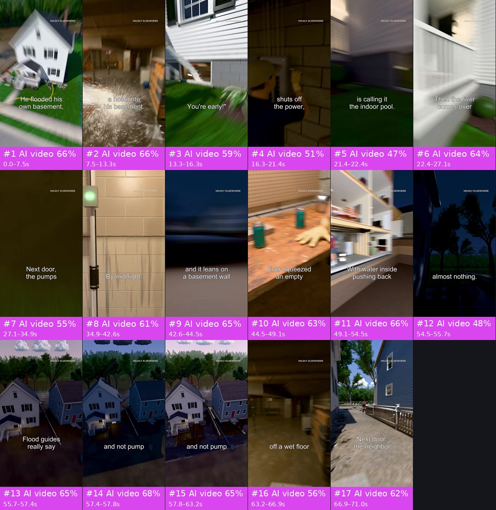
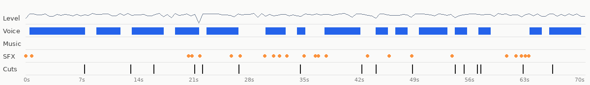

# How this video was made: flooded_basement.mp4

**In one line**: A counter-intuitive flood story: the man who floods his own basement on purpose ends up with intact walls, while the neighbour who pumps his dry has his basement wall collapse.
**How it was made**: Mixed production: live action or AI, to confirm 93% + AI-generated video 7%

- 1:11 · vertical 9:16 · 17 shots, 4.2s each on average
- Confidence 61%, based on: tool measurements + AI assistant reviewed 17 shots
- ⚠️ 17 points are uncertain, see “Open questions”



# Part one · Breakdown: how this video is built

## What makes it work

- **The hook**: 0-3 s: 'He flooded his own basement the day before the river could' — an absurd-sounding action that demands an explanation.
- Fool-vs-smart-neighbour structure with a reversal: the mocker loses ('How's the pool?' → kitchen in the basement)
- Physics made visible with cross-section cutaways (soil pressure, a bowing wall)
- Everyday analogies: a parked truck leaning on the wall; empty vs full soda can
- Relentless FPV fly-through camera with whip-blur transitions: no static frame in 71 s

## Production pipeline at a glance

| Stage | What this video uses | Remake approach |
|---|---|---|
| **Base picture** | AI-generated video 17 shots (100%) | AI in 10 generations |
| **Packaging** | 64 subtitle lines (bottom/middle/top, up to 2 rows): white text, black outline, keywords highlighted in green, line height 5.6%; entrance: hard in×23, fade in×10, slide in×1; keywords change colour as they are spoken; text label ×2: "the indoor poo", "comes over"; SFX hits on: subtitle in ×10; Placed by spoken line ×1 (with new wording they follow the line, not the old second): text label "the indoor poo" → 0.0s into "is calling it the ", on "theindoorpool" | export `packaging/subtitles.srt` for timeline alignment |
| **Sound** | voice（TTS voice-over）, 6 distinct effects (15 hits) | voice: TTS voice-over; effects: add from a library at the listed times |

## Content and structure

**Narrative line**

Keep this line in a remake: same order, same job at each step, with the point refilled from your own cases, numbers and material, so it is more than a change of subject.

| Time | Shots | Job | What it says |
|---|---|---|---|
| 0.0–7.5s | #1 | grab attention | He floods his own basement the day before the river does |
| 7.5–13.3s | #2 | — | Neighbour mocks him; three pumps going |
| 13.3–16.3s | #3 | — | He moves valuables up and kills the power |
| 16.3–21.4s | #4 | — | 'The indoor pool' |
| 21.4–22.4s | #5 | — | Transition |
| 22.4–42.6s | #6–#8 | turn | The river arrives; both houses flooded → Neighbour gloats, then a hairline crack → The wall is bending in |
| 42.6–44.5s | #9 | — | Soaked soil pushes like a parked truck |
| 44.5–49.1s | #10 | — | Analogy: full can resists crushing |
| 49.1–54.5s | #11 | — | Water inside balances the pressure |
| 54.5–55.7s | #12 | — | Authority beat |
| 55.7–57.4s | #13 | — | Let the water in, don't pump until the river drops |
| 57.4–57.8s | #14 | — | Transition |
| 57.8–71.0s | #15–#17 | deliver the conclusion | He drains it slowly once the river drops → His walls survived → Twist: the neighbour's kitchen fell into his basement |

**Script** (local speech recognition, unchecked; trust on-screen subtitles for names and homophones)

<details class="ref"><summary>all 20 lines</summary>

| Time | Who | Line | Delivery |
|---|---|---|---|
| 0.2–3.2s | narration | He flooded his own basement the day before the river could. | measured: rate fast (3.6 words/s), wide pitch movement, higher than this speaker's other lines |
| 3.6–7.7s | narration | The whole street is stacking sandbags and he's running a hose into his basement. | measured: rate fast (3.4 words/s), wide pitch movement |
| 8.2–13.3s | narration | His neighbor has three pumps going and yells over flood's not till tomorrow, pal, you're early. | measured: rate normal (3.1 words/s), wide pitch movement, higher than this speaker's other lines, louder than the other lines |
| 13.8–18.1s | narration | But he carries the couch upstairs, shuts off the power, and fills it to the top step. | measured: rate fast (3.9 words/s), wide pitch movement |
| 18.7–21.8s | narration | By dinner, the whole street is calling it the indoor pool. | measured: rate fast (3.6 words/s), 0.6s pause before |
| 22.2–26.3s | narration | Then the river comes over the bank and both houses end up in a brown lake. | measured: rate fast (3.9 words/s), lower than this speaker's other lines |
| 26.7–30.4s | narration | Next door, the pumps are winning and the neighbor yells,How's the pool?? | measured: rate fast (3.5 words/s), wide pitch movement, louder than the other lines |
| 30.7–33.2s | narration | But by sunset, there's a crack in the neighbor's wall. | measured: rate fast (3.9 words/s) |
| 33.5–34.5s | narration | Thin as a hair. | measured: rate fast (4.3 words/s) |
| 35.0–38.8s | narration | By midnight, it's wide enough for a finger and the wall is bending in. | measured: rate fast (3.7 words/s), lower than this speaker's other lines |
| 39.2–44.0s | narration | You see, soaked dirt is heavy and it leans on a basement wall like a parked truck. | measured: rate fast (3.6 words/s), wide pitch movement |
| 44.5–46.0s | narration | Ever squeezed an empty soda can. | measured: rate fast (3.9 words/s), higher than this speaker's other lines |
| 46.3–48.7s | narration | It crumples a full one won't give. | measured: rate normal (3.0 words/s), wide pitch movement |
| 49.2–54.3s | narration | With water inside pushing back just as hard, the indoor pool's walls feel almost nothing. | measured: rate normal (3.0 words/s), wide pitch movement |
| 54.9–59.3s | narration | Flood guides really say to let the water in and not pump until the river drops. | measured: rate fast (3.6 words/s), wide pitch movement, 0.6s pause before |
| 59.8–61.6s | narration | A week later, he drains his pool. | measured: rate fast (3.9 words/s), wide pitch movement |
| 61.9–63.0s | narration | Nice and slow. | measured: rate normal (2.9 words/s), flatter than the other lines |
| 63.2–65.7s | narration | Off a wet floor and four straight walls. | measured: rate normal (3.3 words/s), flatter than the other lines, lower than this speaker's other lines |
| 66.1–68.5s | narration | Next door, the neighbor is pumping his out too. | measured: rate fast (3.8 words/s) |
| 68.8–70.6s | narration | Except his kitchen is down there with it. | measured: rate fast (4.4 words/s), flatter than the other lines, lower than this speaker's other lines |

</details>

## Shot list

| # | Frame | Time | What it says | Picture | Camera |
|---|---|---|---|---|---|
| 1 |  | 0:00.0 · 7.5s | grab attention: He floods his own basement the day before th… | Hook: FPV fly-in to the white house; the hero runs a yellow … | smooth move |
| 2 |  | 0:07.5 · 5.8s | Neighbour mocks him; three pumps going | Fast fly-by to the blue neighbour's house: blue discharge ho… | smooth move |
| 3 |  | 0:13.3 · 3.0s | He moves valuables up and kills the power | Whip into the flooding basement; the hero carries a couch up… | handheld shake |
| 4 |  | 0:16.3 · 5.2s | 'The indoor pool' | POV down the basement stairs: the water is up to the top ste… | static (subject moves) |
| 5 |  | 0:21.4 · 1.0s | Transition | Night exterior through a window; transition beat. Style: Sem… | static |
| 6 |  | 0:22.4 · 4.6s | turn: The river arrives; both houses flooded | River overtops the bank and sandbags; aerial of both houses … | smooth move |
| 7 |  | 0:27.1 · 7.8s | turn: Neighbour gloats, then a hairline crack | Cutaway of the neighbour's dry basement with pumps winning; … | smooth move |
| 8 |  | 0:34.9 · 7.8s | turn: The wall is bending in | Midnight: the crack widens to finger width (flashlight close… | smooth move |
| 9 |  | 0:42.6 · 1.8s | Soaked soil pushes like a parked truck | Cutaway metaphor: a red pickup truck leaning against the bas… | smooth move |
| 10 |  | 0:44.5 · 4.6s | Analogy: full can resists crushing | Workbench close-up: a gloved hand squeezes an empty soda can… | smooth move |
| 11 |  | 0:49.1 · 5.4s | Water inside balances the pressure | Side-by-side cutaway: the flooded basement walls with water … | smooth move |
| 12 |  | 0:54.5 · 1.1s | Authority beat | Quick graphic/insert beat for 'flood guides really say'. Sty… | static (subject moves) |
| 13 |  | 0:55.7 · 1.7s | Let the water in, don't pump until the river drops | Aerial of the flooded street. Style: Semi-realistic '3D-rend… | smooth move |
| 14 |  | 0:57.4 · 0.4s | Transition | Brief zoom/pan frame. Style: Semi-realistic '3D-render' look… | whole-frame zoom / pan |
| 15 |  | 0:57.8 · 5.4s | deliver the conclusion: He drains it slowly once the river d… | Aerial as the river recedes, leaving muddy yards; a week lat… | smooth move |
| 16 |  | 1:03.2 · 3.7s | deliver the conclusion: His walls survived | Inside the hero's basement: empty, wet floor, four straight … | smooth move |
| 17 |  | 1:06.9 · 4.2s | deliver the conclusion: Twist: the neighbour's kitchen fell … | Neighbour in rubber boots pumping his basement out, kitchen … | smooth move |

## Cast, scenes and props

- **Visual style**: Semi-realistic '3D-render' look (game-engine/archviz style: clean geometry, soft GI lighting, plastic-ish skin), American suburban street with a white clapboard house (the hero's) and a blue house (th

| Id | Name | Kind | Look | Role | Voice | Shots |
|---|---|---|---|---|---|---|
| A | Hero | other | blue/grey T-shirt, khaki shorts or trousers, short hair; later navy shirt | floods his own basement | — | #1, #3, #4, #15, #16 |
| B | Neighbour | other | dark hair, maroon T-shirt, grey shorts, later rubber boots | pumps his basement, mocks the hero | — | #2, #7, #8, #17 |

- Character consistency: Hero, Neighbour appear across multiple shots; lock an anchor image first and feed it as reference in later shots

**Scenes**

| Scene | Where | When | Set / light | Shots |
|---|---|---|---|---|
| S1 | suburban street by a river: white clapboard house and blue house, lawns, picket  | day → sunset → night → a week later | bright daylight, then night | #1, #2, #5, #6, #13–#15 |
| S2 | basements (cutaways, stairs, breaker panel, workbench) | — | warm interior light | #3, #4, #7–#12, #16, #17 |

**Props / products / logos**

- yellow hose / green hose (shots #1, #15)
- blue pump discharge hoses (shots #2)
- sandbags (shots #1, #6)
- life ring (shots #4)
- red pickup truck (metaphor) (shots #9)
- teal soda cans (shots #10)

## Packaging layer (subtitles / styled text / stickers / sound-effect hits)

- 64 subtitle lines (bottom/middle/top, up to 2 rows): white text, black outline, keywords highlighted in green, line height 5.6%; entrance: hard in×23, fade in×10, slide in×1; keywords change colour as they are spoken
- text label ×2: "the indoor poo", "comes over"
- SFX hits on: subtitle in ×10
- Placed by spoken line ×1 (with new wording they follow the line, not the old second): text label "the indoor poo" → 0.0s into "is calling it the ", on "theindoorpool"

<details class="ref"><summary>text timeline (66 rows)</summary>

| Time | Kind | Text | Style | In / out | SFX |
|---|---|---|---|---|---|
| 0.00–1.60s | subtitle | MILDLY ELSEWHERE | white text, keywords highlighted in grey, line height 1.9% (about 37px) | fade out | ding |
| 0.00–1.60s | subtitle | He flooded his ⏎ own basement, | white text, black outline, keywords highlighted in green, line height 5.3% (about 103px) | hard out | — |
| 1.90–3.10s | subtitle | the day before ⏎ the river could. | white text, black outline, keywords highlighted in green, line height 5.6% (about 107px) | hard in / fade out | — |
| 2.00–2.10s | subtitle | MIEE | white text, keywords highlighted in grey, line height 1.9% (about 37px) | hard in / hard out | — |
| 2.30–10.40s | subtitle | MILDLY ELSEWHERE | white text, line height 1.9% (about 37px) | hard in / hard out (bounces / changes colour midway) | — |
| 3.50–4.90s | subtitle | The whole street ⏎ is stacking | white text, black outline, keywords highlighted in green, line height 6.0% (about 115px) | fade in | — |
| 4.90–6.10s | subtitle | sandbags, ⏎ and he's running | white text, black outline, keywords highlighted in green, line height 6.1% (about 117px) | hard out | — |
| 6.30–7.60s | subtitle | a hose into ⏎ his basement. | white text, black outline, keywords highlighted in green, line height 5.1% (about 98px) | hard out | — |
| 8.00–9.30s | subtitle | His neighbor ⏎ has three pumps | white text, black outline, line height 6.0% (about 115px) | fade in / hard out | — |
| 9.50–10.60s | subtitle | going ⏎ and yells over, | white text, black outline, line height 5.9% (about 114px) | fade in / fade out (bounces / changes colour midway) | — |
| 10.50–12.50s | subtitle | SEWHERE | white text, line height 1.9% (about 37px) | fade in / hard out | — |
| 10.90–12.20s | subtitle | "Flood's not till ⏎ tomorrow, pal. | white text, black outline, keywords highlighted in green, line height 5.3% (about 103px) | fade in / hard out | — |
| 12.50–13.50s | subtitle | You're early!" | white text, black outline, black box, line height 6.2% (about 120px) | hard out (bounces / changes colour midway) | — |
| 13.50–14.10s | subtitle | But he ⏎ carries the couch | white text, black outline, line height 5.1% (about 98px) | fade out | — |
| 14.50–15.40s | subtitle | upstairs, | white text, black outline, keywords highlighted in brown, line height 6.0% (about 115px) | hard out | — |
| 15.50–16.50s | subtitle | shuts off ⏎ the power, | white text, black outline, keywords highlighted in orange, line height 5.8% (about 111px) | hard in / slide out | — |
| 16.50–18.50s | subtitle | and fills it to ⏎ the top step. | white text, black outline, line height 5.6% (about 108px) | hard out | — |
| 18.50–19.70s | subtitle | By dinner, ⏎ the whole street | white text, black outline, line height 5.3% (about 103px) | hard in / slide out | — |
| 20.00–21.60s | subtitle | is calling it ⏎ the indoor pool. | white text, black outline, keywords highlighted in brown, line height 5.9% (about 114px) | shrink out | — |
| 20.00–21.20s | text label | the indoor pool. | white text, black outline, keywords highlighted in white, line height 5.8% (about 112px) | hard out | — |
| 22.00–23.00s | subtitle | Then the river | white text, black outline, line height 5.3% (about 101px) | — | pop |
| 22.00–22.80s | text label | comes over | white text, black outline, line height 4.0% (about 76px) | hard out | — |
| 23.00–23.80s | subtitle | the bank, | white text, black outline, keywords highlighted in green, line height 5.7% (about 109px) | — | — |
| 23.80–24.10s | subtitle | and both houses | white text, black outline, line height 5.1% (about 98px) | hard in / hard out | — |
| 23.90–24.10s | subtitle | end up | white text, black outline, line height 6.5% (about 124px) | hard in / hard out | — |
| 24.50–24.60s | subtitle | and both houses ⏎ end up | white text, black outline, keywords highlighted in green, line height 5.7% (about 110px) | hard in / hard out | — |
| 25.00–26.50s | subtitle | in a brown lake. | white text, black outline, line height 4.8% (about 93px) | hard out | — |
| 26.50–27.50s | subtitle | Next door, ⏎ the pumps | white text, black outline, line height 5.8% (about 111px) | hard in / slide out | — |
| 27.50–28.10s | subtitle | are winning, ⏎ and the neighbor | white text, black outline, line height 5.7% (about 110px) | slide out | — |
| 28.50–28.60s | subtitle | yells, | white text, black outline, line height 5.8% (about 111px) | hard in / hard out | — |
| 28.50–30.50s | subtitle | yells, ⏎ "How's the pool?" | white text, black outline, line height 6.0% (about 116px) | hard out | — |
| 30.50–31.50s | subtitle | But by sunset, | white text, black outline, brown box, line height 6.6% (about 126px) | hard out | pop |
| 31.50–32.80s | subtitle | there's a crack ⏎ in the neighbor's | white text, black outline, line height 5.4% (about 103px) | hard out | pop |
| 33.00–33.10s | subtitle | wall, | white text, black outline, line height 5.5% (about 107px) | hard in / hard out | — |
| 33.30–34.90s | subtitle | thin as a hair. | white text, black outline, line height 5.2% (about 100px) | hard in / hard out | pop |
| 34.90–35.10s | subtitle | By midnight, | white text, black outline, line height 6.2% (about 118px) | hard out | — |
| 35.50–37.30s | subtitle | it's wide enough ⏎ for a finger, | white text, black outline, line height 6.2% (about 118px) | hard out | ding |
| 37.30–38.60s | subtitle | and the wall | white text, black outline, line height 4.9% (about 94px) | fade out | click |
| 38.00–38.60s | subtitle | is bending in. | white text, black outline, line height 6.4% (about 122px) | fade in / hard out | click |
| 39.00–40.10s | subtitle | You see, ⏎ soaked dirt | white text, black outline, line height 5.5% (about 107px) | hard out | — |
| 40.50–41.30s | subtitle | is heavy, | white text, black outline, keywords highlighted in grey, line height 6.2% (about 118px) | hard in / fade out | — |
| 41.40–42.60s | subtitle | and it leans on ⏎ a basement wall | white text, black outline, line height 5.1% (about 98px) | hard out | — |
| 42.80–44.50s | subtitle | like a parked ⏎ truck. | white text, black outline, line height 5.4% (about 104px) | hard in / hard out | — |
| 44.50–45.30s | subtitle | Ever squeezed ⏎ an empty | white text, black outline, keywords highlighted in orange, line height 5.7% (about 109px) | hard in / hard out | — |
| 45.50–46.40s | subtitle | soda can? | white text, black outline, keywords highlighted in orange, line height 6.0% (about 115px) | fade in | — |
| 46.40–47.30s | subtitle | It crumples. | white text, black outline, keywords highlighted in orange, line height 6.0% (about 115px) | fade in | — |
| 47.30–48.70s | subtitle | A full one ⏎ won't give. | white text, black outline, keywords highlighted in orange, line height 5.9% (about 113px) | hard in | — |
| 49.00–50.10s | subtitle | With water inside | white text, black outline, line height 4.8% (about 93px) | hard in / fade out | — |
| 49.50–50.10s | subtitle | pushing back | white text, black outline, line height 6.1% (about 117px) | fade in / hard out | — |
| 50.50–51.60s | subtitle | just as hard, | white text, black outline, line height 5.6% (about 108px) | fade out | — |
| 51.80–52.60s | subtitle | the indoor pool's ⏎ walls feel | white text, black outline, line height 5.6% (about 108px) | hard in / hard out | — |
| 53.00–54.80s | subtitle | almost nothing. | white text, black outline, line height 6.4% (about 124px) | hard out | — |
| 54.80–55.90s | subtitle | Flood guides ⏎ really say | white text, black outline, line height 6.2% (about 120px) | hard in / slide out | — |
| 56.00–56.80s | subtitle | to let the water in | white text, black outline, line height 5.0% (about 95px) | slide out | — |
| 57.00–57.70s | subtitle | and not pump | white text, black outline, line height 5.7% (about 109px) | hard out | — |
| 58.00–59.10s | subtitle | until the ⏎ river drops. | white text, black outline, line height 5.2% (about 100px) | hard in / hard out | — |
| 59.00–59.10s | subtitle | river drops. | white text, black outline, line height 5.5% (about 107px) | hard in / hard out | — |
| 59.50–60.10s | subtitle | A week later, | white text, black outline, line height 5.5% (about 107px) | hard out | — |
| 60.50–61.60s | subtitle | he drains ⏎ his pool, | white text, black outline, line height 5.9% (about 113px) | fade in / hard out | — |
| 62.00–62.60s | subtitle | nice and slow, | white text, black outline, line height 5.7% (about 110px) | slide in / fade out | — |
| 63.00–63.90s | subtitle | off a wet floor | white text, black outline, keywords highlighted in brown, line height 5.3% (about 101px) | hard out | click |
| 63.90–66.00s | subtitle | and four ⏎ straight walls. | white text, black outline, keywords highlighted in brown, line height 5.5% (about 105px) | hard in / hard out | click |
| 66.00–66.80s | subtitle | Next door, ⏎ the neighbor | white text, black outline, keywords highlighted in brown, line height 5.8% (about 112px) | hard in / slide out | — |
| 67.00–68.10s | subtitle | is pumping ⏎ his out too, | white text, black outline, line height 5.8% (about 111px) | hard out | — |
| 68.50–69.50s | subtitle | except ⏎ his kitchen | white text, black outline, line height 5.2% (about 100px) | slide out | — |
| 69.50–71.10s | subtitle | is down there ⏎ with it. | white text, black outline, line height 5.3% (about 102px) | — | — |

</details>

| Time | Layer | Spoken line |
|---|---|---|
| 20.00s | text label "the indoor poo" | 0.0s into "is calling it the ", on "theindoorpool" |

- Remake: import `packaging/subtitles.srt` into your editor and replace the words; styled version in `packaging/overlays.ass`

## Sound

**Voice**

- male-leaning
- Source: TTS voice-over
- Remake: TTS voice-over: CapCut text-to-speech or another TTS tool, with a similar voice and pace

**Sound effects** (15 hits, 6 distinct sounds)

| Sound | Listen | Type | Times used | At | On screen |
|---|---|---|---|---|---|
| F1 | [listen](sfx/sfx_01.wav) | ding | 7 | 0.1s, 0.8s, 30.4s, 31.5s, 33.2s, 35.3s, 43.4s | subtitle "MILDLY ELSEWHERE" appears; subtitle "But by sunset," appears; subtitle "there's a crack " appears |
| F2 | [listen](sfx/sfx_02.wav) | pop | 1 | 22.1s | subtitle "Then the river" appears |
| F3 | [listen](sfx/sfx_03.wav) | click | 3 | 32.2s, 36.8s, 37.2s | subtitle "and the wall" appears |
| F4 | [listen](sfx/sfx_04.wav) | click | 1 | 38.1s | subtitle "is bending in." appears |
| F5 | [listen](sfx/sfx_05.wav) | click | 1 | 63.0s | subtitle "off a wet floor" appears |
| F6 | [listen](sfx/sfx_06.wav) | click | 2 | 63.4s, 63.9s | subtitle "and four straigh" appears |

- Remake: play each sound, find a similar one in your editor's library and place it at the times under “At”

**Listen to the tracks**

- voice: [stems/vocals.wav](stems/vocals.wav)

<details class="ref"><summary>Sound measurements and evidence</summary>



- Loudness -17.2 dBFS, peak -0.8 dBFS
- sound runs across cuts, laid in post as one bed (background changes 5.5dB at cuts vs 3.7dB within shots)
- Voice on 62% of the duration, pitch about 141.3Hz
- Voice source: TTS voice-over (TTS voice-over 64%, human recording 27%, native dialogue from the AI video model 9%)
  - Voice and background sound run across cuts: the voice-over was laid on separately in post (TTS or a human voice-over)

</details>

## Open questions

- Shot #1 (0.0–7.5s): Live action / stop motion or AI, to confirm: no AIGC label; 24fps-source marks appear in AI video, stop motion and cinema-camera footage alike
- Shot #2 (7.5–13.3s): Live action / stop motion or AI, to confirm: no AIGC label; 24fps-source marks appear in AI video, stop motion and cinema-camera footage alike
- Shot #3 (13.3–16.3s): Live action / stop motion or AI, to confirm: no AIGC label; 24fps-source marks appear in AI video, stop motion and cinema-camera footage alike
- Shot #4 (16.3–21.4s): Live action / stop motion or AI, to confirm: no AIGC label; 24fps-source marks appear in AI video, stop motion and cinema-camera footage alike
- Shot #5 (21.4–22.4s): Live action / stop motion or AI, to confirm: no AIGC label; 24fps-source marks appear in AI video, stop motion and cinema-camera footage alike
- Shot #6 (22.4–27.1s): Live action / stop motion or AI, to confirm: no AIGC label; 24fps-source marks appear in AI video, stop motion and cinema-camera footage alike
- Shot #7 (27.1–34.9s): Live action / stop motion or AI, to confirm: no AIGC label; 24fps-source marks appear in AI video, stop motion and cinema-camera footage alike
- Shot #8 (34.9–42.6s): Live action / stop motion or AI, to confirm: no AIGC label; 24fps-source marks appear in AI video, stop motion and cinema-camera footage alike
- Shot #9 (42.6–44.5s): Live action / stop motion or AI, to confirm: no AIGC label; 24fps-source marks appear in AI video, stop motion and cinema-camera footage alike
- Shot #11 (49.1–54.5s): Live action / stop motion or AI, to confirm: no AIGC label; 24fps-source marks appear in AI video, stop motion and cinema-camera footage alike
- Shot #12 (54.5–55.7s): Live action / stop motion or AI, to confirm: no AIGC label; 24fps-source marks appear in AI video, stop motion and cinema-camera footage alike
- Shot #13 (55.7–57.4s): Live action / stop motion or AI, to confirm: no AIGC label; 24fps-source marks appear in AI video, stop motion and cinema-camera footage alike
- Shot #14 (57.4–57.8s): Live action / stop motion or AI, to confirm: no AIGC label; 24fps-source marks appear in AI video, stop motion and cinema-camera footage alike
- Shot #15 (57.8–63.2s): Live action / stop motion or AI, to confirm: no AIGC label; 24fps-source marks appear in AI video, stop motion and cinema-camera footage alike
- Shot #16 (63.2–66.9s): Live action / stop motion or AI, to confirm: no AIGC label; 24fps-source marks appear in AI video, stop motion and cinema-camera footage alike
- Shot #17 (66.9–71.0s): Live action / stop motion or AI, to confirm: no AIGC label; 24fps-source marks appear in AI video, stop motion and cinema-camera footage alike
- No AI listened to the soundtrack (the review covered the picture only): real voice versus TTS is inferred from the waveform; the effects were found on the separated effects track and their types are estimated from the sound. Play the stems and each effect under “Sound” to check

# Part two · Remake plan

Planned for **MiniMax H3 / H3 Max**: ≤15 s per call, several shots per call, takes reference video (3 clips, ≤15 s in all), ≤9 reference images, first / last frame, native sound. Name another model and the split, lengths and prompts are redone for it.

## Remake it yourself: do it in this order

Copy the method and the rhythm, not the pictures: keep what each part does and fill it with your own content and material.

This is a AI story short. Do the steps in this order; the detail for each is in the matching subsection below.

1. **Write the content**: write yours in the same 13 steps as the original (narrative line under “Content and structure”)
2. **Collect material**: one reference image per recurring character to lock appearance across shots: Hero, Neighbour
3. **Generate**: 10 calls (71 s), several shots each. Each shot gets one source frame for composition (subtitles erased, in `remake/refs/`), the swapped-in people, animals and products get reference images, and the prompt lists the shots in order
4. **Adapt the prompts to your model**: each unit's draft is already laid out in MiniMax H3 / H3 Max's shot, tag and audio format; refine it against the model's prompt guide before generating (or run `rea-video plan <folder> --rewrite-prompts`)
5. **Voice**: the original is TTS voice-over; record it yourself or use TTS; 20 lines with their pace in the script table under “Sound”
6. **Edit**: follow the order and lengths in the shot list; the original has 17 shots at 4.2s each; 11 transitions under “Edit”
7. **Subtitles and styled text**: import `packaging/subtitles.srt` and replace the words; timing and style under “Packaging layer”
8. **Sound effects**: 15; place similar ones from a library at the times under “Sound”
9. **Put it together and compare**: hand the shots you made to the agent; it places them on the original timeline, keeps the original where yours are missing, and renders a side-by-side comparison with the original

### AI generation

**10 generations, 71 s in total**

> ⚠️ G1, G2, G3, G4, G5, G6, G7, G8, G9, G10: the prompts are the tool's drafts, already in MiniMax H3 / H3 Max's layout. Check them against the model's conventions and good prompts for similar shots, then put the finals into `remake/prompts.json`; `rea-video plan` then checks the format.

- **How it is generated**: multi-shot from key frames

| Part | Shots | Time | Length | Prepare |
|---|---|---|---|---|
| G1 | #1 | 0.0–7.5s | generate 8s, trim to 7.5s | reference images |
| G2 | #2 | 7.5–13.3s | 5.8s | reference images |
| G3 | #3, #4 | 13.3–21.4s | generate 9s, trim to 8.1s | reference images |
| G4 | #5, #6 | 21.4–27.1s | 5.6s | reference images |
| G5 | #7 | 27.1–34.9s | 7.8s | reference images |
| G6 | #8, #9 | 34.9–44.5s | 9.6s | reference images |
| G7 | #10 | 44.5–49.1s | 4.6s | reference images |
| G8 | #11, #12 | 49.1–55.7s | 6.5s | reference images |
| G9 | #13–#15 | 55.7–63.2s | 7.5s | reference images |
| G10 | #16, #17 | 63.2–71.0s | 7.9s | reference images |

<details class="ref"><summary>Why it is split this way</summary>

- Grouping: consecutive shots share a call where they fit, ≤10s per call, ≤4 shots; a long stretch is cut at a scene change first
- Inputs: the model also takes reference video, but key frames are used here: one key frame per shot fixes composition and look, swapped-in things get their own images
- Audio: the model can generate action sound effects and ambience along with the picture; voice-over is better done as separate TTS and mixed in, so copy and timing stay editable
- Packaging: the subtitle, text label on the generated shots is post-production packaging: keep it out of the prompts (erased from source references) and lay it back on from the packaging timeline after generation

</details>

<details><summary>Frames to make first (17)</summary>

When swapping people or products, or switching to shot-by-shot image-to-video, prepare each shot's first frame as below:

| Shot | Role | How | Reference images | Save as |
|---|---|---|---|---|
| #1 | first frame | text-to-image (also serves as character anchor image) | `shots/shot_001_first.jpg` (source first frame: composition and style reference) | `remake/redrawn/shot001.png` |
| #2 | first frame | text-to-image (also serves as character anchor image) | `shots/shot_002_first.jpg` (source first frame: composition and style reference) | `remake/redrawn/shot002.png` |
| #3 | first frame | image-to-image / reference edit (lock character look) | anchor frame from shot #1 (locks Hero look and outfit); `shots/shot_003_first.jpg` (source first frame: shot framing and pose reference) | `remake/redrawn/shot003.png` |
| #4 | first frame | image-to-image / reference edit (lock character look) | anchor frame from shot #1 (locks Hero look and outfit); `shots/shot_004_first.jpg` (source first frame: shot framing and pose reference) | `remake/redrawn/shot004.png` |
| #5 | first frame | text-to-image (or low-denoise I2I from source frame) | `shots/shot_005_first.jpg` (source first frame: composition and style reference) | `remake/redrawn/shot005.png` |
| #6 | first frame | text-to-image (or low-denoise I2I from source frame) | `shots/shot_006_first.jpg` (source first frame: composition and style reference) | `remake/redrawn/shot006.png` |
| #7 | first frame | image-to-image / reference edit (lock character look) | anchor frame from shot #2 (locks Neighbour look and outfit); `shots/shot_007_first.jpg` (source first frame: shot framing and pose reference) | `remake/redrawn/shot007.png` |
| #8 | first frame | image-to-image / reference edit (lock character look) | anchor frame from shot #2 (locks Neighbour look and outfit); `shots/shot_008_first.jpg` (source first frame: shot framing and pose reference) | `remake/redrawn/shot008.png` |
| #9 | first frame | text-to-image (or low-denoise I2I from source frame) | `shots/shot_009_first.jpg` (source first frame: composition and style reference) | `remake/redrawn/shot009.png` |
| #10 | first frame | text-to-image (or low-denoise I2I from source frame) | `shots/shot_010_first.jpg` (source first frame: composition and style reference) | `remake/redrawn/shot010.png` |
| #11 | first frame | text-to-image (or low-denoise I2I from source frame) | `shots/shot_011_first.jpg` (source first frame: composition and style reference) | `remake/redrawn/shot011.png` |
| #12 | first frame | text-to-image (or low-denoise I2I from source frame) | `shots/shot_012_first.jpg` (source first frame: composition and style reference) | `remake/redrawn/shot012.png` |
| #13 | first frame | text-to-image (or low-denoise I2I from source frame) | `shots/shot_013_first.jpg` (source first frame: composition and style reference) | `remake/redrawn/shot013.png` |
| #14 | first frame | text-to-image (or low-denoise I2I from source frame) | `shots/shot_014_first.jpg` (source first frame: composition and style reference) | `remake/redrawn/shot014.png` |
| #15 | first frame | image-to-image / reference edit (lock character look) | anchor frame from shot #1 (locks Hero look and outfit); `shots/shot_015_first.jpg` (source first frame: shot framing and pose reference) | `remake/redrawn/shot015.png` |
| #16 | first frame | image-to-image / reference edit (lock character look) | anchor frame from shot #1 (locks Hero look and outfit); `shots/shot_016_first.jpg` (source first frame: shot framing and pose reference) | `remake/redrawn/shot016.png` |
| #17 | first frame | image-to-image / reference edit (lock character look) | anchor frame from shot #2 (locks Neighbour look and outfit); `shots/shot_017_first.jpg` (source first frame: shot framing and pose reference) | `remake/redrawn/shot017.png` |

- **#1 first frame (text-to-image (also serves as character anchor image))**
  - Image prompt: Vertical 9:16. medium close-up, subject centred in frame, camera push-in. Hook: FPV fly-in to the white house; the hero runs a yellow hose into his own basement window while the street stacks sandbags against the rising river
- **#2 first frame (text-to-image (also serves as character anchor image))**
  - Image prompt: Vertical 9:16. medium close-up, subject in the lower middle of the frame, camera push-in. Fast fly-by to the blue neighbour's house: blue discharge hoses, the neighbour leans on a white picket fence and yells 'Flood's not till tomorrow, pal. You're early!'
- **#3 first frame (image-to-image / reference edit (lock character look))**
  - Image prompt: Keep the exact facial features and outfit from shot #1's anchor image: Vertical 9:16. medium shot, subject in the lower middle of the frame, camera push-in. Whip into the flooding basement; the hero carries a couch up the stairs alone; cut to him shutting off the breaker panel
- **#4 first frame (image-to-image / reference edit (lock character look))**
  - Image prompt: Keep the exact facial features and outfit from shot #1's anchor image: Vertical 9:16. medium shot, subject in the lower middle of the frame. POV down the basement stairs: the water is up to the top step; neighbours gather on the stairs with a life ring, joking
- **#5 first frame (text-to-image (or low-denoise I2I from source frame))**
  - Image prompt: Vertical 9:16. medium shot, subject in the lower middle of the frame. Night exterior through a window; transition beat
- **#6 first frame (text-to-image (or low-denoise I2I from source frame))**
  - Image prompt: Vertical 9:16. medium shot, subject in the lower middle of the frame, camera pull-out. River overtops the bank and sandbags; aerial of both houses standing in a brown lake
- **#7 first frame (image-to-image / reference edit (lock character look))**
  - Image prompt: Keep the exact facial features and outfit from shot #2's anchor image: Vertical 9:16. medium shot, subject in the left of the frame, camera push-in. Cutaway of the neighbour's dry basement with pumps winning; neighbour yells 'How's the pool?'; sunset: a hairline crack appears in his basement wall
- **#8 first frame (image-to-image / reference edit (lock character look))**
  - Image prompt: Keep the exact facial features and outfit from shot #2's anchor image: Vertical 9:16. medium shot, subject in the lower middle of the frame, camera pull-out. Midnight: the crack widens to finger width (flashlight close-up); cutaway shows the wall bowing inward under the saturated soil
- **#9 first frame (text-to-image (or low-denoise I2I from source frame))**
  - Image prompt: Vertical 9:16. medium shot, subject in the upper right of the frame, camera push-in. Cutaway metaphor: a red pickup truck leaning against the basement wall from the soil side
- **#10 first frame (text-to-image (or low-denoise I2I from source frame))**
  - Image prompt: Vertical 9:16. medium shot, subject centred in frame, camera push-in. Workbench close-up: a gloved hand squeezes an empty soda can (crumples) vs a full one (doesn't give)
- **#11 first frame (text-to-image (or low-denoise I2I from source frame))**
  - Image prompt: Vertical 9:16. medium close-up, subject in the lower middle of the frame, camera push-in. Side-by-side cutaway: the flooded basement walls with water pushing back equally from inside
- **#12 first frame (text-to-image (or low-denoise I2I from source frame))**
  - Image prompt: Vertical 9:16. medium shot, subject in the lower middle of the frame. Quick graphic/insert beat for 'flood guides really say'
- **#13 first frame (text-to-image (or low-denoise I2I from source frame))**
  - Image prompt: Vertical 9:16. medium shot, subject in the left of the frame, camera pull-out. Aerial of the flooded street
- **#14 first frame (text-to-image (or low-denoise I2I from source frame))**
  - Image prompt: Vertical 9:16. medium shot, subject in the upper middle of the frame. Brief zoom/pan frame
- **#15 first frame (image-to-image / reference edit (lock character look))**
  - Image prompt: Keep the exact facial features and outfit from shot #1's anchor image: Vertical 9:16. medium shot, subject in the left of the frame, camera push-in. Aerial as the river recedes, leaving muddy yards; a week later the hero walks a green hose out and drains his basement slowly
- **#16 first frame (image-to-image / reference edit (lock character look))**
  - Image prompt: Keep the exact facial features and outfit from shot #1's anchor image: Vertical 9:16. medium shot, subject in the lower middle of the frame, camera pan / track. Inside the hero's basement: empty, wet floor, four straight walls
- **#17 first frame (image-to-image / reference edit (lock character look))**
  - Image prompt: Keep the exact facial features and outfit from shot #2's anchor image: Vertical 9:16. medium shot, subject centred in frame, camera push-in. Neighbour in rubber boots pumping his basement out, kitchen debris and furniture all over the mud

</details>

<details><summary>G1 · shots #1 · 7.5s</summary>

- reference images: source frames of shots #1 (subtitles erased)

Draft prompt (in MiniMax H3 / H3 Max's layout; check it and put the final into remake/prompts.json before generating):

```text
integrated_multimodal_description: Generate the shots below in order in one go, hard cuts between them; each shot takes composition, size and camera from its source frame image. Vertical 9:16; soft frontal light, neutral tones, background clearly blurred.
[Shot 1] Hook: FPV fly-in to the white house; the hero runs a yellow hose into his own basement window while the street stacks sandbags against the rising river. (composition: <Picture 1>)
overall_soundscape: Only the natural sounds of the actions on screen.
non_diegetic_music: N/A
```

</details>

<details><summary>G2 · shots #2 · 5.8s</summary>

- reference images: source frames of shots #2 (subtitles erased)

Draft prompt (in MiniMax H3 / H3 Max's layout; check it and put the final into remake/prompts.json before generating):

```text
integrated_multimodal_description: Generate the shots below in order in one go, hard cuts between them; each shot takes composition, size and camera from its source frame image. Vertical 9:16; soft frontal light, neutral tones, background clearly blurred.
[Shot 1] Fast fly-by to the blue neighbour's house: blue discharge hoses, the neighbour leans on a white picket fence and yells 'Flood's not till tomorrow, pal. You're early!' (composition: <Picture 1>)
overall_soundscape: Only the natural sounds of the actions on screen.
non_diegetic_music: N/A
```

</details>

<details><summary>G3 · shots #3, #4 · 8.1s</summary>

- reference images: source frames of shots #3, #4 (subtitles erased)

Draft prompt (in MiniMax H3 / H3 Max's layout; check it and put the final into remake/prompts.json before generating):

```text
integrated_multimodal_description: Generate the shots below in order in one go, hard cuts between them; each shot takes composition, size and camera from its source frame image. Vertical 9:16; soft frontal light, neutral tones, background clearly blurred.
[Shot 1] Whip into the flooding basement; the hero carries a couch up the stairs alone; cut to him shutting off the breaker panel. (composition: <Picture 1>)
[Shot 2] At 00:02.960, the camera cuts to: POV down the basement stairs: the water is up to the top step; neighbours gather on the stairs with a life ring, joking. (composition: <Picture 2>)
overall_soundscape: Only the natural sounds of the actions on screen.
non_diegetic_music: N/A
```

</details>

<details><summary>G4 · shots #5, #6 · 5.6s</summary>

- reference images: source frames of shots #5, #6 (subtitles erased)

Draft prompt (in MiniMax H3 / H3 Max's layout; check it and put the final into remake/prompts.json before generating):

```text
integrated_multimodal_description: Generate the shots below in order in one go, hard cuts between them; each shot takes composition, size and camera from its source frame image. Vertical 9:16; soft frontal light, neutral tones, background clearly blurred.
[Shot 1] Night exterior through a window; transition beat. (composition: <Picture 1>)
[Shot 2] At 00:01.001, the camera cuts to: River overtops the bank and sandbags; aerial of both houses standing in a brown lake. (composition: <Picture 2>)
overall_soundscape: Only the natural sounds of the actions on screen.
non_diegetic_music: N/A
```

</details>

<details><summary>G5 · shots #7 · 7.8s</summary>

- reference images: source frames of shots #7 (subtitles erased)

Draft prompt (in MiniMax H3 / H3 Max's layout; check it and put the final into remake/prompts.json before generating):

```text
integrated_multimodal_description: Generate the shots below in order in one go, hard cuts between them; each shot takes composition, size and camera from its source frame image. Vertical 9:16; soft frontal light, neutral tones, background clearly blurred.
[Shot 1] Cutaway of the neighbour's dry basement with pumps winning; neighbour yells 'How's the pool?'; sunset: a hairline crack appears in his basement wall. (composition: <Picture 1>)
overall_soundscape: Only the natural sounds of the actions on screen.
non_diegetic_music: N/A
```

</details>

<details><summary>G6 · shots #8, #9 · 9.6s</summary>

- reference images: source frames of shots #8, #9 (subtitles erased)

Draft prompt (in MiniMax H3 / H3 Max's layout; check it and put the final into remake/prompts.json before generating):

```text
integrated_multimodal_description: Generate the shots below in order in one go, hard cuts between them; each shot takes composition, size and camera from its source frame image. Vertical 9:16; soft frontal light, neutral tones, background clearly blurred.
[Shot 1] Midnight: the crack widens to finger width (flashlight close-up); cutaway shows the wall bowing inward under the saturated soil. (composition: <Picture 1>)
[Shot 2] At 00:07.754, the camera cuts to: Cutaway metaphor: a red pickup truck leaning against the basement wall from the soil side. (composition: <Picture 2>)
overall_soundscape: Only the natural sounds of the actions on screen.
non_diegetic_music: N/A
```

</details>

<details><summary>G7 · shots #10 · 4.6s</summary>

- reference images: source frames of shots #10 (subtitles erased)

Draft prompt (in MiniMax H3 / H3 Max's layout; check it and put the final into remake/prompts.json before generating):

```text
integrated_multimodal_description: Generate the shots below in order in one go, hard cuts between them; each shot takes composition, size and camera from its source frame image. Vertical 9:16; soft frontal light, neutral tones, background clearly blurred.
[Shot 1] Workbench close-up: a gloved hand squeezes an empty soda can (crumples) vs a full one (doesn't give). (composition: <Picture 1>)
overall_soundscape: Only the natural sounds of the actions on screen.
non_diegetic_music: N/A
```

</details>

<details><summary>G8 · shots #11, #12 · 6.5s</summary>

- reference images: source frames of shots #11, #12 (subtitles erased)

Draft prompt (in MiniMax H3 / H3 Max's layout; check it and put the final into remake/prompts.json before generating):

```text
integrated_multimodal_description: Generate the shots below in order in one go, hard cuts between them; each shot takes composition, size and camera from its source frame image. Vertical 9:16; soft frontal light, neutral tones, background clearly blurred.
[Shot 1] Side-by-side cutaway: the flooded basement walls with water pushing back equally from inside. (composition: <Picture 1>)
[Shot 2] At 00:05.420, the camera cuts to: Quick graphic/insert beat for 'flood guides really say'. (composition: <Picture 2>)
overall_soundscape: Only the natural sounds of the actions on screen.
non_diegetic_music: N/A
```

</details>

<details><summary>G9 · shots #13–#15 · 7.5s</summary>

- reference images: source frames of shots #13, #14, #15 (subtitles erased)

Draft prompt (in MiniMax H3 / H3 Max's layout; check it and put the final into remake/prompts.json before generating):

```text
integrated_multimodal_description: Generate the shots below in order in one go, hard cuts between them; each shot takes composition, size and camera from its source frame image. Vertical 9:16; soft frontal light, neutral tones, background clearly blurred.
[Shot 1] Aerial of the flooded street. (composition: <Picture 1>)
[Shot 2] At 00:01.709, the camera cuts to: Brief zoom/pan frame. (composition: <Picture 2>)
[Shot 3] At 00:02.126, the camera cuts to: Aerial as the river recedes, leaving muddy yards; a week later the hero walks a green hose out and drains his basement slowly. (composition: <Picture 3>)
overall_soundscape: Only the natural sounds of the actions on screen.
non_diegetic_music: N/A
```

</details>

<details><summary>G10 · shots #16, #17 · 7.9s</summary>

- reference images: source frames of shots #16, #17 (subtitles erased)

Draft prompt (in MiniMax H3 / H3 Max's layout; check it and put the final into remake/prompts.json before generating):

```text
integrated_multimodal_description: Generate the shots below in order in one go, hard cuts between them; each shot takes composition, size and camera from its source frame image. Vertical 9:16; soft frontal light, neutral tones, background clearly blurred.
[Shot 1] Inside the hero's basement: empty, wet floor, four straight walls. (composition: <Picture 1>)
[Shot 2] At 00:03.710, the camera cuts to: Neighbour in rubber boots pumping his basement out, kitchen debris and furniture all over the mud. (composition: <Picture 2>)
overall_soundscape: Only the natural sounds of the actions on screen.
non_diegetic_music: N/A
```

</details>

<details><summary>Prompt guides for MiniMax H3 / H3 Max</summary>

- https://huggingface.co/MiniMaxAI/MiniMax-H3/raw/main/docs/VIDEO_PROMPT_WRITING_GUIDE_base_en.md
- https://huggingface.co/MiniMaxAI/MiniMax-H3/raw/main/docs/VIDEO_PROMPT_WRITING_GUIDE_ref_en.md
- https://platform.minimax.io/docs/api-reference/video-generation-v2-create
- https://docs.comfy.org/tutorials/video/minimax/minimax-h3-prompt-guide.md

</details>

### Edit

- Cut in the order and lengths of the shot list
- Approach: Hard cuts hidden inside motion-blur whips; ~13 cuts/min; paced by the TTS narration
- Rhythm: 4.2s per shot; transitions blur transition×2, cut×5, dissolve×2, flash cut×1, whip pan×5, zoom transition×1

**Transitions**

| Time | Into shot | Transition |
|---|---|---|
| 12.5–13.3s | #3 | whip pan, leftwards, 0.8s |
| 21.2–21.4s | #5 | whip pan, leftwards, 0.2s |
| 27.1–27.3s | #7 | blur transition, 0.3s |
| 33.5–36.4s | #8 | dissolve, 2.8s |
| 42.6–42.6s | #9 | blur transition |
| 44.5–44.7s | #10 | whip pan, rightwards, 0.2s |
| 48.7–49.4s | #11 | whip pan, rightwards, 0.8s |
| 53.9–54.5s | #12 | whip pan, leftwards, 0.6s |
| 57.7–58.0s | #15 | dissolve, 0.2s |
| 62.9–63.2s | #16 | zoom transition, 0.2s |
| 66.5–66.9s | #17 | flash cut, 0.4s |

## Appendix

### Shot by shot

Each shot has two parts: what is visible on screen, and how the tools infer it was made (with the basis); remake prompts last. Folded by default.

<details class="ref"><summary>#1 00:00.000–00:07.463 · AI-generated video + code / editor overlays (subtitles, title)</summary>


**Visible on screen** (check against the frames)
- Picture: Hook: FPV fly-in to the white house; the hero runs a yellow hose into his own basement window while the street stacks sandbags against the rising river. Style: Semi-realistic '3D-render' look (game-engine/archviz style: clean geometry, soft GI lighting, plastic-ish skin), American suburban street with a white clapboard house (the hero's) and a blue house (the neighbour's); cutaway cross-sections of basements; FPV-drone style fly-through camera with whip-pan motion-blur transitions; 24 fps.
- Framing / light: medium close-up; centred; camera push-in; key light frontal (from the camera side; both sides of the subject about equally bright); soft light (wide lit-to-shadow ramp); neutral tone
- Text track (subtitle/bottom): own basement, / the river could. / is stacking / and he's running
- Text track (subtitle/middle): He flooded his / He-flooded his / the day before / The whole street
- Text track (title/top): MILDLY ELSEWHERE / MIESE EERE / MIEE / MIEHMESE MRE
- [AI assistant review] Scenes change through fast motion-blur whip/fly-through moves rather than edits; the 24 fps cadence fits video-generation models

**How it was made, as inferred by the tools** (inferred, not seen)
- Inference: AI-generated video 64%, 3D render 13%, live action 10% (fused_agent)
- ⚠️ To confirm: Live action / stop motion or AI, to confirm: no AIGC label; 24fps-source marks appear in AI video, stop motion and cinema-camera footage alike
- Material: AI-generated
- Basis (tool measurements, not necessarily visible to the eye):
  - Photographic texture: noise σ=0.44, 149 colours, 9% flat blocks
  - Platform transcode (YouTube) has compressed the sensor noise away: noise cues no longer apply, live action vs AI rests on frame rate and picture content

- Remake: Source is AI-generated: remake it with a video model; which shots share a call and what it is fed (the source clip, keyframes or first / last frames) depend on the chosen model, see the generation units in the remake plan
  - First-frame image prompt: Vertical 9:16 semi-realistic 3D archviz render, soft global illumination; Hook: FPV fly-in to the white house; the hero runs a yellow hose into his own basement window while the street stacks sandbags against the rising river.
  - Image-to-video motion prompt: Hook: FPV fly-in to the white house; the hero runs a yellow hose into his own basement window while the street stacks sandbags against the rising river.
  - Full video prompt: Hook: FPV fly-in to the white house; the hero runs a yellow hose into his own basement window while the street stacks sandbags against the rising river.

</details>

<details class="ref"><summary>#2 00:07.463–00:13.299 · AI-generated video + code / editor overlays (subtitles, title)</summary>


**Visible on screen** (check against the frames)
- Picture: Fast fly-by to the blue neighbour's house: blue discharge hoses, the neighbour leans on a white picket fence and yells 'Flood's not till tomorrow, pal. You're early!' Style: Semi-realistic '3D-render' look (game-engine/archviz style: clean geometry, soft GI lighting, plastic-ish skin), American suburban street with a white clapboard house (the hero's) and a blue house (the neighbour's); cutaway cross-sections of basements; FPV-drone style fly-through camera with whip-pan motion-blur transitions; 24 fps.
- Framing / light: medium close-up; centred; camera push-in; key light frontal (from the camera side; both sides of the subject about equally bright); medium-soft; neutral tone
- Text track (subtitle/bottom): his basement. / has three pumps / and yells over, / tomorrow, pal.
- Text track (subtitle/middle): a hose into / His neighbor / going / "Flood's not till
- Text track (title/top): MILDLY ELSEWHERE / MILDLYELSEWHERE / EWHERE / LSEWHERE
- [AI assistant review] Scenes change through fast motion-blur whip/fly-through moves rather than edits; the 24 fps cadence fits video-generation models

**How it was made, as inferred by the tools** (inferred, not seen)
- Inference: AI-generated video 64%, 3D render 14%, live action 10% (fused_agent)
- ⚠️ To confirm: Live action / stop motion or AI, to confirm: no AIGC label; 24fps-source marks appear in AI video, stop motion and cinema-camera footage alike
- Material: AI-generated
- Basis (tool measurements, not necessarily visible to the eye):
  - Photographic texture: noise σ=0.46, 140 colours, 11% flat blocks
  - Platform transcode (YouTube) has compressed the sensor noise away: noise cues no longer apply, live action vs AI rests on frame rate and picture content

- Remake: Source is AI-generated: remake it with a video model; which shots share a call and what it is fed (the source clip, keyframes or first / last frames) depend on the chosen model, see the generation units in the remake plan
  - First-frame image prompt: Vertical 9:16 semi-realistic 3D archviz render, soft global illumination; Fast fly-by to the blue neighbour's house: blue discharge hoses, the neighbour leans on a white picket fence and yells 'Flood's not till tomorrow, pal. You're early!'
  - Image-to-video motion prompt: Fast fly-by to the blue neighbour's house: blue discharge hoses, the neighbour leans on a white picket fence and yells 'Flood's not till tomorrow, pal. You're early!'
  - Full video prompt: Fast fly-by to the blue neighbour's house: blue discharge hoses, the neighbour leans on a white picket fence and yells 'Flood's not till tomorrow, pal. You're early!'

</details>

<details class="ref"><summary>#3 00:13.299–00:16.259 · AI-generated video + code / editor overlays (subtitles, title)</summary>


**Visible on screen** (check against the frames)
- Picture: Whip into the flooding basement; the hero carries a couch up the stairs alone; cut to him shutting off the breaker panel. Style: Semi-realistic '3D-render' look (game-engine/archviz style: clean geometry, soft GI lighting, plastic-ish skin), American suburban street with a white clapboard house (the hero's) and a blue house (the neighbour's); cutaway cross-sections of basements; FPV-drone style fly-through camera with whip-pan motion-blur transitions; 24 fps.
- Framing / light: medium shot; centred; camera push-in; key light frame left, three-quarter front; medium-soft; warm tone
- Text track (subtitle/bottom): carries the couch / upstairs, / the power,
- Text track (subtitle/middle): But he / shuts off
- Text track (title/top): MILDLY ELSEWHERE
- [AI assistant review] Couch (#3): one man carries a whole couch upstairs alone, and its shape changes as he climbs; not real footage despite the handheld-like motion
- [AI assistant review] Scenes change through fast motion-blur whip/fly-through moves rather than edits; the 24 fps cadence fits video-generation models

**How it was made, as inferred by the tools** (inferred, not seen)
- Inference: AI-generated video 58%, 3D render 18%, live action 11% (fused_agent)
- ⚠️ To confirm: Live action / stop motion or AI, to confirm: no AIGC label; 24fps-source marks appear in AI video, stop motion and cinema-camera footage alike
- Material: AI-generated
- Basis (tool measurements, not necessarily visible to the eye):
  - Photographic texture: noise σ=0.14, 97 colours, 15% flat blocks

- Remake: Source is AI-generated: remake it with a video model; which shots share a call and what it is fed (the source clip, keyframes or first / last frames) depend on the chosen model, see the generation units in the remake plan
  - First-frame image prompt: Vertical 9:16 semi-realistic 3D archviz render, soft global illumination; Whip into the flooding basement; the hero carries a couch up the stairs alone; cut to him shutting off the breaker panel.
  - Image-to-video motion prompt: Whip into the flooding basement; the hero carries a couch up the stairs alone; cut to him shutting off the breaker panel.
  - Full video prompt: Whip into the flooding basement; the hero carries a couch up the stairs alone; cut to him shutting off the breaker panel.

</details>

<details class="ref"><summary>#4 00:16.259–00:21.429 · AI-generated video + code / editor overlays (subtitles, title)</summary>


**Visible on screen** (check against the frames)
- Picture: POV down the basement stairs: the water is up to the top step; neighbours gather on the stairs with a life ring, joking. Style: Semi-realistic '3D-render' look (game-engine/archviz style: clean geometry, soft GI lighting, plastic-ish skin), American suburban street with a white clapboard house (the hero's) and a blue house (the neighbour's); cutaway cross-sections of basements; FPV-drone style fly-through camera with whip-pan motion-blur transitions; 24 fps.
- Framing / light: medium shot; centred; key light frame right, three-quarter front; soft light (wide lit-to-shadow ramp); warm tone
- Text track (subtitle/bottom): the top step. / the whole street / the indoor pool.
- Text track (subtitle/middle): and fills it to / By dinner, / is calling it
- Text track (title/top): MILDLY ELSEWHERE
- [AI assistant review] Stairs (#4): a third person fades in behind the couple and the life ring materialises out of nowhere

**How it was made, as inferred by the tools** (inferred, not seen)
- Inference: AI-generated video 50%, 3D render 30%, live action 7% (fused_agent)
- ⚠️ To confirm: Live action / stop motion or AI, to confirm: no AIGC label; 24fps-source marks appear in AI video, stop motion and cinema-camera footage alike
- Material: AI-generated
- Basis (tool measurements, not necessarily visible to the eye):
  - Rendered texture: 27% flat colour blocks, 95% of pixels use only 40 colours, 30% axis-aligned edges
  - Platform transcode (YouTube) has compressed the sensor noise away: noise cues no longer apply, live action vs AI rests on frame rate and picture content

- Remake: Source is AI-generated: remake it with a video model; which shots share a call and what it is fed (the source clip, keyframes or first / last frames) depend on the chosen model, see the generation units in the remake plan
  - First-frame image prompt: Vertical 9:16 semi-realistic 3D archviz render, soft global illumination; POV down the basement stairs: the water is up to the top step; neighbours gather on the stairs with a life ring, joking.
  - Image-to-video motion prompt: POV down the basement stairs: the water is up to the top step; neighbours gather on the stairs with a life ring, joking.
  - Full video prompt: POV down the basement stairs: the water is up to the top step; neighbours gather on the stairs with a life ring, joking.

</details>

<details class="ref"><summary>#5 00:21.429–00:22.430 · AI-generated video + code / editor overlays (subtitles, title)</summary>


**Visible on screen** (check against the frames)
- Picture: Night exterior through a window; transition beat. Style: Semi-realistic '3D-render' look (game-engine/archviz style: clean geometry, soft GI lighting, plastic-ish skin), American suburban street with a white clapboard house (the hero's) and a blue house (the neighbour's); cutaway cross-sections of basements; FPV-drone style fly-through camera with whip-pan motion-blur transitions; 24 fps.
- Framing / light: medium shot; centred; key light frame left, three-quarter front; hard light (sharp shadow edge); neutral tone
- Text track (subtitle/bottom): the indoor pool. / comes over
- Text track (subtitle/middle): is calling it / Then the river
- Text track (title/top): MILDLY ELSEWHERE
- [AI assistant review] Scenes change through fast motion-blur whip/fly-through moves rather than edits; the 24 fps cadence fits video-generation models

**How it was made, as inferred by the tools** (inferred, not seen)
- Inference: AI-generated video 46%, 3D render 34%, live action 6% (fused_agent)
- ⚠️ To confirm: Live action / stop motion or AI, to confirm: no AIGC label; 24fps-source marks appear in AI video, stop motion and cinema-camera footage alike
- Material: AI-generated
- Basis (tool measurements, not necessarily visible to the eye):
  - Rendered texture: 23% flat colour blocks, 95% of pixels use only 26 colours, 46% axis-aligned edges
  - Platform transcode (YouTube) has compressed the sensor noise away: noise cues no longer apply, live action vs AI rests on frame rate and picture content

- Remake: Source is AI-generated: remake it with a video model; which shots share a call and what it is fed (the source clip, keyframes or first / last frames) depend on the chosen model, see the generation units in the remake plan
  - First-frame image prompt: Vertical 9:16 semi-realistic 3D archviz render, soft global illumination; Night exterior through a window; transition beat.
  - Image-to-video motion prompt: Night exterior through a window; transition beat.
  - Full video prompt: Night exterior through a window; transition beat.

</details>

<details class="ref"><summary>#6 00:22.430–00:27.057 · AI-generated video + code / editor overlays (subtitles, title)</summary>


**Visible on screen** (check against the frames)
- Picture: River overtops the bank and sandbags; aerial of both houses standing in a brown lake. Style: Semi-realistic '3D-render' look (game-engine/archviz style: clean geometry, soft GI lighting, plastic-ish skin), American suburban street with a white clapboard house (the hero's) and a blue house (the neighbour's); cutaway cross-sections of basements; FPV-drone style fly-through camera with whip-pan motion-blur transitions; 24 fps.
- Framing / light: medium shot; centred; camera pull-out; key light frontal (from the camera side; both sides of the subject about equally bright); soft light (wide lit-to-shadow ramp); neutral tone
- Text track (subtitle/bottom): comes over / the bank, / end up / in a brown lake.
- Text track (subtitle/middle): Then the river / and both houses / Next door,
- Text track (title/top): MILDLY ELSEWHERE
- [AI assistant review] Scenes change through fast motion-blur whip/fly-through moves rather than edits; the 24 fps cadence fits video-generation models

**How it was made, as inferred by the tools** (inferred, not seen)
- Inference: AI-generated video 62%, 3D render 15%, live action 10% (fused_agent)
- ⚠️ To confirm: Live action / stop motion or AI, to confirm: no AIGC label; 24fps-source marks appear in AI video, stop motion and cinema-camera footage alike
- Material: AI-generated
- Basis (tool measurements, not necessarily visible to the eye):
  - Photographic texture: noise σ=0.28, 110 colours, 13% flat blocks
  - Platform transcode (YouTube) has compressed the sensor noise away: noise cues no longer apply, live action vs AI rests on frame rate and picture content

- Remake: Source is AI-generated: remake it with a video model; which shots share a call and what it is fed (the source clip, keyframes or first / last frames) depend on the chosen model, see the generation units in the remake plan
  - First-frame image prompt: Vertical 9:16 semi-realistic 3D archviz render, soft global illumination; River overtops the bank and sandbags; aerial of both houses standing in a brown lake.
  - Image-to-video motion prompt: River overtops the bank and sandbags; aerial of both houses standing in a brown lake.
  - Full video prompt: River overtops the bank and sandbags; aerial of both houses standing in a brown lake.

</details>

<details class="ref"><summary>#7 00:27.057–00:34.895 · AI-generated video + code / editor overlays (subtitles, title)</summary>


**Visible on screen** (check against the frames)
- Picture: Cutaway of the neighbour's dry basement with pumps winning; neighbour yells 'How's the pool?'; sunset: a hairline crack appears in his basement wall. Style: Semi-realistic '3D-render' look (game-engine/archviz style: clean geometry, soft GI lighting, plastic-ish skin), American suburban street with a white clapboard house (the hero's) and a blue house (the neighbour's); cutaway cross-sections of basements; FPV-drone style fly-through camera with whip-pan motion-blur transitions; 24 fps.
- Framing / light: medium shot; left of centre; camera push-in; key light frontal (from the camera side; both sides of the subject about equally bright); soft light (wide lit-to-shadow ramp); neutral tone
- Text track (subtitle/bottom): and the neighbor / "How's the pool?" / But by sunset, / in the neighbor's
- Text track (subtitle/middle): are winning, / yells, / there's a crack
- Text track (title/top): MILDLY ELSEWHERE / MILDLYELSEWHERE
- [AI assistant review] Cutaway cross-sections (houses sliced open to show basement, soil and water) keep a 3D-render look, yet details drift between frames (wall thickness, stairs, furniture)

**How it was made, as inferred by the tools** (inferred, not seen)
- Inference: AI-generated video 54%, 3D render 26%, live action 8% (fused_agent)
- ⚠️ To confirm: Live action / stop motion or AI, to confirm: no AIGC label; 24fps-source marks appear in AI video, stop motion and cinema-camera footage alike
- Material: AI-generated
- Basis (tool measurements, not necessarily visible to the eye):
  - Platform transcode (YouTube) has compressed the sensor noise away: noise cues no longer apply, live action vs AI rests on frame rate and picture content

- Remake: Source is AI-generated: remake it with a video model; which shots share a call and what it is fed (the source clip, keyframes or first / last frames) depend on the chosen model, see the generation units in the remake plan
  - First-frame image prompt: Vertical 9:16 semi-realistic 3D archviz render, soft global illumination; Cutaway of the neighbour's dry basement with pumps winning; neighbour yells 'How's the pool?'; sunset: a hairline crack appears in his basement wall.
  - Image-to-video motion prompt: Cutaway of the neighbour's dry basement with pumps winning; neighbour yells 'How's the pool?'; sunset: a hairline crack appears in his basement wall.
  - Full video prompt: Cutaway of the neighbour's dry basement with pumps winning; neighbour yells 'How's the pool?'; sunset: a hairline crack appears in his basement wall.

</details>

<details class="ref"><summary>#8 00:34.895–00:42.650 · AI-generated video + code / editor overlays (subtitles, title)</summary>


**Visible on screen** (check against the frames)
- Picture: Midnight: the crack widens to finger width (flashlight close-up); cutaway shows the wall bowing inward under the saturated soil. Style: Semi-realistic '3D-render' look (game-engine/archviz style: clean geometry, soft GI lighting, plastic-ish skin), American suburban street with a white clapboard house (the hero's) and a blue house (the neighbour's); cutaway cross-sections of basements; FPV-drone style fly-through camera with whip-pan motion-blur transitions; 24 fps.
- Framing / light: medium shot; centred; camera pull-out; key light frontal (from the camera side; both sides of the subject about equally bright); medium-soft; neutral tone
- Text track (subtitle/bottom): By midnight, / for a finger, / is bending in. / soaked dirt
- Text track (subtitle/middle): it's wide enough / and the wall / You see, / and it leans on
- Text track (title/top): MILDLY ELSEWHERE / MILDLY ELSEWYHERE
- [AI assistant review] Cutaway cross-sections (houses sliced open to show basement, soil and water) keep a 3D-render look, yet details drift between frames (wall thickness, stairs, furniture)

**How it was made, as inferred by the tools** (inferred, not seen)
- Inference: AI-generated video 59%, 3D render 19%, live action 9% (fused_agent)
- ⚠️ To confirm: Live action / stop motion or AI, to confirm: no AIGC label; 24fps-source marks appear in AI video, stop motion and cinema-camera footage alike
- Material: AI-generated
- Basis (tool measurements, not necessarily visible to the eye):
  - Photographic texture: noise σ=0.29, 149 colours, 11% flat blocks
  - Platform transcode (YouTube) has compressed the sensor noise away: noise cues no longer apply, live action vs AI rests on frame rate and picture content

- Remake: Source is AI-generated: remake it with a video model; which shots share a call and what it is fed (the source clip, keyframes or first / last frames) depend on the chosen model, see the generation units in the remake plan
  - First-frame image prompt: Vertical 9:16 semi-realistic 3D archviz render, soft global illumination; Midnight: the crack widens to finger width (flashlight close-up); cutaway shows the wall bowing inward under the saturated soil.
  - Image-to-video motion prompt: Midnight: the crack widens to finger width (flashlight close-up); cutaway shows the wall bowing inward under the saturated soil.
  - Full video prompt: Midnight: the crack widens to finger width (flashlight close-up); cutaway shows the wall bowing inward under the saturated soil.

</details>

<details class="ref"><summary>#9 00:42.650–00:44.484 · AI-generated video + code / editor overlays (text labels, title)</summary>


**Visible on screen** (check against the frames)
- Picture: Cutaway metaphor: a red pickup truck leaning against the basement wall from the soil side. Style: Semi-realistic '3D-render' look (game-engine/archviz style: clean geometry, soft GI lighting, plastic-ish skin), American suburban street with a white clapboard house (the hero's) and a blue house (the neighbour's); cutaway cross-sections of basements; FPV-drone style fly-through camera with whip-pan motion-blur transitions; 24 fps.
- Framing / light: medium shot; right of centre; camera push-in; key light frame right, three-quarter front; hard light (sharp shadow edge); warm tone
- Text track (text/bottom): truck.
- Text track (text/middle): like a parked
- Text track (title/top): MILDLY ELSEWHERE
- [AI assistant review] Cutaway cross-sections (houses sliced open to show basement, soil and water) keep a 3D-render look, yet details drift between frames (wall thickness, stairs, furniture)

**How it was made, as inferred by the tools** (inferred, not seen)
- Inference: AI-generated video 63%, 3D render 15%, live action 10% (fused_agent)
- ⚠️ To confirm: Live action / stop motion or AI, to confirm: no AIGC label; 24fps-source marks appear in AI video, stop motion and cinema-camera footage alike
- Material: AI-generated
- Basis (tool measurements, not necessarily visible to the eye):
  - Photographic texture: noise σ=0.18, 143 colours, 11% flat blocks
  - Platform transcode (YouTube) has compressed the sensor noise away: noise cues no longer apply, live action vs AI rests on frame rate and picture content

- Remake: Source is AI-generated: remake it with a video model; which shots share a call and what it is fed (the source clip, keyframes or first / last frames) depend on the chosen model, see the generation units in the remake plan
  - First-frame image prompt: Vertical 9:16 semi-realistic 3D archviz render, soft global illumination; Cutaway metaphor: a red pickup truck leaning against the basement wall from the soil side.
  - Image-to-video motion prompt: Cutaway metaphor: a red pickup truck leaning against the basement wall from the soil side.
  - Full video prompt: Cutaway metaphor: a red pickup truck leaning against the basement wall from the soil side.

</details>

<details class="ref"><summary>#10 00:44.484–00:49.112 · AI-generated video + code / editor overlays (subtitles)</summary>


**Visible on screen** (check against the frames)
- Picture: Workbench close-up: a gloved hand squeezes an empty soda can (crumples) vs a full one (doesn't give). Style: Semi-realistic '3D-render' look (game-engine/archviz style: clean geometry, soft GI lighting, plastic-ish skin), American suburban street with a white clapboard house (the hero's) and a blue house (the neighbour's); cutaway cross-sections of basements; FPV-drone style fly-through camera with whip-pan motion-blur transitions; 24 fps.
- Framing / light: medium shot; centred; camera push-in; key light frame left, three-quarter front; medium-soft; warm tone
- Text on objects in the scene (not subtitles): MILDLY ELSEWHERE, MILDLYELSEWHERE
- Text track (subtitle/bottom): an empty / soda can? / It crumples. / won't give.
- Text track (subtitle/middle): Ever squeezed / A full one / With water inside
- Text track (title/top): MILDLY ELSEWHERE / MILDLYELSEWHERE
- [AI assistant review] Soda can (#10): the gloved hand appears with no arm, an extra can pops in and out, and the can crumples before the grip closes

**How it was made, as inferred by the tools** (inferred, not seen)
- Inference: AI-generated video 62%, live action 13%, 3D render 12% (fused_agent)
- Material: AI-generated
- Basis (tool measurements, not necessarily visible to the eye):
  - Photographic texture: noise σ=1.00, 130 colours, 5% flat blocks
  - Temporal noise 1.58, 20% of pixels unchanged frame to frame: sensor noise is present, consistent with live action

- Remake: Source is AI-generated: remake it with a video model; which shots share a call and what it is fed (the source clip, keyframes or first / last frames) depend on the chosen model, see the generation units in the remake plan
  - First-frame image prompt: Vertical 9:16 semi-realistic 3D archviz render, soft global illumination; Workbench close-up: a gloved hand squeezes an empty soda can (crumples) vs a full one (doesn't give).
  - Image-to-video motion prompt: Workbench close-up: a gloved hand squeezes an empty soda can (crumples) vs a full one (doesn't give).
  - Full video prompt: Workbench close-up: a gloved hand squeezes an empty soda can (crumples) vs a full one (doesn't give).

</details>

<details class="ref"><summary>#11 00:49.112–00:54.531 · AI-generated video + code / editor overlays (subtitles, title)</summary>


**Visible on screen** (check against the frames)
- Picture: Side-by-side cutaway: the flooded basement walls with water pushing back equally from inside. Style: Semi-realistic '3D-render' look (game-engine/archviz style: clean geometry, soft GI lighting, plastic-ish skin), American suburban street with a white clapboard house (the hero's) and a blue house (the neighbour's); cutaway cross-sections of basements; FPV-drone style fly-through camera with whip-pan motion-blur transitions; 24 fps.
- Framing / light: medium close-up; centred; camera push-in; key light frame right, three-quarter front; medium-soft; neutral tone
- Text track (subtitle/bottom): pushing back / just as hard, / walls feel / almost nothing
- Text track (subtitle/middle): With water inside / the indoor pool's
- Text track (title/top): MILDLY ELSEWHERE / MILEEY EERE / MILDLYELSEWHERE
- [AI assistant review] Cutaway cross-sections (houses sliced open to show basement, soil and water) keep a 3D-render look, yet details drift between frames (wall thickness, stairs, furniture)

**How it was made, as inferred by the tools** (inferred, not seen)
- Inference: AI-generated video 64%, 3D render 13%, live action 10% (fused_agent)
- ⚠️ To confirm: Live action / stop motion or AI, to confirm: no AIGC label; 24fps-source marks appear in AI video, stop motion and cinema-camera footage alike
- Material: AI-generated
- Basis (tool measurements, not necessarily visible to the eye):
  - Photographic texture: noise σ=0.63, 142 colours, 9% flat blocks

- Remake: Source is AI-generated: remake it with a video model; which shots share a call and what it is fed (the source clip, keyframes or first / last frames) depend on the chosen model, see the generation units in the remake plan
  - First-frame image prompt: Vertical 9:16 semi-realistic 3D archviz render, soft global illumination; Side-by-side cutaway: the flooded basement walls with water pushing back equally from inside.
  - Image-to-video motion prompt: Side-by-side cutaway: the flooded basement walls with water pushing back equally from inside.
  - Full video prompt: Side-by-side cutaway: the flooded basement walls with water pushing back equally from inside.

</details>

<details class="ref"><summary>#12 00:54.531–00:55.657 · AI-generated video + code / editor overlays (text labels, title)</summary>


**Visible on screen** (check against the frames)
- Picture: Quick graphic/insert beat for 'flood guides really say'. Style: Semi-realistic '3D-render' look (game-engine/archviz style: clean geometry, soft GI lighting, plastic-ish skin), American suburban street with a white clapboard house (the hero's) and a blue house (the neighbour's); cutaway cross-sections of basements; FPV-drone style fly-through camera with whip-pan motion-blur transitions; 24 fps.
- Framing / light: medium shot; centred; key light frontal (from the camera side; both sides of the subject about equally bright); soft light (almost no lit / shadow edge); cool tone
- Text track (text/bottom): really say
- Text track (text/middle): Flood guides
- Text track (title/top): MILDLY ELSEWHERE
- [AI assistant review] Scenes change through fast motion-blur whip/fly-through moves rather than edits; the 24 fps cadence fits video-generation models

**How it was made, as inferred by the tools** (inferred, not seen)
- Inference: AI-generated video 47%, 3D render 32%, live action 6% (fused_agent)
- ⚠️ To confirm: Live action / stop motion or AI, to confirm: no AIGC label; 24fps-source marks appear in AI video, stop motion and cinema-camera footage alike
- Material: AI-generated
- Basis (tool measurements, not necessarily visible to the eye):
  - Rendered texture: 53% flat colour blocks, 95% of pixels use only 15 colours, 18% axis-aligned edges
  - Platform transcode (YouTube) has compressed the sensor noise away: noise cues no longer apply, live action vs AI rests on frame rate and picture content

- Remake: Source is AI-generated: remake it with a video model; which shots share a call and what it is fed (the source clip, keyframes or first / last frames) depend on the chosen model, see the generation units in the remake plan
  - First-frame image prompt: Vertical 9:16 semi-realistic 3D archviz render, soft global illumination; Quick graphic/insert beat for 'flood guides really say'.
  - Image-to-video motion prompt: Quick graphic/insert beat for 'flood guides really say'.
  - Full video prompt: Quick graphic/insert beat for 'flood guides really say'.

</details>

<details class="ref"><summary>#13 00:55.657–00:57.366 · AI-generated video + code / editor overlays (subtitles, title)</summary>


**Visible on screen** (check against the frames)
- Picture: Aerial of the flooded street. Style: Semi-realistic '3D-render' look (game-engine/archviz style: clean geometry, soft GI lighting, plastic-ish skin), American suburban street with a white clapboard house (the hero's) and a blue house (the neighbour's); cutaway cross-sections of basements; FPV-drone style fly-through camera with whip-pan motion-blur transitions; 24 fps.
- Framing / light: medium shot; left of centre; camera pull-out; key light frontal (from the camera side; both sides of the subject about equally bright); medium-soft; neutral tone
- Text track (subtitle/bottom): to let the water in / and not pump
- Text track (title/top): MILDLY ELSEWHERE
- [AI assistant review] Scenes change through fast motion-blur whip/fly-through moves rather than edits; the 24 fps cadence fits video-generation models

**How it was made, as inferred by the tools** (inferred, not seen)
- Inference: AI-generated video 63%, 3D render 14%, live action 10% (fused_agent)
- ⚠️ To confirm: Live action / stop motion or AI, to confirm: no AIGC label; 24fps-source marks appear in AI video, stop motion and cinema-camera footage alike
- Material: AI-generated
- Basis (tool measurements, not necessarily visible to the eye):
  - Photographic texture: noise σ=0.31, 95 colours, 8% flat blocks
  - Platform transcode (YouTube) has compressed the sensor noise away: noise cues no longer apply, live action vs AI rests on frame rate and picture content

- Remake: Source is AI-generated: remake it with a video model; which shots share a call and what it is fed (the source clip, keyframes or first / last frames) depend on the chosen model, see the generation units in the remake plan
  - First-frame image prompt: Vertical 9:16 semi-realistic 3D archviz render, soft global illumination; Aerial of the flooded street.
  - Image-to-video motion prompt: Aerial of the flooded street.
  - Full video prompt: Aerial of the flooded street.

</details>

<details class="ref"><summary>#14 00:57.366–00:57.783 · AI-generated video + code / editor overlays (text labels, title, static graphics)</summary>


**Visible on screen** (check against the frames)
- Picture: Brief zoom/pan frame. Style: Semi-realistic '3D-render' look (game-engine/archviz style: clean geometry, soft GI lighting, plastic-ish skin), American suburban street with a white clapboard house (the hero's) and a blue house (the neighbour's); cutaway cross-sections of basements; FPV-drone style fly-through camera with whip-pan motion-blur transitions; 24 fps.
- Framing / light: medium shot; centred; key light frontal (from the camera side; both sides of the subject about equally bright); hard light (sharp shadow edge); cool tone
- Text track (text/bottom): and not pump
- Text track (title/top): MILDLY ELSEWHERE
- [AI assistant review] Scenes change through fast motion-blur whip/fly-through moves rather than edits; the 24 fps cadence fits video-generation models

**How it was made, as inferred by the tools** (inferred, not seen)
- Inference: AI-generated video 68%, 3D render 12%, still image + pan/zoom 7% (fused_agent)
- ⚠️ To confirm: Live action / stop motion or AI, to confirm: no AIGC label; 24fps-source marks appear in AI video, stop motion and cinema-camera footage alike
- Material: AI-generated
- Basis (tool measurements, not necessarily visible to the eye):
  - Whole frame moves as one rigid transform (100% inliers, 0.08px residual, no local motion) → pan/zoom on a still image: zoom -0.2%/s, pan 2px/s
  - Low-light shot: 56% of the frame is near-black but grainy (not a solid fill), flat blocks cover only 15% of the lit part, and there is a face: the flat blocks / small palette come from crushed shadows, not counted as rendered texture
  - Photographic texture: noise σ=0.19, 48 colours, 18% flat blocks
  - Platform transcode (YouTube) has compressed the sensor noise away: noise cues no longer apply, live action vs AI rests on frame rate and picture content

- Remake: Source is AI-generated: remake it with a video model; which shots share a call and what it is fed (the source clip, keyframes or first / last frames) depend on the chosen model, see the generation units in the remake plan
  - First-frame image prompt: Vertical 9:16 semi-realistic 3D archviz render, soft global illumination; Brief zoom/pan frame.
  - Image-to-video motion prompt: Brief zoom/pan frame.
  - Full video prompt: Brief zoom/pan frame.

</details>

<details class="ref"><summary>#15 00:57.783–01:03.161 · AI-generated video + code / editor overlays (subtitles, title)</summary>


**Visible on screen** (check against the frames)
- Picture: Aerial as the river recedes, leaving muddy yards; a week later the hero walks a green hose out and drains his basement slowly. Style: Semi-realistic '3D-render' look (game-engine/archviz style: clean geometry, soft GI lighting, plastic-ish skin), American suburban street with a white clapboard house (the hero's) and a blue house (the neighbour's); cutaway cross-sections of basements; FPV-drone style fly-through camera with whip-pan motion-blur transitions; 24 fps.
- Framing / light: medium shot; left of centre; camera push-in; key light frontal (from the camera side; both sides of the subject about equally bright); hard light (sharp shadow edge); cool tone
- Text track (subtitle/bottom): river drops. / A week later, / his pool, / nice and slow,
- Text track (subtitle/middle): until the / he dráins / he drains
- Text track (title/top): MILDLY ELSEWHERE / MILDLYELSEWHERE / MILDLY EISEWHERE
- [AI assistant review] Scenes change through fast motion-blur whip/fly-through moves rather than edits; the 24 fps cadence fits video-generation models

**How it was made, as inferred by the tools** (inferred, not seen)
- Inference: AI-generated video 64%, 3D render 13%, live action 11% (fused_agent)
- ⚠️ To confirm: Live action / stop motion or AI, to confirm: no AIGC label; 24fps-source marks appear in AI video, stop motion and cinema-camera footage alike
- Material: AI-generated
- Basis (tool measurements, not necessarily visible to the eye):
  - Photographic texture: noise σ=0.76, 120 colours, 4% flat blocks

- Remake: Source is AI-generated: remake it with a video model; which shots share a call and what it is fed (the source clip, keyframes or first / last frames) depend on the chosen model, see the generation units in the remake plan
  - First-frame image prompt: Vertical 9:16 semi-realistic 3D archviz render, soft global illumination; Aerial as the river recedes, leaving muddy yards; a week later the hero walks a green hose out and drains his basement slowly.
  - Image-to-video motion prompt: Aerial as the river recedes, leaving muddy yards; a week later the hero walks a green hose out and drains his basement slowly.
  - Full video prompt: Aerial as the river recedes, leaving muddy yards; a week later the hero walks a green hose out and drains his basement slowly.

</details>

<details class="ref"><summary>#16 01:03.161–01:06.872 · AI-generated video + code / editor overlays (subtitles, title)</summary>


**Visible on screen** (check against the frames)
- Picture: Inside the hero's basement: empty, wet floor, four straight walls. Style: Semi-realistic '3D-render' look (game-engine/archviz style: clean geometry, soft GI lighting, plastic-ish skin), American suburban street with a white clapboard house (the hero's) and a blue house (the neighbour's); cutaway cross-sections of basements; FPV-drone style fly-through camera with whip-pan motion-blur transitions; 24 fps.
- Framing / light: medium shot; centred; camera pan / track; key light frontal (from the camera side; both sides of the subject about equally bright); hard light (sharp shadow edge); warm tone
- Text track (subtitle/bottom): off a wet floor / straight walls. / the neighbor
- Text track (subtitle/middle): 'and four / and four / Next door,
- Text track (title/top): MILDLY ELSEWHERE
- [AI assistant review] Scenes change through fast motion-blur whip/fly-through moves rather than edits; the 24 fps cadence fits video-generation models

**How it was made, as inferred by the tools** (inferred, not seen)
- Inference: AI-generated video 55%, 3D render 24%, live action 8% (fused_agent)
- ⚠️ To confirm: Live action / stop motion or AI, to confirm: no AIGC label; 24fps-source marks appear in AI video, stop motion and cinema-camera footage alike
- Material: AI-generated
- Basis (tool measurements, not necessarily visible to the eye):
  - Platform transcode (YouTube) has compressed the sensor noise away: noise cues no longer apply, live action vs AI rests on frame rate and picture content

- Remake: Source is AI-generated: remake it with a video model; which shots share a call and what it is fed (the source clip, keyframes or first / last frames) depend on the chosen model, see the generation units in the remake plan
  - First-frame image prompt: Vertical 9:16 semi-realistic 3D archviz render, soft global illumination; Inside the hero's basement: empty, wet floor, four straight walls.
  - Image-to-video motion prompt: Inside the hero's basement: empty, wet floor, four straight walls.
  - Full video prompt: Inside the hero's basement: empty, wet floor, four straight walls.

</details>

<details class="ref"><summary>#17 01:06.872–01:11.041 · AI-generated video + code / editor overlays (subtitles, title)</summary>


**Visible on screen** (check against the frames)
- Picture: Neighbour in rubber boots pumping his basement out, kitchen debris and furniture all over the mud. Style: Semi-realistic '3D-render' look (game-engine/archviz style: clean geometry, soft GI lighting, plastic-ish skin), American suburban street with a white clapboard house (the hero's) and a blue house (the neighbour's); cutaway cross-sections of basements; FPV-drone style fly-through camera with whip-pan motion-blur transitions; 24 fps.
- Framing / light: medium shot; centred; camera push-in; key light frame left, three-quarter front; soft light (wide lit-to-shadow ramp); cool tone
- Text track (subtitle/bottom): his out too, / his kitchen / with it.
- Text track (subtitle/middle): is pumping / except / is down there
- Text track (title/top): MILDLY ELSEWHERE
- [AI assistant review] Scenes change through fast motion-blur whip/fly-through moves rather than edits; the 24 fps cadence fits video-generation models

**How it was made, as inferred by the tools** (inferred, not seen)
- Inference: AI-generated video 60%, 3D render 18%, live action 9% (fused_agent)
- ⚠️ To confirm: Live action / stop motion or AI, to confirm: no AIGC label; 24fps-source marks appear in AI video, stop motion and cinema-camera footage alike
- Material: AI-generated
- Basis (tool measurements, not necessarily visible to the eye):
  - Photographic texture: noise σ=0.23, 100 colours, 16% flat blocks
  - Platform transcode (YouTube) has compressed the sensor noise away: noise cues no longer apply, live action vs AI rests on frame rate and picture content

- Remake: Source is AI-generated: remake it with a video model; which shots share a call and what it is fed (the source clip, keyframes or first / last frames) depend on the chosen model, see the generation units in the remake plan
  - First-frame image prompt: Vertical 9:16 semi-realistic 3D archviz render, soft global illumination; Neighbour in rubber boots pumping his basement out, kitchen debris and furniture all over the mud.
  - Image-to-video motion prompt: Neighbour in rubber boots pumping his basement out, kitchen debris and furniture all over the mud.
  - Full video prompt: Neighbour in rubber boots pumping his basement out, kitchen debris and furniture all over the mud.

</details>

### Metadata clues

- Encoder: `Lavf60.16.100`
- platform: YouTube

### Notes

- Deterministic forensics is reliable on motion, whole-frame pan/zoom, rendered texture and 24→30 fps conversion; telling live action from AI from 3D needs image reading (a VLM or an AI assistant's review), and a look at the frames yourself.
- Platform transcoding usually strips metadata; missing metadata proves nothing.
- The full data is in `breakdown.json`; the package for models starts at `VIDEO.md`.

---

Made with [REA-VIDEO](https://github.com/JuneYaooo/rea-video) · https://github.com/JuneYaooo/rea-video
