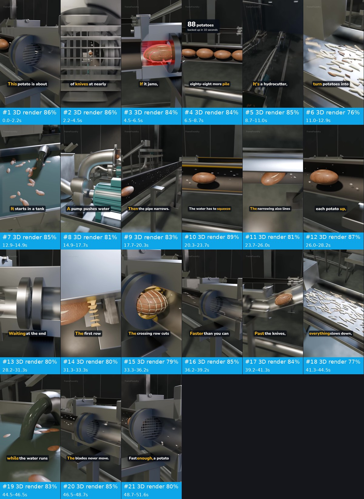
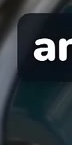
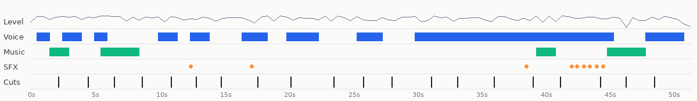

# How this video was made: potatoes.mp4

**In one line**: How a hydrocutter turns potatoes into fries: water accelerates each potato through a pipe into a fixed grid of blades.
**How it was made**: Mixed production: 3D render 100%

- 0:51 · vertical 9:16 · 21 shots, 2.5s each on average
- Confidence 83%, based on: tool measurements + AI assistant reviewed 21 shots
- ⚠️ 1 points are uncertain, see “Open questions”



# Part one · Breakdown: how this video is built

## What makes it work

- **The hook**: 0-9 s: danger + numbers: a potato about to hit knives at ~40 mph, and if it jams 88 more pile up in 10 seconds.
- Stakes-first hook built from two concrete numbers shown as animated data cards
- Every claim gets a dedicated cutaway or X-ray (narrowing pipe, blade rows, exploded slices)
- Paradox payoff: 'the blades never move — fast enough, a potato cuts itself'
- Short ~2.4 s shots, each matching one clause of narration

## Production pipeline at a glance

| Stage | What this video uses | Remake approach |
|---|---|---|
| **Base picture** | 3D render 21 shots (100%) | AI in 7 generations |
| **Packaging** | 40 subtitle lines (bottom, up to 1 rows): white text, black outline, keywords highlighted in yellow, line height 4.6%; entrance: hard in×22, fade in×2, slide in×1; keywords change colour as they are spoken; styled text ×1 (large size, brown fill, multi-colour / gradient): "三"; text label ×14 (1 of them follow an object): "~40 mph", "into the knive", "88 potatoes", "backed up in 1", "It's ahydrocut", "apipe." …; Stickers / GIFs: animated sticker / GIF ×2; SFX hits on: subtitle in ×3, text label in ×1; Placed by spoken line ×4 (with new wording they follow the line, not the old second): text label "apipe." → 0.5s before "Then the pipe narr", on "pipe", animated sticker / GIF → 0.7s after "in ten seconds.", styled text "三" → 0.0s into "The first row" …; 3 persistent layers (unchanged across cuts: lay each on once for its span, not per shot): animated sticker / GIF 8.8–12.8s, text label "FrameFoundry" 31.5–51.6s (2 spans), animated sticker / GIF 39.3–44.4s | export `packaging/subtitles.srt` for timeline alignment |
| **Sound** | voice（TTS voice-over）, 4 distinct effects (9 hits) | voice: TTS voice-over; effects: add from a library at the listed times |

## Content and structure

**Narrative line**

Keep this line in a remake: same order, same job at each step, with the point refilled from your own cases, numbers and material, so it is more than a change of subject.

| Time | Shots | Job | What it says |
|---|---|---|---|
| 0.0–8.7s | #1–#4 | grab attention | A potato is about to hit knives at 40 mph → Speed stat → If it jams… → 88 more in 10 seconds |
| 8.7–11.0s | #5 | — | It's a hydrocutter |
| 11.0–12.9s | #6 | — | How factories make fries |
| 12.9–14.9s | #7 | — | Starts in a tank of water |
| 14.9–31.3s | #8–#13 | add information | A pump pushes them into a pipe → The pipe narrows → Water speeds up and carries the potato → Lines each potato up → Nose first, dead centre → (… 6 points, each shot in the shot list) |
| 31.3–33.3s | #14 | — | First row slices |
| 33.3–36.2s | #15 | — | Crossing row cuts sticks |
| 36.2–39.2s | #16 | — | Through faster than a blink |
| 39.2–46.5s | #17–#19 | add information | The pipe widens → Fries land on a shaker → Water recirculates |
| 46.5–51.6s | #20, #21 | deliver the conclusion | The blades never move → Fast enough, a potato cuts itself |

**Script** (local speech recognition, unchecked; trust on-screen subtitles for names and homophones)

| Time | Who | Line | Delivery |
|---|---|---|---|
| 0.1–4.1s | narration | This potato is about to hit a grid of knives at nearly 40 miles an hour. | measured: rate fast (4.0 words/s), wide pitch movement |
| 4.5–8.0s | narration | If it jams, 88 more pile up behind it in 10 seconds, | measured: rate fast (3.4 words/s), wide pitch movement |
| 8.0–12.6s | narration | it's a hydro cutter and it's how factories turn potatoes into fries. | measured: rate normal (2.6 words/s), wide pitch movement |
| 12.9–14.4s | narration | It starts in a tank of water. | measured: rate fast (4.4 words/s), wide pitch movement |
| 14.9–17.4s | narration | Pump pushes water and potatoes into a pipe. | measured: rate normal (3.3 words/s), wide pitch movement |
| 17.7–23.9s | narration | Then the pipe narrows the water has to squeeze through so it speeds up and carries the potato with it. | measured: rate normal (3.2 words/s) |
| 23.9–27.7s | narration | The narrowing also lines each potato up nose first dead center. | measured: rate normal (2.9 words/s), wide pitch movement |
| 28.1–33.0s | narration | Waiting at the end is a grid of thin steel blades. The first row slices the potato. | measured: rate fast (3.5 words/s), wide pitch movement |
| 33.4–38.7s | narration | ACssing row cuts every slice into sticks faster than you can blink the whole potato is through. | measured: rate normal (3.2 words/s), wide pitch movement |
| 39.1–40.9s | narration | Pass the knives, the pipe widens, | measured: rate fast (3.4 words/s), wide pitch movement |
| 40.9–46.1s | narration | everything slows down and the fries land on a shaking screen while the water runs back to the tank. | measured: rate fast (3.6 words/s) |
| 46.6–50.6s | narration | Bldes never move fast enough, a potato cuts itself. | measured: rate normal (2.3 words/s), wide pitch movement, lower than this speaker's other lines |

## Shot list

| # | Frame | Time | What it says | Picture | Camera |
|---|---|---|---|---|---|
| 1 |  | 0:00.0 · 2.2s | grab attention: A potato is about to hit knives at 40 mph | Hook close-up: a potato racing toward a grid of knives in th… | smooth move |
| 2 |  | 0:02.2 · 2.3s | grab attention: Speed stat | View through the blade grid as the potato approaches; '~40 m… | smooth move |
| 3 |  | 0:04.5 · 2.0s | grab attention: If it jams… | Red X-ray cutaway of a potato jammed in the cutter. Style: C… | smooth move |
| 4 |  | 0:06.5 · 2.2s | grab attention: 88 more in 10 seconds | Potatoes back up in the pipe; counter card ticks up to '88 p… | static (subject moves) |
| 5 |  | 0:08.7 · 2.3s | It's a hydrocutter | Wide pull-back over the hydrocutter line in the factory hall… | smooth move |
| 6 |  | 0:11.0 · 1.9s | How factories make fries | Wide over the line. Style: Clean 3D product-visualisation re… | smooth move |
| 7 |  | 0:12.9 · 1.9s | Starts in a tank of water | Potatoes poured into a water tank. Style: Clean 3D product-v… | smooth move |
| 8 |  | 0:14.9 · 2.9s | add information: A pump pushes them into a pipe | Teal pump motor and pipework pushing water and potatoes. Sty… | smooth move |
| 9 |  | 0:17.7 · 2.6s | add information: The pipe narrows | Pipe narrows; yellow highlight glow traces the narrowing sec… | smooth move |
| 10 |  | 0:20.3 · 3.3s | add information: Water speeds up and carries the potato | Potato speeds up inside the pipe (cutaway). Style: Clean 3D … | static (subject moves) |
| 11 |  | 0:23.7 · 2.3s | add information: Lines each potato up | Potato being centred by the narrowing pipe. Style: Clean 3D … | static (subject moves) |
| 12 |  | 0:26.0 · 2.2s | add information: Nose first, dead centre | Potato travelling nose first, dead centre. Style: Clean 3D p… | static (subject moves) |
| 13 |  | 0:28.2 · 3.1s | add information: A grid of thin blades | Cutter housing; yellow highlight on the grid of thin steel b… | smooth move |
| 14 |  | 0:31.3 · 2.1s | First row slices | Macro cutaway: first row of blades slices the potato into sl… | smooth move |
| 15 |  | 0:33.3 · 2.9s | Crossing row cuts sticks | Crossing row cuts each slab into sticks (exploded view). Sty… | smooth move |
| 16 |  | 0:36.2 · 3.0s | Through faster than a blink | Potato bursts through the grid as a spray of fries. Style: C… | smooth move |
| 17 |  | 0:39.2 · 2.1s | add information: The pipe widens | Pipe widens; fries fan out. Style: Clean 3D product-visualis… | smooth move |
| 18 |  | 0:41.3 · 3.1s | add information: Fries land on a shaker | Fries land on a shaking screen. Style: Clean 3D product-visu… | smooth move |
| 19 |  | 0:44.5 · 2.0s | add information: Water recirculates | Water runs back into the tank. Style: Clean 3D product-visua… | smooth move |
| 20 |  | 0:46.5 · 2.2s | deliver the conclusion: The blades never move | Static blade grid as potatoes shoot through. Style: Clean 3D… | smooth move |
| 21 |  | 0:48.7 · 2.9s | deliver the conclusion: Fast enough, a potato cuts itself | Final burst of fries from the cutter. Style: Clean 3D produc… | static (subject moves) |

## Cast, scenes and props

- **Visual style**: Clean 3D product-visualisation render (Blender-style): brushed stainless-steel food-processing machinery, dark industrial hall, glossy brown potatoes, soft studio lighting; 9:16.

- No cast extracted this time (needs AI image reading)

**Scenes**

| Scene | Where | When | Set / light | Shots |
|---|---|---|---|---|
| S1 | industrial potato-processing hall with a hydrocutter line | — | dark hall, brushed steel, soft key light | #1–#21 |

**Props / products / logos**

- hydrocutter (pump, pipe, cutter housing with blade grid) (shots #1–#21): one consistent 3D model
- potatoes / fries (shots #1–#21)

## Packaging layer (subtitles / styled text / stickers / sound-effect hits)

- 40 subtitle lines (bottom, up to 1 rows): white text, black outline, keywords highlighted in yellow, line height 4.6%; entrance: hard in×22, fade in×2, slide in×1; keywords change colour as they are spoken
- styled text ×1 (large size, brown fill, multi-colour / gradient): "三"
- text label ×14 (1 of them follow an object): "~40 mph", "into the knive", "88 potatoes", "backed up in 1", "It's ahydrocut", "apipe." …
- Stickers / GIFs: animated sticker / GIF ×2
- SFX hits on: subtitle in ×3, text label in ×1
- Placed by spoken line ×4 (with new wording they follow the line, not the old second): text label "apipe." → 0.5s before "Then the pipe narr", on "pipe", animated sticker / GIF → 0.7s after "in ten seconds.", styled text "三" → 0.0s into "The first row" …
- 3 persistent layers (unchanged across cuts: lay each on once for its span, not per shot): animated sticker / GIF 8.8–12.8s, text label "FrameFoundry" 31.5–51.6s (2 spans), animated sticker / GIF 39.3–44.4s

<details class="ref"><summary>text timeline (55 rows)</summary>

| Time | Kind | Text | Style | In / out | SFX |
|---|---|---|---|---|---|
| 0.00–0.70s | subtitle | This potato is about | white text, black outline, keywords highlighted in yellow, line height 5.0% (about 97px) | fade out | — |
| 1.00–1.80s | subtitle | to hit a grid | white text, black outline, keywords highlighted in yellow, line height 5.0% (about 97px) | hard out | — |
| 1.80–3.00s | subtitle | of knives at nearly | white text, black outline, keywords highlighted in yellow, line height 5.1% (about 98px) | hard in / hard out | — |
| 3.00–4.50s | text label | ~40 mph | white text, black outline, line height 8.4% (about 161px) | hard in / hard out | — |
| 3.00–4.50s | text label | into the knives | white text, line height 3.0% (about 59px) | hard in / hard out | — |
| 3.00–4.50s | subtitle | forty miles an hour. | white text, black outline, keywords highlighted in yellow, line height 4.5% (about 87px) | hard in / hard out | — |
| 4.50–5.50s | subtitle | If it jams, | white text, black outline, keywords highlighted in yellow, line height 5.2% (about 100px) | hard in / hard out | — |
| 5.50–8.50s | text label | 88 potatoes | white text, black outline, line height 8.2% (about 157px) | fade in / hard out | — |
| 5.50–8.50s | text label | backed up in 10 seconds | black text, white outline, line height 3.0% (about 59px) | fade in / fade out | — |
| 5.50–6.10s | subtitle | eighty-eight more pile | white text, black outline, keywords highlighted in white, line height 4.3% (about 83px) | hard in / slide out | — |
| 6.50–7.40s | subtitle | up behind it | white text, black outline, keywords highlighted in yellow, line height 4.8% (about 92px) | — | — |
| 7.50–8.10s | subtitle | in ten seconds. | white text, black outline, keywords highlighted in yellow, line height 4.1% (about 79px) | hard in / fade out | — |
| 8.50–9.70s | text label | It's ahydrocutter, | yellow text, keywords highlighted in white, line height 5.2% (about 100px) | slide out | — |
| 9.90–11.00s | subtitle | and it's how factories | white text, black outline, keywords highlighted in yellow, line height 4.0% (about 76px) | hard in | — |
| 11.00–12.00s | subtitle | turn potatoes into | white text, black outline, keywords highlighted in yellow, line height 4.7% (about 90px) | — | — |
| 12.00–12.90s | subtitle | fries. | white text, black outline, line height 5.5% (about 105px) | hard in | — |
| 12.90–14.00s | subtitle | It starts in a tank | white text, black outline, keywords highlighted in yellow, line height 4.1% (about 79px) | hard in / hard out | — |
| 14.00–14.90s | subtitle | ofwater. | white text, black outline, keywords highlighted in white, line height 4.8% (about 92px) | hard in / hard out | — |
| 14.90–16.00s | subtitle | A pump pushes water | white text, black outline, keywords highlighted in yellow, line height 5.0% (about 97px) | hard in | — |
| 16.00–16.90s | subtitle | andpotatoesinto | white text, black outline, keywords highlighted in white, line height 4.6% (about 88px) | hard out | — |
| 17.00–17.10s | text label | apipe. | yellow text, black outline, keywords highlighted in black, line height 5.8% (about 111px) | hard in / hard out | — |
| 17.50–19.30s | subtitle | Then the pipe narrows. | white text, black outline, keywords highlighted in yellow, line height 4.6% (about 88px) | hard out | — |
| 19.50–20.30s | subtitle | The water has to squeeze | white text, black outline, keywords highlighted in yellow, line height 4.0% (about 76px) | fade in / hard out | — |
| 20.00–20.10s | text label | 0 | grey text, line height 0.7% (about 13px) | hard in / hard out | — |
| 20.50–21.10s | subtitle | through,so it speeds | white text, black outline, keywords highlighted in yellow, line height 4.6% (about 88px) | slide out | — |
| 21.50–22.40s | subtitle | up, and carries | white text, black outline, keywords highlighted in yellow, line height 5.3% (about 103px) | hard out | — |
| 22.50–23.10s | text label · follows an object | 8 | black text, grey outline, line height 1.6% (about 30px) | hard in / hard out | — |
| 22.50–23.10s | subtitle | the potato with it. | white text, black outline, keywords highlighted in white, line height 4.9% (about 94px) | hard in / slide out | — |
| 23.50–25.00s | subtitle | The narrowing also lines | white text, black outline, keywords highlighted in yellow, line height 4.4% (about 84px) | hard out | — |
| 25.00–26.00s | subtitle | each potato up, | white text, black outline, keywords highlighted in yellow, line height 5.3% (about 101px) | hard in / hard out | — |
| 26.00–27.60s | subtitle | nose first, dead centre. | white text, black outline, keywords highlighted in yellow, line height 3.7% (about 71px) | hard out | — |
| 28.00–28.90s | text label | Waitingat the end | yellow text, black outline, blue box, keywords highlighted in white, line height 5.2% (about 100px) | pop / hard out | — |
| 28.90–29.50s | text label | is a grid | white text, black outline, keywords highlighted in yellow, line height 5.4% (about 103px) | — | — |
| 29.50–31.30s | subtitle | of thin steel blades. | white text, black outline, keywords highlighted in yellow, line height 3.8% (about 72px) | hard in / hard out | — |
| 31.30–31.70s | styled text | 三 | brown text, orange box, keywords highlighted in orange, line height 13.2% (about 253px) | hard in / fade out | — |
| 31.30–32.00s | subtitle | The first row | white text, black outline, keywords highlighted in white, line height 4.5% (about 87px) | hard in / hard out | — |
| 31.50–42.40s | text label | FrameFoundry | grey text, line height 2.8% (about 54px) | pop / fade out (bounces / changes colour midway) | — |
| 32.00–33.30s | subtitle | slices the potato. | white text, black outline, keywords highlighted in yellow, line height 5.0% (about 96px) | hard in / hard out | — |
| 33.30–34.50s | subtitle | The crossing row cuts | white text, black outline, keywords highlighted in white, line height 4.6% (about 89px) | hard out | — |
| 34.50–35.60s | subtitle | every slice into sticks. | white text, black outline, keywords highlighted in yellow, line height 4.1% (about 78px) | hard in / shrink out | — |
| 36.00–37.00s | subtitle | Fasterthan you can | white text, black outline, keywords highlighted in yellow, line height 5.2% (about 100px) | hard out | — |
| 37.00–37.80s | subtitle | blink, the whole | white text, black outline, keywords highlighted in yellow, line height 4.9% (about 94px) | hard in / hard out | — |
| 38.00–38.60s | subtitle | potato is through. | white text, black outline, keywords highlighted in white, line height 4.9% (about 94px) | slide in / hard out | — |
| 39.00–40.00s | text label | Pastthe knives, | yellow text, black outline, keywords highlighted in white, line height 5.2% (about 100px) | hard in / hard out | — |
| 40.00–41.30s | subtitle | the pipe widens, | white text, black outline, keywords highlighted in yellow, line height 5.2% (about 100px) | hard in / hard out | — |
| 41.30–42.40s | subtitle | everything slows down, | white text, black outline, keywords highlighted in yellow, line height 4.2% (about 80px) | — | — |
| 42.40–43.30s | subtitle | and the fries land | white text, black outline, keywords highlighted in yellow, line height 4.3% (about 83px) | hard in | click |
| 42.50–42.60s | text label | ndry | black text, grey outline, line height 2.3% (about 45px) | hard in / hard out | pop |
| 42.50–51.60s | text label | FrameFoundry | grey text, line height 2.8% (about 54px) | fade in (bounces / changes colour midway) | — |
| 43.30–44.50s | subtitle | on a shaking screen | white text, black outline, keywords highlighted in yellow, line height 4.7% (about 91px) | — | click |
| 44.50–45.40s | subtitle | while the water runs | white text, black outline, keywords highlighted in yellow, line height 4.4% (about 84px) | hard in / hard out | pop |
| 45.40–46.50s | subtitle | back to the tank. | white text, black outline, keywords highlighted in yellow, line height 4.3% (about 83px) | hard in / hard out | — |
| 46.50–48.40s | subtitle | The blades never move. | white text, black outline, keywords highlighted in yellow, line height 4.3% (about 83px) | hard in / hard out | — |
| 48.50–49.10s | subtitle | Fastenough,a potato | white text, black outline, keywords highlighted in yellow, line height 4.7% (about 90px) | fade in / hard out | — |
| 49.50–51.20s | subtitle | cuts itself. | white text, black outline, keywords highlighted in white, line height 4.3% (about 83px) | hard out | — |

</details>

**Stickers / GIFs / picture-in-picture**

| Time | Kind | Position | Motion | Confidence | Crop |
|---|---|---|---|---|---|
| 8.80–12.80s | animated sticker / GIF | x10% y74% w10% h11% | animated | medium (unchanged across a cut) |  |
| 39.30–44.40s | animated sticker / GIF | x20% y63% w15% h6% | animated | medium (unchanged across a cut) |  |

| Time | Layer | Spoken line |
|---|---|---|
| 8.80s | animated sticker / GIF | 0.7s after "in ten seconds." |
| 17.00s | text label "apipe." | 0.5s before "Then the pipe narr", on "pipe" |
| 31.30s | styled text "三" | 0.0s into "The first row" |
| 39.30s | animated sticker / GIF | 0.7s after "potato is through." |

- Remake: import `packaging/subtitles.srt` into your editor and replace the words; styled version in `packaging/overlays.ass`; find matching stickers and GIFs in an asset library

## Sound

**Voice**

- male-leaning
- Source: TTS voice-over
- Remake: TTS voice-over: CapCut text-to-speech or another TTS tool, with a similar voice and pace

**Sound effects** (9 hits, 4 distinct sounds)

| Sound | Listen | Type | Times used | At | On screen |
|---|---|---|---|---|---|
| F1 | [listen](sfx/sfx_01.wav) | click | 5 | 12.6s, 42.3s, 43.2s, 44.2s, 44.7s | subtitle "and the fries la" appears; subtitle "on a shaking scr" appears; subtitle "while the water " appears |
| F2 | [listen](sfx/sfx_02.wav) | whoosh | 1 | 17.3s | — |
| F3 | [listen](sfx/sfx_03.wav) | click | 1 | 38.7s | — |
| F4 | [listen](sfx/sfx_04.wav) | pop | 2 | 42.6s, 43.6s | text label "ndry" appears |

- Remake: play each sound, find a similar one in your editor's library and place it at the times under “At”

**Listen to the tracks**

- voice: [stems/vocals.wav](stems/vocals.wav)

<details class="ref"><summary>Sound measurements and evidence</summary>



- Loudness -23.8 dBFS, peak -5.2 dBFS
- sound runs across cuts, laid in post as one bed (background changes 4.7dB at cuts vs 3.0dB within shots)
- Voice on 61% of the duration, pitch about 132.4Hz
- Voice source: TTS voice-over (TTS voice-over 64%, human recording 27%, native dialogue from the AI video model 9%)
  - Voice and background sound run across cuts: the voice-over was laid on separately in post (TTS or a human voice-over)

</details>

## Open questions

- No AI listened to the soundtrack (the review covered the picture only): real voice versus TTS is inferred from the waveform; the effects were found on the separated effects track and their types are estimated from the sound. Play the stems and each effect under “Sound” to check

# Part two · Remake plan

Planned for **MiniMax H3 / H3 Max**: ≤15 s per call, several shots per call, takes reference video (3 clips, ≤15 s in all), ≤9 reference images, first / last frame, native sound. Name another model and the split, lengths and prompts are redone for it.

## Remake it yourself: do it in this order

Copy the method and the rhythm, not the pictures: keep what each part does and fill it with your own content and material.

This is a 3D / animation. Do the steps in this order; the detail for each is in the matching subsection below.

1. **Write the content**: write yours in the same 10 steps as the original (narrative line under “Content and structure”)
2. **Generate**: 7 calls (52 s), several shots each. Each shot gets one source frame for composition (subtitles erased, in `remake/refs/`), the swapped-in people, animals and products get reference images, and the prompt lists the shots in order
3. **Adapt the prompts to your model**: each unit's draft is already laid out in MiniMax H3 / H3 Max's shot, tag and audio format; refine it against the model's prompt guide before generating (or run `rea-video plan <folder> --rewrite-prompts`)
4. **Voice**: the original is TTS voice-over; record it yourself or use TTS; 12 lines with their pace in the script table under “Sound”
5. **Edit**: follow the order and lengths in the shot list; the original has 21 shots at 2.5s each
6. **Subtitles and styled text**: import `packaging/subtitles.srt` and replace the words; timing and style under “Packaging layer”
7. **Sound effects**: 9; place similar ones from a library at the times under “Sound”
8. **Put it together and compare**: hand the shots you made to the agent; it places them on the original timeline, keeps the original where yours are missing, and renders a side-by-side comparison with the original

### AI generation

**7 generations, 52 s in total**

> ⚠️ G1, G2, G3, G4, G5, G6, G7: the prompts are the tool's drafts, already in MiniMax H3 / H3 Max's layout. Check them against the model's conventions and good prompts for similar shots, then put the finals into `remake/prompts.json`; `rea-video plan` then checks the format.

- **How it is generated**: multi-shot from key frames

| Part | Shots | Time | Length | Prepare |
|---|---|---|---|---|
| G1 | #1–#4 | 0.0–8.7s | 8.7s | reference images |
| G2 | #5–#8 | 8.7–17.7s | 9.0s | reference images |
| G3 | #9–#11 | 17.7–26.0s | generate 9s, trim to 8.3s | reference images |
| G4 | #12–#14 | 26.0–33.3s | generate 8s, trim to 7.3s | reference images |
| G5 | #15–#17 | 33.3–41.3s | 8.0s | reference images |
| G6 | #18, #19 | 41.3–46.5s | generate 6s, trim to 5.1s | reference images |
| G7 | #20, #21 | 46.5–51.6s | generate 6s, trim to 5.1s | reference images |

<details class="ref"><summary>Why it is split this way</summary>

- Grouping: consecutive shots share a call where they fit, ≤10s per call, ≤4 shots; a long stretch is cut at a scene change first
- Inputs: the model also takes reference video, but key frames are used here: one key frame per shot fixes composition and look, swapped-in things get their own images
- Audio: the model can generate action sound effects and ambience along with the picture; voice-over is better done as separate TTS and mixed in, so copy and timing stay editable
- Packaging: the subtitle, text label, sticker, styled text on the generated shots is post-production packaging: keep it out of the prompts (erased from source references) and lay it back on from the packaging timeline after generation

</details>

<details><summary>Frames to make first (21)</summary>

When swapping people or products, or switching to shot-by-shot image-to-video, prepare each shot's first frame as below:

| Shot | Role | How | Reference images | Save as |
|---|---|---|---|---|
| #1 | first frame | text-to-image (or low-denoise I2I from source frame) | `shots/shot_001_first.jpg` (source first frame: composition and style reference) | `remake/redrawn/shot001.png` |
| #2 | first frame | text-to-image (or low-denoise I2I from source frame) | `shots/shot_002_first.jpg` (source first frame: composition and style reference) | `remake/redrawn/shot002.png` |
| #3 | first frame | text-to-image (or low-denoise I2I from source frame) | `shots/shot_003_first.jpg` (source first frame: composition and style reference) | `remake/redrawn/shot003.png` |
| #4 | first frame | text-to-image (or low-denoise I2I from source frame) | `shots/shot_004_first.jpg` (source first frame: composition and style reference) | `remake/redrawn/shot004.png` |
| #5 | first frame | text-to-image (or low-denoise I2I from source frame) | `shots/shot_005_first.jpg` (source first frame: composition and style reference) | `remake/redrawn/shot005.png` |
| #6 | first frame | text-to-image (or low-denoise I2I from source frame) | `shots/shot_006_first.jpg` (source first frame: composition and style reference) | `remake/redrawn/shot006.png` |
| #7 | first frame | text-to-image (or low-denoise I2I from source frame) | `shots/shot_007_first.jpg` (source first frame: composition and style reference) | `remake/redrawn/shot007.png` |
| #8 | first frame | text-to-image (or low-denoise I2I from source frame) | `shots/shot_008_first.jpg` (source first frame: composition and style reference) | `remake/redrawn/shot008.png` |
| #9 | first frame | text-to-image (or low-denoise I2I from source frame) | `shots/shot_009_first.jpg` (source first frame: composition and style reference) | `remake/redrawn/shot009.png` |
| #10 | first frame | text-to-image (or low-denoise I2I from source frame) | `shots/shot_010_first.jpg` (source first frame: composition and style reference) | `remake/redrawn/shot010.png` |
| #11 | first frame | text-to-image (or low-denoise I2I from source frame) | `shots/shot_011_first.jpg` (source first frame: composition and style reference) | `remake/redrawn/shot011.png` |
| #12 | first frame | text-to-image (or low-denoise I2I from source frame) | `shots/shot_012_first.jpg` (source first frame: composition and style reference) | `remake/redrawn/shot012.png` |
| #13 | first frame | text-to-image (or low-denoise I2I from source frame) | `shots/shot_013_first.jpg` (source first frame: composition and style reference) | `remake/redrawn/shot013.png` |
| #14 | first frame | text-to-image (or low-denoise I2I from source frame) | `shots/shot_014_first.jpg` (source first frame: composition and style reference) | `remake/redrawn/shot014.png` |
| #15 | first frame | text-to-image (or low-denoise I2I from source frame) | `shots/shot_015_first.jpg` (source first frame: composition and style reference) | `remake/redrawn/shot015.png` |
| #16 | first frame | text-to-image (or low-denoise I2I from source frame) | `shots/shot_016_first.jpg` (source first frame: composition and style reference) | `remake/redrawn/shot016.png` |
| #17 | first frame | text-to-image (or low-denoise I2I from source frame) | `shots/shot_017_first.jpg` (source first frame: composition and style reference) | `remake/redrawn/shot017.png` |
| #18 | first frame | text-to-image (or low-denoise I2I from source frame) | `shots/shot_018_first.jpg` (source first frame: composition and style reference) | `remake/redrawn/shot018.png` |
| #19 | first frame | text-to-image (or low-denoise I2I from source frame) | `shots/shot_019_first.jpg` (source first frame: composition and style reference) | `remake/redrawn/shot019.png` |
| #20 | first frame | text-to-image (or low-denoise I2I from source frame) | `shots/shot_020_first.jpg` (source first frame: composition and style reference) | `remake/redrawn/shot020.png` |
| #21 | first frame | text-to-image (or low-denoise I2I from source frame) | `shots/shot_021_first.jpg` (source first frame: composition and style reference) | `remake/redrawn/shot021.png` |

- **#1 first frame (text-to-image (or low-denoise I2I from source frame))**
  - Image prompt: Vertical 9:16. medium shot, subject in the lower middle of the frame, camera push-in. Hook close-up: a potato racing toward a grid of knives in the cutter housing
- **#2 first frame (text-to-image (or low-denoise I2I from source frame))**
  - Image prompt: Vertical 9:16. medium shot, subject centred in frame, camera pull-out. View through the blade grid as the potato approaches; '~40 mph into the knives' stat card
- **#3 first frame (text-to-image (or low-denoise I2I from source frame))**
  - Image prompt: Vertical 9:16. medium shot, subject centred in frame, camera pull-out. Red X-ray cutaway of a potato jammed in the cutter
- **#4 first frame (text-to-image (or low-denoise I2I from source frame))**
  - Image prompt: Vertical 9:16. medium shot, subject in the upper left of the frame. Potatoes back up in the pipe; counter card ticks up to '88 potatoes backed up in 10 seconds'
- **#5 first frame (text-to-image (or low-denoise I2I from source frame))**
  - Image prompt: Vertical 9:16. medium close-up, subject in the lower middle of the frame, camera push-in. Wide pull-back over the hydrocutter line in the factory hall
- **#6 first frame (text-to-image (or low-denoise I2I from source frame))**
  - Image prompt: Vertical 9:16. medium close-up, subject centred in frame, camera push-in. Wide over the line
- **#7 first frame (text-to-image (or low-denoise I2I from source frame))**
  - Image prompt: Vertical 9:16. medium shot, subject in the lower middle of the frame, camera pan / track. Potatoes poured into a water tank
- **#8 first frame (text-to-image (or low-denoise I2I from source frame))**
  - Image prompt: Vertical 9:16. medium close-up, subject in the lower middle of the frame, camera push-in. Teal pump motor and pipework pushing water and potatoes
- **#9 first frame (text-to-image (or low-denoise I2I from source frame))**
  - Image prompt: Vertical 9:16. medium shot, subject in the lower middle of the frame, camera pan / track. Pipe narrows; yellow highlight glow traces the narrowing section
- **#10 first frame (text-to-image (or low-denoise I2I from source frame))**
  - Image prompt: Vertical 9:16. medium shot, subject in the lower middle of the frame. Potato speeds up inside the pipe (cutaway)
- **#11 first frame (text-to-image (or low-denoise I2I from source frame))**
  - Image prompt: Vertical 9:16. medium shot, subject in the lower middle of the frame. Potato being centred by the narrowing pipe
- **#12 first frame (text-to-image (or low-denoise I2I from source frame))**
  - Image prompt: Vertical 9:16. medium shot, subject in the lower middle of the frame. Potato travelling nose first, dead centre
- **#13 first frame (text-to-image (or low-denoise I2I from source frame))**
  - Image prompt: Vertical 9:16. medium shot, subject in the lower middle of the frame, camera push-in. Cutter housing; yellow highlight on the grid of thin steel blades
- **#14 first frame (text-to-image (or low-denoise I2I from source frame))**
  - Image prompt: Vertical 9:16. medium close-up, subject in the lower middle of the frame, camera pull-out. Macro cutaway: first row of blades slices the potato into slabs
- **#15 first frame (text-to-image (or low-denoise I2I from source frame))**
  - Image prompt: Vertical 9:16. medium close-up, subject centred in frame, camera push-in. Crossing row cuts each slab into sticks (exploded view)
- **#16 first frame (text-to-image (or low-denoise I2I from source frame))**
  - Image prompt: Vertical 9:16. medium shot, subject in the lower middle of the frame, camera push-in. Potato bursts through the grid as a spray of fries
- **#17 first frame (text-to-image (or low-denoise I2I from source frame))**
  - Image prompt: Vertical 9:16. medium shot, subject in the right of the frame, camera push-in. Pipe widens; fries fan out
- **#18 first frame (text-to-image (or low-denoise I2I from source frame))**
  - Image prompt: Vertical 9:16. medium close-up, subject centred in frame, camera push-in. Fries land on a shaking screen
- **#19 first frame (text-to-image (or low-denoise I2I from source frame))**
  - Image prompt: Vertical 9:16. medium shot, subject in the lower middle of the frame, camera pull-out. Water runs back into the tank
- **#20 first frame (text-to-image (or low-denoise I2I from source frame))**
  - Image prompt: Vertical 9:16. medium shot, subject in the lower middle of the frame, camera push-in. Static blade grid as potatoes shoot through
- **#21 first frame (text-to-image (or low-denoise I2I from source frame))**
  - Image prompt: Vertical 9:16. medium shot, subject in the lower middle of the frame. Final burst of fries from the cutter

</details>

<details><summary>G1 · shots #1–#4 · 8.7s</summary>

- reference images: source frames of shots #1, #2, #3, #4 (subtitles erased)

Draft prompt (in MiniMax H3 / H3 Max's layout; check it and put the final into remake/prompts.json before generating):

```text
integrated_multimodal_description: Generate the shots below in order in one go, hard cuts between them; each shot takes composition, size and camera from its source frame image. Vertical 9:16; soft frontal light, cool tones, background clearly blurred.
[Shot 1] Hook close-up: a potato racing toward a grid of knives in the cutter housing. (composition: <Picture 1>)
[Shot 2] At 00:02.200, the camera cuts to: View through the blade grid as the potato approaches; '~40 mph into the knives' stat card. (composition: <Picture 2>)
[Shot 3] At 00:04.500, the camera cuts to: Red X-ray cutaway of a potato jammed in the cutter. (composition: <Picture 3>)
[Shot 4] At 00:06.533, the camera cuts to: Potatoes back up in the pipe; counter card ticks up to '88 potatoes backed up in 10 seconds'. (composition: <Picture 4>)
overall_soundscape: Only the natural sounds of the actions on screen.
non_diegetic_music: N/A
```

</details>

<details><summary>G2 · shots #5–#8 · 9.0s</summary>

- reference images: source frames of shots #5, #6, #7, #8 (subtitles erased)

Draft prompt (in MiniMax H3 / H3 Max's layout; check it and put the final into remake/prompts.json before generating):

```text
integrated_multimodal_description: Generate the shots below in order in one go, hard cuts between them; each shot takes composition, size and camera from its source frame image. Vertical 9:16; soft frontal light, cool tones, background clearly blurred.
[Shot 1] Wide pull-back over the hydrocutter line in the factory hall. (composition: <Picture 1>)
[Shot 2] At 00:02.267, the camera cuts to: Wide over the line. (composition: <Picture 2>)
[Shot 3] At 00:04.200, the camera cuts to: Potatoes poured into a water tank. (composition: <Picture 3>)
[Shot 4] At 00:06.133, the camera cuts to: Teal pump motor and pipework pushing water and potatoes. (composition: <Picture 4>)
overall_soundscape: Only the natural sounds of the actions on screen.
non_diegetic_music: N/A
```

</details>

<details><summary>G3 · shots #9–#11 · 8.3s</summary>

- reference images: source frames of shots #9, #10, #11 (subtitles erased)

Draft prompt (in MiniMax H3 / H3 Max's layout; check it and put the final into remake/prompts.json before generating):

```text
integrated_multimodal_description: Generate the shots below in order in one go, hard cuts between them; each shot takes composition, size and camera from its source frame image. Vertical 9:16; soft frontal light, cool tones, background clearly blurred.
[Shot 1] Pipe narrows; yellow highlight glow traces the narrowing section. (composition: <Picture 1>)
[Shot 2] At 00:02.600, the camera cuts to: Potato speeds up inside the pipe (cutaway). (composition: <Picture 2>)
[Shot 3] At 00:05.933, the camera cuts to: Potato being centred by the narrowing pipe. (composition: <Picture 3>)
overall_soundscape: Only the natural sounds of the actions on screen.
non_diegetic_music: N/A
```

</details>

<details><summary>G4 · shots #12–#14 · 7.3s</summary>

- reference images: source frames of shots #12, #13, #14 (subtitles erased)

Draft prompt (in MiniMax H3 / H3 Max's layout; check it and put the final into remake/prompts.json before generating):

```text
integrated_multimodal_description: Generate the shots below in order in one go, hard cuts between them; each shot takes composition, size and camera from its source frame image. Vertical 9:16; soft frontal light, cool tones, background clearly blurred.
[Shot 1] Potato travelling nose first, dead centre. (composition: <Picture 1>)
[Shot 2] At 00:02.200, the camera cuts to: Cutter housing; yellow highlight on the grid of thin steel blades. (composition: <Picture 2>)
[Shot 3] At 00:05.267, the camera cuts to: Macro cutaway: first row of blades slices the potato into slabs. (composition: <Picture 3>)
overall_soundscape: Only the natural sounds of the actions on screen.
non_diegetic_music: N/A
```

</details>

<details><summary>G5 · shots #15–#17 · 8.0s</summary>

- reference images: source frames of shots #15, #16, #17 (subtitles erased)

Draft prompt (in MiniMax H3 / H3 Max's layout; check it and put the final into remake/prompts.json before generating):

```text
integrated_multimodal_description: Generate the shots below in order in one go, hard cuts between them; each shot takes composition, size and camera from its source frame image. Vertical 9:16; soft frontal light, cool tones, background clearly blurred.
[Shot 1] Crossing row cuts each slab into sticks (exploded view). (composition: <Picture 1>)
[Shot 2] At 00:02.867, the camera cuts to: Potato bursts through the grid as a spray of fries. (composition: <Picture 2>)
[Shot 3] At 00:05.867, the camera cuts to: Pipe widens; fries fan out. (composition: <Picture 3>)
overall_soundscape: Only the natural sounds of the actions on screen.
non_diegetic_music: N/A
```

</details>

<details><summary>G6 · shots #18, #19 · 5.1s</summary>

- reference images: source frames of shots #18, #19 (subtitles erased)

Draft prompt (in MiniMax H3 / H3 Max's layout; check it and put the final into remake/prompts.json before generating):

```text
integrated_multimodal_description: Generate the shots below in order in one go, hard cuts between them; each shot takes composition, size and camera from its source frame image. Vertical 9:16; soft frontal light, cool tones, background clearly blurred.
[Shot 1] Fries land on a shaking screen. (composition: <Picture 1>)
[Shot 2] At 00:03.133, the camera cuts to: Water runs back into the tank. (composition: <Picture 2>)
overall_soundscape: Only the natural sounds of the actions on screen.
non_diegetic_music: N/A
```

</details>

<details><summary>G7 · shots #20, #21 · 5.1s</summary>

- reference images: source frames of shots #20, #21 (subtitles erased)

Draft prompt (in MiniMax H3 / H3 Max's layout; check it and put the final into remake/prompts.json before generating):

```text
integrated_multimodal_description: Generate the shots below in order in one go, hard cuts between them; each shot takes composition, size and camera from its source frame image. Vertical 9:16; soft frontal light, cool tones, background clearly blurred.
[Shot 1] Static blade grid as potatoes shoot through. (composition: <Picture 1>)
[Shot 2] At 00:02.200, the camera cuts to: Final burst of fries from the cutter. (composition: <Picture 2>)
overall_soundscape: Only the natural sounds of the actions on screen.
non_diegetic_music: N/A
```

</details>

<details><summary>Prompt guides for MiniMax H3 / H3 Max</summary>

- https://huggingface.co/MiniMaxAI/MiniMax-H3/raw/main/docs/VIDEO_PROMPT_WRITING_GUIDE_base_en.md
- https://huggingface.co/MiniMaxAI/MiniMax-H3/raw/main/docs/VIDEO_PROMPT_WRITING_GUIDE_ref_en.md
- https://platform.minimax.io/docs/api-reference/video-generation-v2-create
- https://docs.comfy.org/tutorials/video/minimax/minimax-h3-prompt-guide.md

</details>

### Edit

- Cut in the order and lengths of the shot list
- Approach: Hard cuts every ~2.4 s, one clause per shot
- Rhythm: 2.5s per shot; transitions cut×20

## Appendix

### Shot by shot

Each shot has two parts: what is visible on screen, and how the tools infer it was made (with the basis); remake prompts last. Folded by default.

<details class="ref"><summary>#1 00:00.000–00:02.200 · 3D render + code / editor overlays (subtitles, title)</summary>


**Visible on screen** (check against the frames)
- Picture: Hook close-up: a potato racing toward a grid of knives in the cutter housing. Style: Clean 3D product-visualisation render (Blender-style): brushed stainless-steel food-processing machinery, dark industrial hall, glossy brown potatoes, soft studio lighting; 9:16.
- Framing / light: medium shot; centred; camera push-in; key light frontal (from the camera side; both sides of the subject about equally bright); medium-soft; cool tone
- Text track (subtitle/bottom): This potato is about / to hit a grid / of knives at nearly
- Text track (title/top): FrameFoundry / FrameFour
- [AI assistant review] The same machine model (cutter housing, bolt, grid, pipes) is identical in every shot, and parts stay rigid; no morphing or texture drift between frames
- [AI assistant review] Engineering-precise motion (potato aligned dead centre, blade grid slicing into exact sticks) and a red X-ray cutaway exactly matching the geometry; typical of keyframed 3D, not generation

**How it was made, as inferred by the tools** (inferred, not seen)
- Inference: 3D render 77%, AI-generated video 7%, code / template render 6% (fused_agent)
- Material: rendered by the creator
- Basis (tool measurements, not necessarily visible to the eye):
  - Rendered texture: 33% flat colour blocks, 95% of pixels use only 33 colours, 32% axis-aligned edges
  - Platform transcode (YouTube) has compressed the sensor noise away: noise cues no longer apply, live action vs AI rests on frame rate and picture content

- Remake: 3D render: a video model gives an approximation (see the generation units); for precise multiple angles, model in 3D and render in Blender
  - First-frame image prompt: Clean 3D product-visualisation render (Blender-style): brushed stainless-steel food-processing machinery, dark industrial hall, glossy brown potatoes, soft studio lighting; 9:16. Hook close-up: a potato racing toward a grid of knives in the cutter housing.
  - Image-to-video motion prompt: Hook close-up: a potato racing toward a grid of knives in the cutter housing.
  - Full video prompt: Hook close-up: a potato racing toward a grid of knives in the cutter housing.

</details>

<details class="ref"><summary>#2 00:02.200–00:04.500 · 3D render + code / editor overlays (subtitles, title)</summary>


**Visible on screen** (check against the frames)
- Picture: View through the blade grid as the potato approaches; '~40 mph into the knives' stat card. Style: Clean 3D product-visualisation render (Blender-style): brushed stainless-steel food-processing machinery, dark industrial hall, glossy brown potatoes, soft studio lighting; 9:16.
- Framing / light: medium shot; centred; camera pull-out; key light frontal (from the camera side; both sides of the subject about equally bright); soft light (wide lit-to-shadow ramp); cool tone
- Text track (subtitle/bottom): of knives at nearly / forty miles an hour.
- Text track (subtitle/middle): ~40 mph / into the knives
- Text track (title/top): FrameFoundry / rameFoundry
- [AI assistant review] The same machine model (cutter housing, bolt, grid, pipes) is identical in every shot, and parts stay rigid; no morphing or texture drift between frames

**How it was made, as inferred by the tools** (inferred, not seen)
- Inference: 3D render 77%, code / template render 7%, AI-generated video 7% (fused_agent)
- Material: rendered by the creator
- Basis (tool measurements, not necessarily visible to the eye):
  - Rendered texture: 24% flat colour blocks, 95% of pixels use only 38 colours, 59% axis-aligned edges
  - Platform transcode (YouTube) has compressed the sensor noise away: noise cues no longer apply, live action vs AI rests on frame rate and picture content

- Remake: 3D render: a video model gives an approximation (see the generation units); for precise multiple angles, model in 3D and render in Blender
  - First-frame image prompt: Clean 3D product-visualisation render (Blender-style): brushed stainless-steel food-processing machinery, dark industrial hall, glossy brown potatoes, soft studio lighting; 9:16. View through the blade grid as the potato approaches; '~40 mph into the knives' stat card.
  - Image-to-video motion prompt: View through the blade grid as the potato approaches; '~40 mph into the knives' stat card.
  - Full video prompt: View through the blade grid as the potato approaches; '~40 mph into the knives' stat card.

</details>

<details class="ref"><summary>#3 00:04.500–00:06.533 · 3D render + code / editor overlays (subtitles, title)</summary>


**Visible on screen** (check against the frames)
- Picture: Red X-ray cutaway of a potato jammed in the cutter. Style: Clean 3D product-visualisation render (Blender-style): brushed stainless-steel food-processing machinery, dark industrial hall, glossy brown potatoes, soft studio lighting; 9:16.
- Framing / light: medium shot; centred; camera pull-out; key light frontal (from the camera side; both sides of the subject about equally bright); soft light (wide lit-to-shadow ramp); neutral tone
- Text track (subtitle/bottom): If it jams, / eighty-eightmore pile / eighty-eight more pile / up behind it
- Text track (subtitle/middle): 57 potatoes / backed up in 10 seconds / 88 potatoes
- Text track (title/top): FrameFoundry
- [AI assistant review] The same machine model (cutter housing, bolt, grid, pipes) is identical in every shot, and parts stay rigid; no morphing or texture drift between frames

**How it was made, as inferred by the tools** (inferred, not seen)
- Inference: 3D render 75%, AI-generated video 8%, code / template render 7% (fused_agent)
- Material: rendered by the creator
- Basis (tool measurements, not necessarily visible to the eye):
  - Rendered texture: 39% flat colour blocks, 95% of pixels use only 92 colours, 47% axis-aligned edges
  - Platform transcode (YouTube) has compressed the sensor noise away: noise cues no longer apply, live action vs AI rests on frame rate and picture content

- Remake: 3D render: a video model gives an approximation (see the generation units); for precise multiple angles, model in 3D and render in Blender
  - First-frame image prompt: Clean 3D product-visualisation render (Blender-style): brushed stainless-steel food-processing machinery, dark industrial hall, glossy brown potatoes, soft studio lighting; 9:16. Red X-ray cutaway of a potato jammed in the cutter.
  - Image-to-video motion prompt: Red X-ray cutaway of a potato jammed in the cutter.
  - Full video prompt: Red X-ray cutaway of a potato jammed in the cutter.

</details>

<details class="ref"><summary>#4 00:06.533–00:08.733 · 3D render + code / editor overlays (subtitles, title)</summary>


**Visible on screen** (check against the frames)
- Picture: Potatoes back up in the pipe; counter card ticks up to '88 potatoes backed up in 10 seconds'. Style: Clean 3D product-visualisation render (Blender-style): brushed stainless-steel food-processing machinery, dark industrial hall, glossy brown potatoes, soft studio lighting; 9:16.
- Framing / light: medium shot; left of centre; key light frame left, three-quarter front; soft light (wide lit-to-shadow ramp); neutral tone
- Text track (subtitle/bottom): up behind it / in ten seconds. / It's a hydrocutter,
- Text track (subtitle/middle): 88 potatoes / backed up in 10 seconds
- Text track (title/top): FrameFoundry
- [AI assistant review] The same machine model (cutter housing, bolt, grid, pipes) is identical in every shot, and parts stay rigid; no morphing or texture drift between frames
- [AI assistant review] Engineering-precise motion (potato aligned dead centre, blade grid slicing into exact sticks) and a red X-ray cutaway exactly matching the geometry; typical of keyframed 3D, not generation

**How it was made, as inferred by the tools** (inferred, not seen)
- Inference: 3D render 76%, AI-generated video 8%, code / template render 6% (fused_agent)
- Material: rendered by the creator
- Basis (tool measurements, not necessarily visible to the eye):
  - Rendered texture: 35% flat colour blocks, 95% of pixels use only 37 colours, 27% axis-aligned edges
  - Platform transcode (YouTube) has compressed the sensor noise away: noise cues no longer apply, live action vs AI rests on frame rate and picture content

- Remake: 3D render: a video model gives an approximation (see the generation units); for precise multiple angles, model in 3D and render in Blender
  - First-frame image prompt: Clean 3D product-visualisation render (Blender-style): brushed stainless-steel food-processing machinery, dark industrial hall, glossy brown potatoes, soft studio lighting; 9:16. Potatoes back up in the pipe; counter card ticks up to '88 potatoes backed up in 10 seconds'.
  - Image-to-video motion prompt: Potatoes back up in the pipe; counter card ticks up to '88 potatoes backed up in 10 seconds'.
  - Full video prompt: Potatoes back up in the pipe; counter card ticks up to '88 potatoes backed up in 10 seconds'.

</details>

<details class="ref"><summary>#5 00:08.733–00:11.000 · 3D render + code / editor overlays (subtitles, title, animated sticker / GIF)</summary>


**Visible on screen** (check against the frames)
- Picture: Wide pull-back over the hydrocutter line in the factory hall. Style: Clean 3D product-visualisation render (Blender-style): brushed stainless-steel food-processing machinery, dark industrial hall, glossy brown potatoes, soft studio lighting; 9:16.
- Framing / light: medium close-up; centred; camera push-in; key light frontal (from the camera side; both sides of the subject about equally bright); soft light (almost no lit / shadow edge); cool tone
- Text track (subtitle/bottom): It's ahydrocutter, / and it's how factories
- Text track (title/top): FrameFoundry
- [AI assistant review] The same machine model (cutter housing, bolt, grid, pipes) is identical in every shot, and parts stay rigid; no morphing or texture drift between frames

**How it was made, as inferred by the tools** (inferred, not seen)
- Inference: 3D render 76%, AI-generated video 7%, code / template render 6% (fused_agent)
- Material: rendered by the creator
- Basis (tool measurements, not necessarily visible to the eye):
  - Rendered texture: 41% flat colour blocks, 95% of pixels use only 15 colours, 14% axis-aligned edges
  - Platform transcode (YouTube) has compressed the sensor noise away: noise cues no longer apply, live action vs AI rests on frame rate and picture content

- Remake: 3D render: a video model gives an approximation (see the generation units); for precise multiple angles, model in 3D and render in Blender
  - First-frame image prompt: Clean 3D product-visualisation render (Blender-style): brushed stainless-steel food-processing machinery, dark industrial hall, glossy brown potatoes, soft studio lighting; 9:16. Wide pull-back over the hydrocutter line in the factory hall.
  - Image-to-video motion prompt: Wide pull-back over the hydrocutter line in the factory hall.
  - Full video prompt: Wide pull-back over the hydrocutter line in the factory hall.

</details>

<details class="ref"><summary>#6 00:11.000–00:12.933 · 3D render + code / editor overlays (subtitles, title, animated sticker / GIF)</summary>


**Visible on screen** (check against the frames)
- Picture: Wide over the line. Style: Clean 3D product-visualisation render (Blender-style): brushed stainless-steel food-processing machinery, dark industrial hall, glossy brown potatoes, soft studio lighting; 9:16.
- Framing / light: medium close-up; centred; camera push-in; key light frame right, three-quarter front; soft light (wide lit-to-shadow ramp); cool tone
- Text track (subtitle/bottom): turn potatoes into / fries.
- Text track (title/top): FrameFoundry
- [AI assistant review] The same machine model (cutter housing, bolt, grid, pipes) is identical in every shot, and parts stay rigid; no morphing or texture drift between frames

**How it was made, as inferred by the tools** (inferred, not seen)
- Inference: 3D render 69%, AI-generated video 12%, code / template render 4% (fused_agent)
- Material: rendered by the creator
- Basis (tool measurements, not necessarily visible to the eye):
  - Platform transcode (YouTube) has compressed the sensor noise away: noise cues no longer apply, live action vs AI rests on frame rate and picture content

- Remake: 3D render: a video model gives an approximation (see the generation units); for precise multiple angles, model in 3D and render in Blender
  - First-frame image prompt: Clean 3D product-visualisation render (Blender-style): brushed stainless-steel food-processing machinery, dark industrial hall, glossy brown potatoes, soft studio lighting; 9:16. Wide over the line.
  - Image-to-video motion prompt: Wide over the line.
  - Full video prompt: Wide over the line.

</details>

<details class="ref"><summary>#7 00:12.933–00:14.867 · 3D render + code / editor overlays (subtitles, title)</summary>


**Visible on screen** (check against the frames)
- Picture: Potatoes poured into a water tank. Style: Clean 3D product-visualisation render (Blender-style): brushed stainless-steel food-processing machinery, dark industrial hall, glossy brown potatoes, soft studio lighting; 9:16.
- Framing / light: medium shot; centred; camera pan / track; key light frontal (from the camera side; both sides of the subject about equally bright); hard light (sharp shadow edge); cool tone
- Text track (subtitle/bottom): It starts in a tank / ofwater. / of water.
- Text track (title/top): FrameFoundry
- [AI assistant review] The same machine model (cutter housing, bolt, grid, pipes) is identical in every shot, and parts stay rigid; no morphing or texture drift between frames

**How it was made, as inferred by the tools** (inferred, not seen)
- Inference: 3D render 77%, AI-generated video 7%, code / template render 6% (fused_agent)
- Material: rendered by the creator
- Basis (tool measurements, not necessarily visible to the eye):
  - Rendered texture: 45% flat colour blocks, 95% of pixels use only 62 colours, 35% axis-aligned edges
  - Platform transcode (YouTube) has compressed the sensor noise away: noise cues no longer apply, live action vs AI rests on frame rate and picture content

- Remake: 3D render: a video model gives an approximation (see the generation units); for precise multiple angles, model in 3D and render in Blender
  - First-frame image prompt: Clean 3D product-visualisation render (Blender-style): brushed stainless-steel food-processing machinery, dark industrial hall, glossy brown potatoes, soft studio lighting; 9:16. Potatoes poured into a water tank.
  - Image-to-video motion prompt: Potatoes poured into a water tank.
  - Full video prompt: Potatoes poured into a water tank.

</details>

<details class="ref"><summary>#8 00:14.867–00:17.733 · 3D render + code / editor overlays (subtitles, title)</summary>


**Visible on screen** (check against the frames)
- Picture: Teal pump motor and pipework pushing water and potatoes. Style: Clean 3D product-visualisation render (Blender-style): brushed stainless-steel food-processing machinery, dark industrial hall, glossy brown potatoes, soft studio lighting; 9:16.
- Framing / light: medium close-up; centred; camera push-in; key light frontal (from the camera side; both sides of the subject about equally bright); soft light (wide lit-to-shadow ramp); cool tone
- Text track (subtitle/bottom): A pump pushes water / andpotatoesinto / and potatoes into / apipe.
- Text track (title/top): FrameFoundry
- [AI assistant review] The same machine model (cutter housing, bolt, grid, pipes) is identical in every shot, and parts stay rigid; no morphing or texture drift between frames

**How it was made, as inferred by the tools** (inferred, not seen)
- Inference: 3D render 72%, AI-generated video 10%, code / template render 6% (fused_agent)
- Material: rendered by the creator
- Basis (tool measurements, not necessarily visible to the eye):
  - Platform transcode (YouTube) has compressed the sensor noise away: noise cues no longer apply, live action vs AI rests on frame rate and picture content

- Remake: 3D render: a video model gives an approximation (see the generation units); for precise multiple angles, model in 3D and render in Blender
  - First-frame image prompt: Clean 3D product-visualisation render (Blender-style): brushed stainless-steel food-processing machinery, dark industrial hall, glossy brown potatoes, soft studio lighting; 9:16. Teal pump motor and pipework pushing water and potatoes.
  - Image-to-video motion prompt: Teal pump motor and pipework pushing water and potatoes.
  - Full video prompt: Teal pump motor and pipework pushing water and potatoes.

</details>

<details class="ref"><summary>#9 00:17.733–00:20.333 · 3D render + code / editor overlays (subtitles, text labels, title)</summary>


**Visible on screen** (check against the frames)
- Picture: Pipe narrows; yellow highlight glow traces the narrowing section. Style: Clean 3D product-visualisation render (Blender-style): brushed stainless-steel food-processing machinery, dark industrial hall, glossy brown potatoes, soft studio lighting; 9:16.
- Framing / light: medium shot; centred; camera pan / track; key light frontal (from the camera side; both sides of the subject about equally bright); hard light (sharp shadow edge); neutral tone
- Text track (subtitle/bottom): Then the pipe narrows. / The water has to squeeze / The water has tosqueeze
- Text track (text/middle): 0
- Text track (title/top): FrameFoundry
- [AI assistant review] The same machine model (cutter housing, bolt, grid, pipes) is identical in every shot, and parts stay rigid; no morphing or texture drift between frames

**How it was made, as inferred by the tools** (inferred, not seen)
- Inference: 3D render 75%, AI-generated video 8%, code / template render 5% (fused_agent)
- Material: rendered by the creator
- Basis (tool measurements, not necessarily visible to the eye):
  - Rendered texture: 31% flat colour blocks, 95% of pixels use only 50 colours, 23% axis-aligned edges
  - Platform transcode (YouTube) has compressed the sensor noise away: noise cues no longer apply, live action vs AI rests on frame rate and picture content

- Remake: 3D render: a video model gives an approximation (see the generation units); for precise multiple angles, model in 3D and render in Blender
  - First-frame image prompt: Clean 3D product-visualisation render (Blender-style): brushed stainless-steel food-processing machinery, dark industrial hall, glossy brown potatoes, soft studio lighting; 9:16. Pipe narrows; yellow highlight glow traces the narrowing section.
  - Image-to-video motion prompt: Pipe narrows; yellow highlight glow traces the narrowing section.
  - Full video prompt: Pipe narrows; yellow highlight glow traces the narrowing section.

</details>

<details class="ref"><summary>#10 00:20.333–00:23.667 · 3D render + code / editor overlays (subtitles, title)</summary>


**Visible on screen** (check against the frames)
- Picture: Potato speeds up inside the pipe (cutaway). Style: Clean 3D product-visualisation render (Blender-style): brushed stainless-steel food-processing machinery, dark industrial hall, glossy brown potatoes, soft studio lighting; 9:16.
- Framing / light: medium shot; centred; key light frontal (from the camera side; both sides of the subject about equally bright); soft light (wide lit-to-shadow ramp); neutral tone
- Text track (subtitle/bottom): through,so it speeds / through, so it speeds / up, and carries / the potato with it.
- Text track (text/middle): 8
- Text track (title/top): FrameFoundry
- [AI assistant review] The same machine model (cutter housing, bolt, grid, pipes) is identical in every shot, and parts stay rigid; no morphing or texture drift between frames

**How it was made, as inferred by the tools** (inferred, not seen)
- Inference: 3D render 79%, code / template render 7%, AI-generated video 5% (fused_agent)
- Material: rendered by the creator
- Basis (tool measurements, not necessarily visible to the eye):
  - Rendered texture: 43% flat colour blocks, 95% of pixels use only 47 colours, 47% axis-aligned edges
  - Platform transcode (YouTube) has compressed the sensor noise away: noise cues no longer apply, live action vs AI rests on frame rate and picture content

- Remake: 3D render: a video model gives an approximation (see the generation units); for precise multiple angles, model in 3D and render in Blender
  - First-frame image prompt: Clean 3D product-visualisation render (Blender-style): brushed stainless-steel food-processing machinery, dark industrial hall, glossy brown potatoes, soft studio lighting; 9:16. Potato speeds up inside the pipe (cutaway).
  - Image-to-video motion prompt: Potato speeds up inside the pipe (cutaway).
  - Full video prompt: Potato speeds up inside the pipe (cutaway).

</details>

<details class="ref"><summary>#11 00:23.667–00:26.000 · 3D render + code / editor overlays (subtitles, title)</summary>


**Visible on screen** (check against the frames)
- Picture: Potato being centred by the narrowing pipe. Style: Clean 3D product-visualisation render (Blender-style): brushed stainless-steel food-processing machinery, dark industrial hall, glossy brown potatoes, soft studio lighting; 9:16.
- Framing / light: medium shot; centred; key light frame left, three-quarter front; hard light (sharp shadow edge); neutral tone
- Text track (subtitle/bottom): The narrowing also lines / each potato up,
- Text track (title/top): FrameFoundry
- [AI assistant review] The same machine model (cutter housing, bolt, grid, pipes) is identical in every shot, and parts stay rigid; no morphing or texture drift between frames

**How it was made, as inferred by the tools** (inferred, not seen)
- Inference: 3D render 74%, AI-generated video 10%, code / template render 5% (fused_agent)
- Material: rendered by the creator
- Basis (tool measurements, not necessarily visible to the eye):
  - Platform transcode (YouTube) has compressed the sensor noise away: noise cues no longer apply, live action vs AI rests on frame rate and picture content

- Remake: 3D render: a video model gives an approximation (see the generation units); for precise multiple angles, model in 3D and render in Blender
  - First-frame image prompt: Clean 3D product-visualisation render (Blender-style): brushed stainless-steel food-processing machinery, dark industrial hall, glossy brown potatoes, soft studio lighting; 9:16. Potato being centred by the narrowing pipe.
  - Image-to-video motion prompt: Potato being centred by the narrowing pipe.
  - Full video prompt: Potato being centred by the narrowing pipe.

</details>

<details class="ref"><summary>#12 00:26.000–00:28.200 · 3D render + code / editor overlays (subtitles, title)</summary>


**Visible on screen** (check against the frames)
- Picture: Potato travelling nose first, dead centre. Style: Clean 3D product-visualisation render (Blender-style): brushed stainless-steel food-processing machinery, dark industrial hall, glossy brown potatoes, soft studio lighting; 9:16.
- Framing / light: medium shot; centred; key light frame left, three-quarter front; soft light (wide lit-to-shadow ramp); neutral tone
- Text track (subtitle/bottom): nose first, dead centre. / Waitingat the end
- Text track (title/top): FrameFoundry
- [AI assistant review] The same machine model (cutter housing, bolt, grid, pipes) is identical in every shot, and parts stay rigid; no morphing or texture drift between frames

**How it was made, as inferred by the tools** (inferred, not seen)
- Inference: 3D render 79%, code / template render 6%, AI-generated video 6% (fused_agent)
- Material: rendered by the creator
- Basis (tool measurements, not necessarily visible to the eye):
  - Rendered texture: 52% flat colour blocks, 95% of pixels use only 37 colours, 34% axis-aligned edges
  - Platform transcode (YouTube) has compressed the sensor noise away: noise cues no longer apply, live action vs AI rests on frame rate and picture content

- Remake: 3D render: a video model gives an approximation (see the generation units); for precise multiple angles, model in 3D and render in Blender
  - First-frame image prompt: Clean 3D product-visualisation render (Blender-style): brushed stainless-steel food-processing machinery, dark industrial hall, glossy brown potatoes, soft studio lighting; 9:16. Potato travelling nose first, dead centre.
  - Image-to-video motion prompt: Potato travelling nose first, dead centre.
  - Full video prompt: Potato travelling nose first, dead centre.

</details>

<details class="ref"><summary>#13 00:28.200–00:31.267 · 3D render + code / editor overlays (subtitles, title)</summary>


**Visible on screen** (check against the frames)
- Picture: Cutter housing; yellow highlight on the grid of thin steel blades. Style: Clean 3D product-visualisation render (Blender-style): brushed stainless-steel food-processing machinery, dark industrial hall, glossy brown potatoes, soft studio lighting; 9:16.
- Framing / light: medium shot; centred; camera push-in; key light frontal (from the camera side; both sides of the subject about equally bright); soft light (wide lit-to-shadow ramp); neutral tone
- Text track (subtitle/bottom): Waiting at the end / is a grid / of thin steel blades.
- Text track (title/top): Foundry / FrameFoundry / rameFound
- [AI assistant review] The same machine model (cutter housing, bolt, grid, pipes) is identical in every shot, and parts stay rigid; no morphing or texture drift between frames

**How it was made, as inferred by the tools** (inferred, not seen)
- Inference: 3D render 72%, AI-generated video 11%, code / template render 5% (fused_agent)
- Material: rendered by the creator
- Basis (tool measurements, not necessarily visible to the eye):
  - Platform transcode (YouTube) has compressed the sensor noise away: noise cues no longer apply, live action vs AI rests on frame rate and picture content

- Remake: 3D render: a video model gives an approximation (see the generation units); for precise multiple angles, model in 3D and render in Blender
  - First-frame image prompt: Clean 3D product-visualisation render (Blender-style): brushed stainless-steel food-processing machinery, dark industrial hall, glossy brown potatoes, soft studio lighting; 9:16. Cutter housing; yellow highlight on the grid of thin steel blades.
  - Image-to-video motion prompt: Cutter housing; yellow highlight on the grid of thin steel blades.
  - Full video prompt: Cutter housing; yellow highlight on the grid of thin steel blades.

</details>

<details class="ref"><summary>#14 00:31.267–00:33.333 · 3D render + code / editor overlays (subtitles, text labels, title, styled text)</summary>


**Visible on screen** (check against the frames)
- Picture: Macro cutaway: first row of blades slices the potato into slabs. Style: Clean 3D product-visualisation render (Blender-style): brushed stainless-steel food-processing machinery, dark industrial hall, glossy brown potatoes, soft studio lighting; 9:16.
- Framing / light: medium close-up; centred; camera pull-out; key light frontal (from the camera side; both sides of the subject about equally bright); hard light (sharp shadow edge); neutral tone
- Text track (subtitle/bottom): The first row / slices the potato.
- Text track (text/middle): 三
- Text track (title/top): FrameFoundry
- [AI assistant review] The same machine model (cutter housing, bolt, grid, pipes) is identical in every shot, and parts stay rigid; no morphing or texture drift between frames
- [AI assistant review] Engineering-precise motion (potato aligned dead centre, blade grid slicing into exact sticks) and a red X-ray cutaway exactly matching the geometry; typical of keyframed 3D, not generation

**How it was made, as inferred by the tools** (inferred, not seen)
- Inference: 3D render 73%, AI-generated video 10%, code / template render 5% (fused_agent)
- Material: rendered by the creator
- Basis (tool measurements, not necessarily visible to the eye):
  - Platform transcode (YouTube) has compressed the sensor noise away: noise cues no longer apply, live action vs AI rests on frame rate and picture content

- Remake: 3D render: a video model gives an approximation (see the generation units); for precise multiple angles, model in 3D and render in Blender
  - First-frame image prompt: Clean 3D product-visualisation render (Blender-style): brushed stainless-steel food-processing machinery, dark industrial hall, glossy brown potatoes, soft studio lighting; 9:16. Macro cutaway: first row of blades slices the potato into slabs.
  - Image-to-video motion prompt: Macro cutaway: first row of blades slices the potato into slabs.
  - Full video prompt: Macro cutaway: first row of blades slices the potato into slabs.

</details>

<details class="ref"><summary>#15 00:33.333–00:36.200 · 3D render + code / editor overlays (subtitles, title)</summary>


**Visible on screen** (check against the frames)
- Picture: Crossing row cuts each slab into sticks (exploded view). Style: Clean 3D product-visualisation render (Blender-style): brushed stainless-steel food-processing machinery, dark industrial hall, glossy brown potatoes, soft studio lighting; 9:16.
- Framing / light: medium close-up; centred; camera push-in; key light frontal (from the camera side; both sides of the subject about equally bright); soft light (almost no lit / shadow edge); neutral tone
- Text track (subtitle/bottom): The crossing row cuts / every slice into sticks. / Fasterthan you can
- Text track (title/top): FrameFoundry
- [AI assistant review] The same machine model (cutter housing, bolt, grid, pipes) is identical in every shot, and parts stay rigid; no morphing or texture drift between frames
- [AI assistant review] Engineering-precise motion (potato aligned dead centre, blade grid slicing into exact sticks) and a red X-ray cutaway exactly matching the geometry; typical of keyframed 3D, not generation

**How it was made, as inferred by the tools** (inferred, not seen)
- Inference: 3D render 72%, AI-generated video 11%, code / template render 5% (fused_agent)
- Material: rendered by the creator
- Basis (tool measurements, not necessarily visible to the eye):
  - Platform transcode (YouTube) has compressed the sensor noise away: noise cues no longer apply, live action vs AI rests on frame rate and picture content

- Remake: 3D render: a video model gives an approximation (see the generation units); for precise multiple angles, model in 3D and render in Blender
  - First-frame image prompt: Clean 3D product-visualisation render (Blender-style): brushed stainless-steel food-processing machinery, dark industrial hall, glossy brown potatoes, soft studio lighting; 9:16. Crossing row cuts each slab into sticks (exploded view).
  - Image-to-video motion prompt: Crossing row cuts each slab into sticks (exploded view).
  - Full video prompt: Crossing row cuts each slab into sticks (exploded view).

</details>

<details class="ref"><summary>#16 00:36.200–00:39.200 · 3D render + code / editor overlays (subtitles, title)</summary>


**Visible on screen** (check against the frames)
- Picture: Potato bursts through the grid as a spray of fries. Style: Clean 3D product-visualisation render (Blender-style): brushed stainless-steel food-processing machinery, dark industrial hall, glossy brown potatoes, soft studio lighting; 9:16.
- Framing / light: medium shot; centred; camera push-in; key light frontal (from the camera side; both sides of the subject about equally bright); soft light (almost no lit / shadow edge); cool tone
- Text track (subtitle/bottom): Faster than you can / blink, the whole / potato is through. / Pastthe knives,
- Text track (title/top): FrameFoundry
- [AI assistant review] The same machine model (cutter housing, bolt, grid, pipes) is identical in every shot, and parts stay rigid; no morphing or texture drift between frames

**How it was made, as inferred by the tools** (inferred, not seen)
- Inference: 3D render 77%, AI-generated video 7%, code / template render 6% (fused_agent)
- Material: rendered by the creator
- Basis (tool measurements, not necessarily visible to the eye):
  - Rendered texture: 34% flat colour blocks, 95% of pixels use only 33 colours, 30% axis-aligned edges
  - Platform transcode (YouTube) has compressed the sensor noise away: noise cues no longer apply, live action vs AI rests on frame rate and picture content

- Remake: 3D render: a video model gives an approximation (see the generation units); for precise multiple angles, model in 3D and render in Blender
  - First-frame image prompt: Clean 3D product-visualisation render (Blender-style): brushed stainless-steel food-processing machinery, dark industrial hall, glossy brown potatoes, soft studio lighting; 9:16. Potato bursts through the grid as a spray of fries.
  - Image-to-video motion prompt: Potato bursts through the grid as a spray of fries.
  - Full video prompt: Potato bursts through the grid as a spray of fries.

</details>

<details class="ref"><summary>#17 00:39.200–00:41.333 · 3D render + code / editor overlays (subtitles, title, animated sticker / GIF)</summary>


**Visible on screen** (check against the frames)
- Picture: Pipe widens; fries fan out. Style: Clean 3D product-visualisation render (Blender-style): brushed stainless-steel food-processing machinery, dark industrial hall, glossy brown potatoes, soft studio lighting; 9:16.
- Framing / light: medium shot; right of centre; camera push-in; key light frame left, three-quarter front; soft light (wide lit-to-shadow ramp); cool tone
- Text track (subtitle/bottom): Past the knives, / the pipe widens,
- Text track (title/top): FrameFoundry
- [AI assistant review] The same machine model (cutter housing, bolt, grid, pipes) is identical in every shot, and parts stay rigid; no morphing or texture drift between frames

**How it was made, as inferred by the tools** (inferred, not seen)
- Inference: 3D render 76%, AI-generated video 8%, code / template render 6% (fused_agent)
- Material: rendered by the creator
- Basis (tool measurements, not necessarily visible to the eye):
  - Rendered texture: 39% flat colour blocks, 95% of pixels use only 49 colours, 28% axis-aligned edges
  - Platform transcode (YouTube) has compressed the sensor noise away: noise cues no longer apply, live action vs AI rests on frame rate and picture content

- Remake: 3D render: a video model gives an approximation (see the generation units); for precise multiple angles, model in 3D and render in Blender
  - First-frame image prompt: Clean 3D product-visualisation render (Blender-style): brushed stainless-steel food-processing machinery, dark industrial hall, glossy brown potatoes, soft studio lighting; 9:16. Pipe widens; fries fan out.
  - Image-to-video motion prompt: Pipe widens; fries fan out.
  - Full video prompt: Pipe widens; fries fan out.

</details>

<details class="ref"><summary>#18 00:41.333–00:44.467 · 3D render + code / editor overlays (subtitles, animated sticker / GIF)</summary>


**Visible on screen** (check against the frames)
- Picture: Fries land on a shaking screen. Style: Clean 3D product-visualisation render (Blender-style): brushed stainless-steel food-processing machinery, dark industrial hall, glossy brown potatoes, soft studio lighting; 9:16.
- Framing / light: medium close-up; centred; camera push-in; key light frame right, three-quarter front; medium-soft; cool tone
- Text track (subtitle/bottom): everything slows down, / and the fries land / on a shaking screen
- Text track (title/top): FrameFoundry / FrameFru / ndry / FrameFoun
- [AI assistant review] The same machine model (cutter housing, bolt, grid, pipes) is identical in every shot, and parts stay rigid; no morphing or texture drift between frames

**How it was made, as inferred by the tools** (inferred, not seen)
- Inference: 3D render 70%, AI-generated video 12%, code / template render 4% (fused_agent)
- Material: rendered by the creator
- Basis (tool measurements, not necessarily visible to the eye):
  - Platform transcode (YouTube) has compressed the sensor noise away: noise cues no longer apply, live action vs AI rests on frame rate and picture content

- Remake: 3D render: a video model gives an approximation (see the generation units); for precise multiple angles, model in 3D and render in Blender
  - First-frame image prompt: Clean 3D product-visualisation render (Blender-style): brushed stainless-steel food-processing machinery, dark industrial hall, glossy brown potatoes, soft studio lighting; 9:16. Fries land on a shaking screen.
  - Image-to-video motion prompt: Fries land on a shaking screen.
  - Full video prompt: Fries land on a shaking screen.

</details>

<details class="ref"><summary>#19 00:44.467–00:46.467 · 3D render + code / editor overlays (subtitles, title)</summary>


**Visible on screen** (check against the frames)
- Picture: Water runs back into the tank. Style: Clean 3D product-visualisation render (Blender-style): brushed stainless-steel food-processing machinery, dark industrial hall, glossy brown potatoes, soft studio lighting; 9:16.
- Framing / light: medium shot; centred; camera pull-out; key light frontal (from the camera side; both sides of the subject about equally bright); soft light (almost no lit / shadow edge); cool tone
- Text track (subtitle/bottom): while the water runs / back to the tank.
- Text track (title/top): FrameFoundry
- [AI assistant review] The same machine model (cutter housing, bolt, grid, pipes) is identical in every shot, and parts stay rigid; no morphing or texture drift between frames

**How it was made, as inferred by the tools** (inferred, not seen)
- Inference: 3D render 75%, AI-generated video 8%, code / template render 5% (fused_agent)
- Material: rendered by the creator
- Basis (tool measurements, not necessarily visible to the eye):
  - Rendered texture: 34% flat colour blocks, 95% of pixels use only 53 colours, 24% axis-aligned edges
  - Platform transcode (YouTube) has compressed the sensor noise away: noise cues no longer apply, live action vs AI rests on frame rate and picture content

- Remake: 3D render: a video model gives an approximation (see the generation units); for precise multiple angles, model in 3D and render in Blender
  - First-frame image prompt: Clean 3D product-visualisation render (Blender-style): brushed stainless-steel food-processing machinery, dark industrial hall, glossy brown potatoes, soft studio lighting; 9:16. Water runs back into the tank.
  - Image-to-video motion prompt: Water runs back into the tank.
  - Full video prompt: Water runs back into the tank.

</details>

<details class="ref"><summary>#20 00:46.467–00:48.667 · 3D render + code / editor overlays (subtitles, title)</summary>


**Visible on screen** (check against the frames)
- Picture: Static blade grid as potatoes shoot through. Style: Clean 3D product-visualisation render (Blender-style): brushed stainless-steel food-processing machinery, dark industrial hall, glossy brown potatoes, soft studio lighting; 9:16.
- Framing / light: medium shot; centred; camera push-in; key light frontal (from the camera side; both sides of the subject about equally bright); medium-soft; cool tone
- Text track (subtitle/bottom): The blades never move. / Fastenough,a potato
- Text track (title/top): FrameFoundry
- [AI assistant review] The same machine model (cutter housing, bolt, grid, pipes) is identical in every shot, and parts stay rigid; no morphing or texture drift between frames

**How it was made, as inferred by the tools** (inferred, not seen)
- Inference: 3D render 77%, AI-generated video 7%, code / template render 6% (fused_agent)
- Material: rendered by the creator
- Basis (tool measurements, not necessarily visible to the eye):
  - Rendered texture: 34% flat colour blocks, 95% of pixels use only 33 colours, 29% axis-aligned edges
  - Platform transcode (YouTube) has compressed the sensor noise away: noise cues no longer apply, live action vs AI rests on frame rate and picture content

- Remake: 3D render: a video model gives an approximation (see the generation units); for precise multiple angles, model in 3D and render in Blender
  - First-frame image prompt: Clean 3D product-visualisation render (Blender-style): brushed stainless-steel food-processing machinery, dark industrial hall, glossy brown potatoes, soft studio lighting; 9:16. Static blade grid as potatoes shoot through.
  - Image-to-video motion prompt: Static blade grid as potatoes shoot through.
  - Full video prompt: Static blade grid as potatoes shoot through.

</details>

<details class="ref"><summary>#21 00:48.667–00:51.567 · 3D render + code / editor overlays (subtitles, title)</summary>


**Visible on screen** (check against the frames)
- Picture: Final burst of fries from the cutter. Style: Clean 3D product-visualisation render (Blender-style): brushed stainless-steel food-processing machinery, dark industrial hall, glossy brown potatoes, soft studio lighting; 9:16.
- Framing / light: medium shot; centred; key light frontal (from the camera side; both sides of the subject about equally bright); hard light (sharp shadow edge); cool tone
- Text track (subtitle/bottom): Fast enough, a potato / cuts itself.
- Text track (title/top): FrameFoundry
- [AI assistant review] The same machine model (cutter housing, bolt, grid, pipes) is identical in every shot, and parts stay rigid; no morphing or texture drift between frames

**How it was made, as inferred by the tools** (inferred, not seen)
- Inference: 3D render 73%, AI-generated video 10%, code / template render 5% (fused_agent)
- Material: rendered by the creator
- Basis (tool measurements, not necessarily visible to the eye):
  - Platform transcode (YouTube) has compressed the sensor noise away: noise cues no longer apply, live action vs AI rests on frame rate and picture content

- Remake: 3D render: a video model gives an approximation (see the generation units); for precise multiple angles, model in 3D and render in Blender
  - First-frame image prompt: Clean 3D product-visualisation render (Blender-style): brushed stainless-steel food-processing machinery, dark industrial hall, glossy brown potatoes, soft studio lighting; 9:16. Final burst of fries from the cutter.
  - Image-to-video motion prompt: Final burst of fries from the cutter.
  - Full video prompt: Final burst of fries from the cutter.

</details>

### Metadata clues

- Encoder: `Lavf61.7.100`
- platform: YouTube

### Notes

- Deterministic forensics is reliable on motion, whole-frame pan/zoom, rendered texture and 24→30 fps conversion; telling live action from AI from 3D needs image reading (a VLM or an AI assistant's review), and a look at the frames yourself.
- Platform transcoding usually strips metadata; missing metadata proves nothing.
- The full data is in `breakdown.json`; the package for models starts at `VIDEO.md`.

---

Made with [REA-VIDEO](https://github.com/JuneYaooo/rea-video) · https://github.com/JuneYaooo/rea-video
