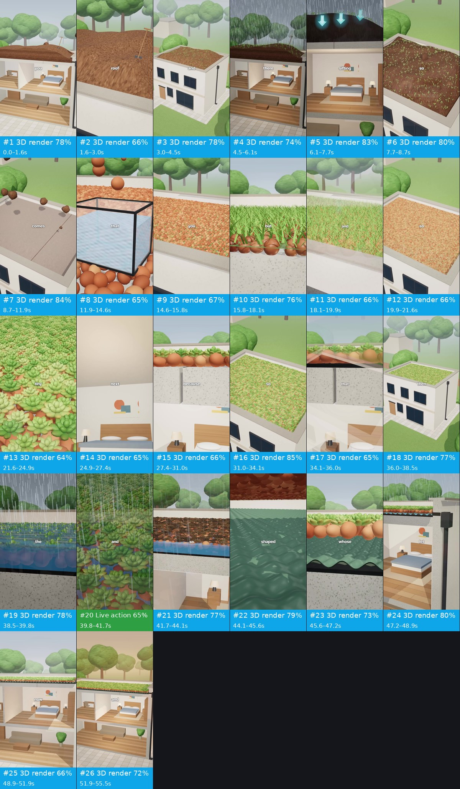
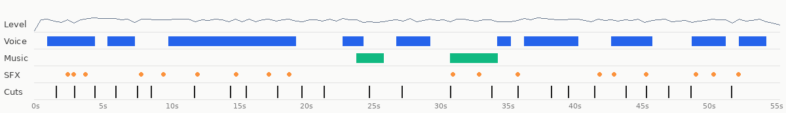

# How this video was made: soil_roof.mp4

**In one line**: How a green roof is really built, told as a chain of failed attempts: soil too heavy → light clay pebbles → grass dries → sedum → roots leak → root barrier → flooding → drainage cups.
**How it was made**: Mixed production: 3D render 96% + live action 4%

- 0:55 · vertical 9:16 · 26 shots, 2.1s each on average
- Confidence 72%, based on: tool measurements + AI assistant reviewed 26 shots
- ⚠️ 2 points are uncertain, see “Open questions”



# Part one · Breakdown: how this video is built

## What makes it work

- **The hook**: 0-6 s: you shovel soil onto your roof, and one storm later tonnes of wet mud sit above your bed (cutaway shows the bed under the load).
- Five problem→fix loops in 55 s, each closing with a new layer of the roof
- A cutaway with the bedroom always visible keeps the stakes personal
- Everyday analogy: drainage sheet 'shaped like an egg carton'
- Payoff ties back to the hook: the bedroom stays cool, the roof waters itself

## Production pipeline at a glance

| Stage | What this video uses | Remake approach |
|---|---|---|
| **Base picture** | 3D render 25 shots (96%), live action 1 shot (4%); includes real material in 1 shot (4%) | filmed in 1 scene; AI in 7 generations |
| **Packaging** | styled text ×1 (large size, tilted, multi-colour / gradient): "E"; text label ×95 (2 of them follow an object): "shovel", "roof", "grow", "garden", "and", "storm" …; SFX hits on: text label in ×12, cut ×1 | export `packaging/overlays.ass` for timeline alignment |
| **Sound** | voice（TTS voice-over）, 10 distinct effects (18 hits) | voice: TTS voice-over; effects: add from a library at the listed times |

## Content and structure

**Narrative line**

Keep this line in a remake: same order, same job at each step, with the point refilled from your own cases, numbers and material, so it is more than a change of subject.

| Time | Shots | Job | What it says |
|---|---|---|---|
| 0.0–1.6s | #1 | grab attention | You shovel soil onto your flat roof to grow a garden. |
| 1.6–4.5s | #2, #3 | add information | You shovel soil onto your flat roof to grow a garden. |
| 4.5–6.1s | #4 | grab attention | And one storm later, there are tons of wet muds sitting above your bed. |
| 6.1–8.7s | #5, #6 | add information | And one storm later, there are tons of wet muds sitting above your bed. |
| 8.7–11.9s | #7 | — | So the soil comes off and you spread a thin layer of baked clay pebbles that sta |
| 11.9–15.8s | #8, #9 | add information | So the soil comes off and you spread a thin layer of baked clay pebbles that sta |
| 15.8–18.1s | #10 | turn | You plant grass, but that thin layer dries out fast and the lawn turns brown. |
| 18.1–19.9s | #11 | add information | You plant grass, but that thin layer dries out fast and the lawn turns brown. |
| 19.9–21.6s | #12 | turn | So you switch to see them. |
| 21.6–27.4s | #13, #14 | add information | Tiny succulents that keep water in their fat leaves. |
| 27.4–31.0s | #15 | turn | Next spring, the ceiling starts dripping because the roots crept into a seam in |
| 31.0–36.0s | #16, #17 | add information | Everything comes up again and down goes a rubber sheet that roots can't get thro |
| 36.0–38.5s | #18 | turn | Then a summer storm floods the roof. |
| 38.5–39.8s | #19 | add information | Then a summer storm floods the roof. |
| 39.8–41.7s | #20 | turn | The water can't drain and the seeedum starts to rot. |
| 41.7–48.9s | #21–#24 | add information | So under the pebbles goes a plastic sheet shaped like an egg cartton. → Whose cups hold a little rain and let the rest drain away. |
| 48.9–55.5s | #25, #26 | deliver the conclusion | Now, the bedroom below stays cooler all summer and your roof is a garden that wa |

**Script** (local speech recognition, unchecked; trust on-screen subtitles for names and homophones)

<details class="ref"><summary>all 13 lines</summary>

| Time | Who | Line | Delivery |
|---|---|---|---|
| 0.0–2.8s | narration | You shovel soil onto your flat roof to grow a garden. | measured: rate fast (3.9 words/s), wide pitch movement, lower than this speaker's other lines |
| 3.2–7.4s | narration | And one storm later, there are tons of wet muds sitting above your bed. | measured: rate normal (3.3 words/s), wide pitch movement |
| 7.8–14.3s | narration | So the soil comes off and you spread a thin layer of baked clay pebbles that stays light even when it's soaked. | measured: rate fast (3.4 words/s), wide pitch movement, higher than this speaker's other lines |
| 14.7–19.7s | narration | You plant grass, but that thin layer dries out fast and the lawn turns brown. | measured: rate normal (3.0 words/s), wide pitch movement |
| 20.0–21.4s | narration | So you switch to see them. | measured: rate fast (4.3 words/s), flatter than the other lines, higher than this speaker's other lines |
| 21.8–24.7s | narration | Tiny succulents that keep water in their fat leaves. | measured: rate normal (3.1 words/s), wide pitch movement |
| 25.1–30.6s | narration | Next spring, the ceiling starts dripping because the roots crept into a seam in the roof looking for water. | measured: rate fast (3.5 words/s), wide pitch movement |
| 31.4–35.6s | narration | Everything comes up again and down goes a rubber sheet that roots can't get through. | measured: rate fast (3.6 words/s), wide pitch movement, 0.8s pause before |
| 36.1–38.2s | narration | Then a summer storm floods the roof. | measured: rate normal (3.3 words/s), wide pitch movement, higher than this speaker's other lines |
| 38.6–41.5s | narration | The water can't drain and the seeedum starts to rot. | measured: rate fast (3.4 words/s), flatter than the other lines, lower than this speaker's other lines |
| 41.8–45.4s | narration | So under the pebbles goes a plastic sheet shaped like an egg cartton. | measured: rate fast (3.7 words/s), wide pitch movement, higher than this speaker's other lines |
| 45.7–48.6s | narration | Whose cups hold a little rain and let the rest drain away. | measured: rate fast (4.2 words/s), wide pitch movement |
| 49.0–54.5s | narration | Now, the bedroom below stays cooler all summer and your roof is a garden that waters itself. | measured: rate normal (3.1 words/s), wide pitch movement |

</details>

## Shot list

| # | Frame | Time | What it says | Picture | Camera | Made with |
|---|---|---|---|---|---|---|
| 1 |  | 0:00.0 · 1.6s | grab attention: You shovel soil onto your flat roof to grow … | Visualises: You shovel soil onto your flat roof to grow a ga… | smooth move | 3D render |
| 2 |  | 0:01.6 · 1.4s | add information: You shovel soil onto your flat roof to grow… | Visualises: You shovel soil onto your flat roof to grow a ga… | whole-frame zoom / pan | 3D render |
| 3 |  | 0:03.0 · 1.5s | add information: You shovel soil onto your flat roof to grow… | Visualises: You shovel soil onto your flat roof to grow a ga… | smooth move | 3D render |
| 4 |  | 0:04.5 · 1.6s | grab attention: And one storm later, there are tons of wet m… | Visualises: And one storm later, there are tons of wet muds … | smooth move | 3D render |
| 5 |  | 0:06.1 · 1.6s | add information: And one storm later, there are tons of wet … | Visualises: And one storm later, there are tons of wet muds … | smooth move | 3D render |
| 6 |  | 0:07.7 · 1.0s | add information: And one storm later, there are tons of wet … | Visualises: And one storm later, there are tons of wet muds … | smooth move | 3D render |
| 7 |  | 0:08.7 · 3.2s | So the soil comes off and you spread a thin layer of baked c… | Visualises: So the soil comes off and you spread a thin laye… | smooth move | 3D render |
| 8 |  | 0:11.9 · 2.7s | add information: So the soil comes off and you spread a thin… | Visualises: So the soil comes off and you spread a thin laye… | smooth move | 3D render |
| 9 |  | 0:14.6 · 1.2s | add information: So the soil comes off and you spread a thin… | Visualises: So the soil comes off and you spread a thin laye… | whole-frame zoom / pan | 3D render |
| 10 |  | 0:15.8 · 2.3s | turn: You plant grass, but that thin layer dries out fast an… | Visualises: You plant grass, but that thin layer dries out f… | smooth move | 3D render |
| 11 |  | 0:18.1 · 1.8s | add information: You plant grass, but that thin layer dries … | Visualises: You plant grass, but that thin layer dries out f… | whole-frame zoom / pan | 3D render |
| 12 |  | 0:19.9 · 1.7s | turn: So you switch to see them. | Visualises: So you switch to see them. Style: Stylised low-p… | whole-frame zoom / pan | 3D render |
| 13 |  | 0:21.6 · 3.3s | add information: Tiny succulents that keep water in their fa… | Visualises: Tiny succulents that keep water in their fat lea… | smooth move | 3D render |
| 14 |  | 0:24.9 · 2.4s | add information: Tiny succulents that keep water in their fa… | Visualises: Tiny succulents that keep water in their fat lea… | whole-frame zoom / pan | 3D render |
| 15 |  | 0:27.4 · 3.6s | turn: Next spring, the ceiling starts dripping because the r… | Visualises: Next spring, the ceiling starts dripping because… | whole-frame zoom / pan | 3D render |
| 16 |  | 0:31.0 · 3.1s | add information: Everything comes up again and down goes a r… | Visualises: Everything comes up again and down goes a rubber… | smooth move | 3D render |
| 17 |  | 0:34.1 · 1.9s | add information: Everything comes up again and down goes a r… | Visualises: Everything comes up again and down goes a rubber… | whole-frame zoom / pan | 3D render |
| 18 |  | 0:36.0 · 2.5s | turn: Then a summer storm floods the roof. | Visualises: Then a summer storm floods the roof. Style: Styl… | smooth move | 3D render |
| 19 |  | 0:38.5 · 1.3s | add information: Then a summer storm floods the roof. | Visualises: Then a summer storm floods the roof. Style: Styl… | smooth move | 3D render |
| 20 |  | 0:39.8 · 2.0s | turn: The water can't drain and the seeedum starts to rot. | Visualises: The water can't drain and the seeedum starts to … | smooth move | live action |
| 21 |  | 0:41.7 · 2.3s | add information: So under the pebbles goes a plastic sheet s… | Visualises: So under the pebbles goes a plastic sheet shaped… | smooth move | 3D render |
| 22 |  | 0:44.1 · 1.5s | add information: So under the pebbles goes a plastic sheet s… | Visualises: So under the pebbles goes a plastic sheet shaped… | smooth move | 3D render |
| 23 |  | 0:45.6 · 1.7s | add information: Whose cups hold a little rain and let the r… | Visualises: Whose cups hold a little rain and let the rest d… | smooth move | 3D render |
| 24 |  | 0:47.2 · 1.7s | add information: Whose cups hold a little rain and let the r… | Visualises: Whose cups hold a little rain and let the rest d… | smooth move | 3D render |
| 25 |  | 0:48.9 · 3.0s | deliver the conclusion: Now, the bedroom below stays cooler … | Visualises: Now, the bedroom below stays cooler all summer a… | whole-frame zoom / pan | 3D render |
| 26 |  | 0:51.9 · 3.6s | deliver the conclusion: Now, the bedroom below stays cooler … | Visualises: Now, the bedroom below stays cooler all summer a… | smooth move | 3D render |

## Cast, scenes and props

- **Visual style**: Stylised low-poly 3D render (toy-like, soft pastel lighting): a flat-roofed white house shown as a cutaway with a bedroom below the roof; instanced clay pebbles, grass, sedum; cyan/orange arrow graphi

- No cast extracted this time (needs AI image reading)

**Scenes**

| Scene | Where | When | Set / light | Shots |
|---|---|---|---|---|
| S1 | flat-roofed house, cutaway with bedroom below | seasons change: storm, spring, summer | pastel daylight, rain | #1–#26 |

**Props / products / logos**

- roof layers: soil, clay pebbles, grass, sedum, rubber root b (shots #1–#26)

## Camera and lighting

- Framing: shot size medium close-up 100%; subject is the in-focus region (no face; shot size is an estimate)
- Camera: moving camera (gimbal / handheld pan) 100%; typical move push-in
- Lighting: Soft pastel 3D lighting (image reading; pixel measurements in the fold below)
- Grade: vintage film (lifted blacks, warm); high saturation, low contrast, lifted blacks (greyish shadows), overall warm

<details class="ref"><summary>Per-item measurements and image readings (10)</summary>

| Aspect | Item | Verdict | Sources |
|---|---|---|---|
| Framing | shot size | medium close-up | measured |
| Camera | camera support | moving camera (gimbal / handheld pan) | measured |
| Camera | set-ups / locations | Keyframed 3D camera, push-ins and orbits | agent review |
| Camera | likely gear | 3D software (stylised, possibly Blender or a web 3D engine) | agent review |
| Lighting | soft / hard | soft light (almost no lit / shadow edge) | measured |
| Lighting | colour temperature | warm (about 3000–4000K) | measured |
| Lighting | overall lighting | Soft pastel 3D lighting | agent review |
| Grade | colour grade | vintage film (lifted blacks, warm) | measured |
| Grade | overall grade | Bright pastel | agent review |
| Editing | editing style | Hard cuts about every 2 s, one clause per shot | agent review |

- Note: lighting ratio, soft / hard, colour temperature and shot size are measured on the subject's pixels (the face when there is one, otherwise the in-focus region, which is an estimate); platform transcodes crush the shadows, so hardness and fill read conservative; camera angle, light source, catchlight and rim light follow the image readers. Where measurement and readers disagree, both are listed.

</details>

## Packaging layer (subtitles / styled text / stickers / sound-effect hits)

- styled text ×1 (large size, tilted, multi-colour / gradient): "E"
- text label ×95 (2 of them follow an object): "shovel", "roof", "grow", "garden", "and", "storm" …
- SFX hits on: text label in ×12, cut ×1

<details class="ref"><summary>text timeline (96 rows)</summary>

| Time | Kind | Text | Style | In / out | SFX |
|---|---|---|---|---|---|
| 0.00–0.60s | text label | shovel | white text, grey outline, line height 4.4% (about 84px) | — | — |
| 1.30–1.60s | text label | roof | white text, brown outline, keywords highlighted in orange, line height 3.2% (about 61px) | hard out | — |
| 1.70–2.10s | text label | grow | white text, black outline, line height 3.2% (about 61px) | hard out | — |
| 2.50–3.00s | text label | garden | white text, black outline, line height 4.4% (about 84px) | hard in | click |
| 3.00–3.20s | text label | and | white text, grey outline, line height 3.9% (about 75px) | hard in / shrink out | click |
| 3.10–3.60s | text label | storm | white text, grey outline, line height 4.4% (about 84px) | hard out | — |
| 3.90–4.50s | text label | later | white text, line height 4.6% (about 89px) | fade in | ding |
| 4.50–4.80s | text label | are | white text, grey outline, line height 3.1% (about 60px) | hard in | — |
| 4.80–5.20s | text label | of | white text, grey outline, line height 4.3% (about 83px) | hard in / hard out | — |
| 5.30–5.80s | text label | wet | white text, grey outline, line height 3.6% (about 69px) | pop | — |
| 5.80–6.10s | text label | sitting | white text, black outline, keywords highlighted in yellow, line height 5.2% (about 99px) | slide in / hard out | — |
| 6.00–7.70s | text label · follows an object | your | white text, grey outline, line height 3.8% (about 74px) | hard out | — |
| 7.00–7.10s | text label | 口 | cyan text, black box, line height 13.5% (about 260px) | hard in / hard out | — |
| 7.90–8.10s | text label | soil | white text, black outline, line height 5.9% (about 113px) | hard in / hard out | ding |
| 8.50–8.60s | text label | comes | white text, grey outline, line height 3.0% (about 57px) | hard in / hard out | — |
| 9.50–9.60s | text label | spread | white text, grey outline, line height 4.5% (about 85px) | hard in / hard out | ding |
| 10.00–10.30s | text label | thin | white text, grey outline, line height 4.3% (about 83px) | hard in / hard out | — |
| 10.50–10.60s | text label | baked | white text, brown outline, keywords highlighted in orange, line height 4.6% (about 89px) | hard in / hard out | — |
| 10.70–11.20s | text label | clay | white text, brown outline, keywords highlighted in orange, line height 5.9% (about 113px) | hard in / fade out | — |
| 11.30–11.80s | text label | pebbles | white text, brown outline, keywords highlighted in orange, line height 4.8% (about 92px) | hard out | — |
| 11.90–12.30s | text label | that | white text, grey outline, line height 3.8% (about 72px) | hard in / hard out | — |
| 12.40–12.60s | text label | light | white text, grey outline, line height 4.2% (about 81px) | hard in / hard out | — |
| 13.00–13.40s | text label | even | white text, grey outline, line height 3.2% (about 61px) | hard in / hard out | — |
| 13.40–13.60s | text label | it's | white text, grey outline, line height 4.1% (about 78px) | hard in / hard out | — |
| 13.80–14.50s | text label | soaked | white text, grey outline, line height 4.5% (about 85px) | hard in / shrink out | — |
| 14.50–14.60s | text label | you | white text, brown outline, line height 3.7% (about 70px) | hard out | — |
| 15.00–15.70s | text label | grass | white text, black outline, line height 3.5% (about 67px) | fade in / hard out | pop |
| 15.80–16.30s | text label | that | white text, black outline, line height 3.9% (about 75px) | hard in / hard out | — |
| 16.40–16.70s | text label | layer | white text, black outline, keywords highlighted in green, line height 4.2% (about 81px) | hard in / hard out | — |
| 16.90–17.30s | text label | die | white text, black outline, line height 3.7% (about 70px) | pop / hard out | — |
| 17.30–17.80s | text label | fast | white text, black outline, keywords highlighted in green, line height 3.6% (about 69px) | slide out | pop |
| 17.70–18.10s | text label | and | white text, black outline, line height 3.8% (about 74px) | hard in / hard out | — |
| 18.50–19.60s | text label | brown | white text, black outline, line height 3.8% (about 74px) | pop / fade out | — |
| 20.00–20.10s | text label | you | white text, brown outline, keywords highlighted in orange, line height 4.4% (about 84px) | hard in / hard out | — |
| 20.40–20.60s | text label | to | white text, brown outline, keywords highlighted in orange, line height 3.7% (about 70px) | hard in / hard out | — |
| 21.00–21.10s | text label | sedum | white text, black outline, line height 5.0% (about 96px) | hard in / hard out | — |
| 21.20–21.60s | text label | tiny | white text, black outline, keywords highlighted in green, line height 5.7% (about 109px) | slide in / hard out | — |
| 21.90–22.50s | text label | succulents | white text, green outline, keywords highlighted in green, line height 4.1% (about 78px) | hard in / hard out | — |
| 22.50–22.80s | text label | that | white text, black outline, line height 3.9% (about 75px) | hard in / hard out | — |
| 22.90–23.50s | text label | water | white text, black outline, keywords highlighted in green, line height 3.8% (about 72px) | fade in / fade out | — |
| 23.40–23.60s | text label | fat | white text, black outline, line height 3.9% (about 75px) | hard out | — |
| 23.70–24.90s | text label | leaves | white text, black outline, line height 4.1% (about 78px) | fade in / hard out | — |
| 24.90–25.60s | text label | 5 | grey text, keywords highlighted in orange, bold, line height 12.2% (about 234px) | hard in / hard out | — |
| 25.00–25.30s | text label | next | white text, grey outline, line height 3.4% (about 66px) | hard in / hard out | — |
| 25.00–26.10s | text label | ı | yellow text, bold, line height 2.0% (about 39px) | hard in / hard out | — |
| 25.30–25.90s | text label | spring | white text, grey outline, line height 5.1% (about 98px) | hard in / hard out | — |
| 25.80–27.30s | text label | S | yellow text, keywords highlighted in grey, line height 11.6% (about 222px) | hard in / hard out | — |
| 26.00–26.10s | text label | ceiling | white text, black outline, line height 5.2% (about 99px) | hard in / hard out | — |
| 26.40–26.60s | text label | dripping | white text, grey outline, line height 5.4% (about 103px) | pop / hard out | — |
| 26.50–26.60s | text label | e | — | hard in / hard out | — |
| 26.60–27.40s | text label | duddn | white text, grey outline, line height 5.3% (about 102px) | hard in / hard out | — |
| 27.40–27.60s | text label | the | white text, grey outline, line height 4.0% (about 76px) | hard in / hard out | — |
| 28.00–28.40s | text label | crept | white text, grey outline, line height 4.1% (about 79px) | hard in | — |
| 28.00–30.60s | text label | Ae | green text, green outline, gradient, keywords highlighted in orange, line height 11.9% (about 228px) | — | — |
| 28.40–28.60s | text label | seam | white text, grey outline, line height 3.0% (about 57px) | hard in / hard out | — |
| 29.00–29.10s | text label | the | white text, grey outline, line height 3.8% (about 74px) | hard in / hard out | — |
| 29.20–29.60s | text label | looking | white text, grey outline, line height 6.0% (about 116px) | hard out | — |
| 30.00–31.00s | text label | water | white text, grey outline, line height 3.7% (about 70px) | hard out | — |
| 31.00–31.20s | text label | everything | white text, yellow outline, line height 5.8% (about 111px) | hard in / hard out | ding |
| 31.50–31.60s | text label | comes | white text, brown outline, line height 3.8% (about 74px) | hard in / hard out | — |
| 33.70–34.10s | text label | that | white text, grey outline, line height 3.6% (about 69px) | hard in / hard out | — |
| 34.40–34.60s | text label | can't | white text, grey outline, line height 3.8% (about 72px) | hard in / hard out | — |
| 34.70–35.10s | text label | get | white text, line height 4.2% (about 81px) | hard in / hard out | — |
| 35.40–36.00s | text label | through | white text, grey outline, line height 4.5% (about 87px) | hard in / hard out | — |
| 36.00–36.20s | text label | a | white text, grey outline, line height 2.8% (about 54px) | hard in / hard out | ding |
| 36.50–36.80s | text label | summer | white text, black outline, line height 3.6% (about 69px) | hard in / hard out | — |
| 37.00–37.20s | text label | floods | white text, black outline, line height 4.5% (about 87px) | hard in / hard out | — |
| 37.50–37.60s | text label | the | white text, grey outline, line height 4.1% (about 79px) | hard in / hard out | — |
| 37.90–38.50s | text label | roof | white text, grey outline, line height 4.1% (about 79px) | hard in | — |
| 38.50–39.80s | text label · follows an object | drain | white text, black outline, line height 3.8% (about 73px) | — | — |
| 40.00–40.10s | text label | sedum | white text, black outline, line height 3.8% (about 72px) | hard in / hard out | — |
| 40.50–41.60s | text label | rot | white text, black outline, keywords highlighted in brown, line height 3.4% (about 65px) | shrink out | — |
| 42.00–42.10s | text label | under | white text, black outline, line height 3.4% (about 65px) | hard in / hard out | ding |
| 42.40–42.60s | text label | pebbles | white text, black outline, line height 4.3% (about 83px) | hard in / hard out | — |
| 42.90–43.10s | text label | plastic | white text, black outline, line height 4.3% (about 83px) | hard in / hard out | — |
| 43.30–43.70s | text label | sheet | white text, black outline, line height 4.1% (about 78px) | — | ding |
| 43.90–44.10s | text label | shaped | white text, black outline, line height 4.5% (about 85px) | hard in / hard out | — |
| 44.40–44.80s | text label | egg | white text, grey outline, line height 5.1% (about 98px) | hard in / hard out | — |
| 45.00–45.10s | text label | carton | white text, black outline, line height 3.7% (about 70px) | hard in / hard out | — |
| 45.30–45.60s | text label | whose | white text, brown outline, line height 4.3% (about 83px) | hard out | — |
| 45.90–46.30s | text label | hold | white text, black outline, line height 3.9% (about 75px) | fade in / shrink out | — |
| 46.50–47.20s | text label | and | white text, grey outline, line height 3.6% (about 69px) | pop / hard out | — |
| 47.20–48.10s | text label | 1 | black text, bold, line height 2.7% (about 51px) | hard in / shrink out | — |
| 47.50–47.60s | text label | rest | white text, grey outline, line height 3.5% (about 68px) | hard in / hard out | — |
| 48.00–48.90s | text label | away | white text, grey outline, line height 3.7% (about 71px) | pop / hard out | — |
| 48.90–49.50s | text label | the | white text, grey outline, line height 4.4% (about 84px) | — | — |
| 49.50–49.80s | text label | bedroom | white text, grey outline, line height 4.3% (about 83px) | hard in / hard out | — |
| 49.80–50.10s | text label | stays | white text, grey outline, line height 4.3% (about 83px) | hard in / hard out | — |
| 50.40–50.90s | text label | cooler | white text, grey outline, line height 4.4% (about 84px) | hard in / hard out | — |
| 51.00–51.90s | text label | summer | white text, grey outline, line height 3.0% (about 57px) | pop / hard out | — |
| 51.90–52.50s | text label | roof | white text, grey outline, line height 3.4% (about 66px) | — | — |
| 51.90–54.10s | styled text | E | white text, keywords highlighted in brown, line height 29.2% (about 561px) | hard in | — |
| 52.50–52.80s | text label | is | white text, line height 3.8% (about 74px) | hard in / hard out | ding |
| 52.90–53.30s | text label | garden | white text, grey outline, line height 4.0% (about 76px) | hard in / hard out | — |
| 53.50–53.60s | text label | waters | white text, grey outline, line height 3.7% (about 70px) | hard in / hard out | — |
| 53.90–55.10s | text label | itself | white text, grey outline, line height 4.1% (about 79px) | hard in / hard out | — |

</details>

- Remake: styled version in `packaging/overlays.ass`

## Sound

**Voice**

- male-leaning
- Source: TTS voice-over
- Remake: TTS voice-over: CapCut text-to-speech or another TTS tool, with a similar voice and pace

**Sound effects** (18 hits, 10 distinct sounds)

| Sound | Listen | Type | Times used | At | On screen |
|---|---|---|---|---|---|
| F1 | [listen](sfx/sfx_01.wav) | click | 1 | 2.5s | text label "garden" appears |
| F2 | [listen](sfx/sfx_02.wav) | click | 1 | 2.9s | text label "and" appears |
| F3 | [listen](sfx/sfx_03.wav) | ding | 4 | 3.9s, 9.6s, 19.0s, 45.6s | text label "later" appears; text label "spread" appears; cut |
| F4 | [listen](sfx/sfx_04.wav) | ding | 3 | 8.0s, 31.2s, 43.2s | text label "soil" appears; text label "everything" appears; text label "sheet" appears |
| F5 | [listen](sfx/sfx_05.wav) | ding | 3 | 12.2s, 15.1s, 50.6s | text label "grass" appears |
| F6 | [listen](sfx/sfx_06.wav) | pop | 1 | 17.5s | text label "fast" appears |
| F7 | [listen](sfx/sfx_07.wav) | ding | 2 | 33.2s, 49.3s | — |
| F8 | [listen](sfx/sfx_08.wav) | ding | 1 | 36.0s | text label "a" appears |
| F9 | [listen](sfx/sfx_09.wav) | ding | 1 | 42.1s | text label "under" appears |
| F10 | [listen](sfx/sfx_10.wav) | ding | 1 | 52.4s | text label "is" appears |

- Remake: play each sound, find a similar one in your editor's library and place it at the times under “At”

**Listen to the tracks**

- voice: [stems/vocals.wav](stems/vocals.wav)

<details class="ref"><summary>Sound measurements and evidence</summary>



- Loudness -16.4 dBFS, peak -2.9 dBFS
- sound runs across cuts, laid in post as one bed (background changes 7.9dB at cuts vs 5.8dB within shots)
- Voice on 57% of the duration, pitch about 123.2Hz
- Voice source: TTS voice-over (TTS voice-over 64%, human recording 27%, native dialogue from the AI video model 9%)
  - Voice and background sound run across cuts: the voice-over was laid on separately in post (TTS or a human voice-over)

</details>

## Open questions

- Shot #20 (39.8–41.7s): Tools say live action, the image review says 3D render; on the AI / live-action axis the fusion follows the tools (eval-calibrated): check the frames to see whether the review's evidence is really visible
- No AI listened to the soundtrack (the review covered the picture only): real voice versus TTS is inferred from the waveform; the effects were found on the separated effects track and their types are estimated from the sound. Play the stems and each effect under “Sound” to check

# Part two · Remake plan

Planned for **MiniMax H3 / H3 Max**: ≤15 s per call, several shots per call, takes reference video (3 clips, ≤15 s in all), ≤9 reference images, first / last frame, native sound. Name another model and the split, lengths and prompts are redone for it.

## Remake it yourself: do it in this order

Copy the method and the rhythm, not the pictures: keep what each part does and fill it with your own content and material.

This is a 3D / animation. Do the steps in this order; the detail for each is in the matching subsection below.

1. **Write the content**: write yours in the same 17 steps as the original (narrative line under “Content and structure”)
2. **Collect material**: the real material in the picture (live footage) needs the original files, listed under “What to prepare”
3. **Generate**: 7 calls (54 s), several shots each. Each shot gets one source frame for composition (subtitles erased, in `remake/refs/`), the swapped-in people, animals and products get reference images, and the prompt lists the shots in order
4. **Adapt the prompts to your model**: each unit's draft is already laid out in MiniMax H3 / H3 Max's shot, tag and audio format; refine it against the model's prompt guide before generating (or run `rea-video plan <folder> --rewrite-prompts`)
5. **Live shots**: 1 shots to film yourself; camera and light under “Shoot” below
6. **Voice**: the original is TTS voice-over; record it yourself or use TTS; 13 lines with their pace in the script table under “Sound”
7. **Edit**: follow the order and lengths in the shot list; the original has 26 shots at 2.1s each; 8 transitions under “Edit”
8. **Subtitles and styled text**: timing and style under “Packaging layer”
9. **Sound effects**: 18; place similar ones from a library at the times under “Sound”
10. **Put it together and compare**: hand the shots you made to the agent; it places them on the original timeline, keeps the original where yours are missing, and renders a side-by-side comparison with the original

### Shoot

Shoot every shot of one scene before moving to the next; within a scene, shoot the wider sizes first and the close-ups last so the lighting is set only once. Leave about 1s of handle at both ends of every take.

**S1**: shots #20 (1.97s on screen); flat-roofed house, cutaway with bedroom below, pastel daylight, rain
- Lighting: soft frontal light (flat light), key light frontal, warm (about 3000–4000K)
- Setup medium close-up · moving camera (gimbal / handheld pan) · push-in: shots #20, 1.97s on screen, shoot about 4.0s

### AI generation

**7 generations, 54 s in total**

> ⚠️ G1, G2, G3, G4, G5, G6, G7: the prompts are the tool's drafts, already in MiniMax H3 / H3 Max's layout. Check them against the model's conventions and good prompts for similar shots, then put the finals into `remake/prompts.json`; `rea-video plan` then checks the format.

- **How it is generated**: multi-shot from key frames

| Part | Shots | Time | Length | Prepare |
|---|---|---|---|---|
| G1 | #1–#4 | 0.0–6.1s | generate 7s, trim to 6.1s | reference images |
| G2 | #5–#8 | 6.1–14.6s | 8.5s | reference images |
| G3 | #9–#12 | 14.6–21.6s | 7.0s | reference images |
| G4 | #13–#15 | 21.6–31.0s | generate 10s, trim to 9.4s | reference images |
| G5 | #16–#19 | 31.0–39.8s | 8.8s | reference images |
| G6 | #21–#24 | 41.7–48.9s | generate 8s, trim to 7.2s | reference images |
| G7 | #25, #26 | 48.9–55.5s | 6.6s | reference images |

<details class="ref"><summary>Why it is split this way</summary>

- Grouping: consecutive shots share a call where they fit, ≤10s per call, ≤4 shots; a long stretch is cut at a scene change first
- Inputs: the model also takes reference video, but key frames are used here: one key frame per shot fixes composition and look, swapped-in things get their own images
- Audio: the model can generate action sound effects and ambience along with the picture; voice-over is better done as separate TTS and mixed in, so copy and timing stay editable
- Packaging: the text label, styled text on the generated shots is post-production packaging: keep it out of the prompts (erased from source references) and lay it back on from the packaging timeline after generation

</details>

<details><summary>Frames to make first (25)</summary>

When swapping people or products, or switching to shot-by-shot image-to-video, prepare each shot's first frame as below:

| Shot | Role | How | Reference images | Save as |
|---|---|---|---|---|
| #1 | first frame | text-to-image (or low-denoise I2I from source frame) | `shots/shot_001_first.jpg` (source first frame: composition and style reference) | `remake/redrawn/shot001.png` |
| #2 | first frame | text-to-image (or low-denoise I2I from source frame) | `shots/shot_002_first.jpg` (source first frame: composition and style reference) | `remake/redrawn/shot002.png` |
| #3 | first frame | text-to-image (or low-denoise I2I from source frame) | `shots/shot_003_first.jpg` (source first frame: composition and style reference) | `remake/redrawn/shot003.png` |
| #4 | first frame | text-to-image (or low-denoise I2I from source frame) | `shots/shot_004_first.jpg` (source first frame: composition and style reference) | `remake/redrawn/shot004.png` |
| #5 | first frame | text-to-image (or low-denoise I2I from source frame) | `shots/shot_005_first.jpg` (source first frame: composition and style reference) | `remake/redrawn/shot005.png` |
| #6 | first frame | text-to-image (or low-denoise I2I from source frame) | `shots/shot_006_first.jpg` (source first frame: composition and style reference) | `remake/redrawn/shot006.png` |
| #7 | first frame | text-to-image (or low-denoise I2I from source frame) | `shots/shot_007_first.jpg` (source first frame: composition and style reference) | `remake/redrawn/shot007.png` |
| #8 | first frame | text-to-image (or low-denoise I2I from source frame) | `shots/shot_008_first.jpg` (source first frame: composition and style reference) | `remake/redrawn/shot008.png` |
| #9 | first frame | text-to-image (or low-denoise I2I from source frame) | `shots/shot_009_first.jpg` (source first frame: composition and style reference) | `remake/redrawn/shot009.png` |
| #10 | first frame | text-to-image (or low-denoise I2I from source frame) | `shots/shot_010_first.jpg` (source first frame: composition and style reference) | `remake/redrawn/shot010.png` |
| #11 | first frame | text-to-image (or low-denoise I2I from source frame) | `shots/shot_011_first.jpg` (source first frame: composition and style reference) | `remake/redrawn/shot011.png` |
| #12 | first frame | text-to-image (or low-denoise I2I from source frame) | `shots/shot_012_first.jpg` (source first frame: composition and style reference) | `remake/redrawn/shot012.png` |
| #13 | first frame | text-to-image (or low-denoise I2I from source frame) | `shots/shot_013_first.jpg` (source first frame: composition and style reference) | `remake/redrawn/shot013.png` |
| #14 | first frame | text-to-image (or low-denoise I2I from source frame) | `shots/shot_014_first.jpg` (source first frame: composition and style reference) | `remake/redrawn/shot014.png` |
| #15 | first frame | text-to-image (or low-denoise I2I from source frame) | `shots/shot_015_first.jpg` (source first frame: composition and style reference) | `remake/redrawn/shot015.png` |
| #16 | first frame | text-to-image (or low-denoise I2I from source frame) | `shots/shot_016_first.jpg` (source first frame: composition and style reference) | `remake/redrawn/shot016.png` |
| #17 | first frame | text-to-image (or low-denoise I2I from source frame) | `shots/shot_017_first.jpg` (source first frame: composition and style reference) | `remake/redrawn/shot017.png` |
| #18 | first frame | text-to-image (or low-denoise I2I from source frame) | `shots/shot_018_first.jpg` (source first frame: composition and style reference) | `remake/redrawn/shot018.png` |
| #19 | first frame | text-to-image (or low-denoise I2I from source frame) | `shots/shot_019_first.jpg` (source first frame: composition and style reference) | `remake/redrawn/shot019.png` |
| #21 | first frame | text-to-image (or low-denoise I2I from source frame) | `shots/shot_021_first.jpg` (source first frame: composition and style reference) | `remake/redrawn/shot021.png` |
| #22 | first frame | text-to-image (or low-denoise I2I from source frame) | `shots/shot_022_first.jpg` (source first frame: composition and style reference) | `remake/redrawn/shot022.png` |
| #23 | first frame | text-to-image (or low-denoise I2I from source frame) | `shots/shot_023_first.jpg` (source first frame: composition and style reference) | `remake/redrawn/shot023.png` |
| #24 | first frame | text-to-image (or low-denoise I2I from source frame) | `shots/shot_024_first.jpg` (source first frame: composition and style reference) | `remake/redrawn/shot024.png` |
| #25 | first frame | text-to-image (or low-denoise I2I from source frame) | `shots/shot_025_first.jpg` (source first frame: composition and style reference) | `remake/redrawn/shot025.png` |
| #26 | first frame | text-to-image (or low-denoise I2I from source frame) | `shots/shot_026_first.jpg` (source first frame: composition and style reference) | `remake/redrawn/shot026.png` |

- **#1 first frame (text-to-image (or low-denoise I2I from source frame))**
  - Image prompt: Vertical 9:16. close-up, subject in the lower middle of the frame, camera push-in. You shovel soil onto your flat roof to grow a garden
- **#2 first frame (text-to-image (or low-denoise I2I from source frame))**
  - Image prompt: Vertical 9:16. medium close-up, subject in the upper middle of the frame, camera push-in. You shovel soil onto your flat roof to grow a garden
- **#3 first frame (text-to-image (or low-denoise I2I from source frame))**
  - Image prompt: Vertical 9:16. medium close-up, subject centred in frame, camera push-in. You shovel soil onto your flat roof to grow a garden
- **#4 first frame (text-to-image (or low-denoise I2I from source frame))**
  - Image prompt: Vertical 9:16. medium close-up, subject in the upper middle of the frame, camera push-in. And one storm later, there are tons of wet muds sitting above your bed
- **#5 first frame (text-to-image (or low-denoise I2I from source frame))**
  - Image prompt: Vertical 9:16. medium shot, subject in the upper middle of the frame, camera push-in. And one storm later, there are tons of wet muds sitting above your bed
- **#6 first frame (text-to-image (or low-denoise I2I from source frame))**
  - Image prompt: Vertical 9:16. medium close-up, subject centred in frame, camera pull-out. And one storm later, there are tons of wet muds sitting above your bed
- **#7 first frame (text-to-image (or low-denoise I2I from source frame))**
  - Image prompt: Vertical 9:16. medium close-up, subject centred in frame, camera push-in. So the soil comes off and you spread a thin layer of baked clay pebbles that stays light even when it's soaked
- **#8 first frame (text-to-image (or low-denoise I2I from source frame))**
  - Image prompt: Vertical 9:16. medium close-up, subject in the upper middle of the frame, camera push-in. So the soil comes off and you spread a thin layer of baked clay pebbles that stays light even when it's soaked
- **#9 first frame (text-to-image (or low-denoise I2I from source frame))**
  - Image prompt: Vertical 9:16. medium close-up, subject centred in frame, camera push-in. So the soil comes off and you spread a thin layer of baked clay pebbles that stays light even when it's soaked
- **#10 first frame (text-to-image (or low-denoise I2I from source frame))**
  - Image prompt: Vertical 9:16. medium close-up, subject centred in frame, camera push-in. You plant grass, but that thin layer dries out fast and the lawn turns brown
- **#11 first frame (text-to-image (or low-denoise I2I from source frame))**
  - Image prompt: Vertical 9:16. medium close-up, subject centred in frame, camera push-in. You plant grass, but that thin layer dries out fast and the lawn turns brown
- **#12 first frame (text-to-image (or low-denoise I2I from source frame))**
  - Image prompt: Vertical 9:16. medium close-up, subject centred in frame, camera push-in. So you switch to see them
- **#13 first frame (text-to-image (or low-denoise I2I from source frame))**
  - Image prompt: Vertical 9:16. medium close-up, subject in the upper middle of the frame, camera push-in. Tiny succulents that keep water in their fat leaves
- **#14 first frame (text-to-image (or low-denoise I2I from source frame))**
  - Image prompt: Vertical 9:16. medium close-up, subject in the lower middle of the frame, camera push-in. Tiny succulents that keep water in their fat leaves
- **#15 first frame (text-to-image (or low-denoise I2I from source frame))**
  - Image prompt: Vertical 9:16. medium close-up, subject in the upper middle of the frame, camera push-in. Next spring, the ceiling starts dripping because the roots crept into a seam in the roof looking for water
- **#16 first frame (text-to-image (or low-denoise I2I from source frame))**
  - Image prompt: Vertical 9:16. medium close-up, subject centred in frame, camera push-in. Everything comes up again and down goes a rubber sheet that roots can't get through
- **#17 first frame (text-to-image (or low-denoise I2I from source frame))**
  - Image prompt: Vertical 9:16. medium close-up, subject in the upper middle of the frame, camera push-in. Everything comes up again and down goes a rubber sheet that roots can't get through
- **#18 first frame (text-to-image (or low-denoise I2I from source frame))**
  - Image prompt: Vertical 9:16. medium close-up, subject centred in frame, camera push-in. Then a summer storm floods the roof
- **#19 first frame (text-to-image (or low-denoise I2I from source frame))**
  - Image prompt: Vertical 9:16. medium shot, subject in the upper middle of the frame, camera push-in. Then a summer storm floods the roof
- **#21 first frame (text-to-image (or low-denoise I2I from source frame))**
  - Image prompt: Vertical 9:16. medium shot, subject in the upper middle of the frame, camera push-in. So under the pebbles goes a plastic sheet shaped like an egg cartton
- **#22 first frame (text-to-image (or low-denoise I2I from source frame))**
  - Image prompt: Vertical 9:16. medium close-up, subject in the upper middle of the frame, camera push-in. So under the pebbles goes a plastic sheet shaped like an egg cartton
- **#23 first frame (text-to-image (or low-denoise I2I from source frame))**
  - Image prompt: Vertical 9:16. medium close-up, subject centred in frame, camera push-in. Whose cups hold a little rain and let the rest drain away
- **#24 first frame (text-to-image (or low-denoise I2I from source frame))**
  - Image prompt: Vertical 9:16. medium close-up, subject in the upper middle of the frame, camera push-in. Whose cups hold a little rain and let the rest drain away
- **#25 first frame (text-to-image (or low-denoise I2I from source frame))**
  - Image prompt: Vertical 9:16. medium close-up, subject centred in frame, camera push-in. Now, the bedroom below stays cooler all summer and your roof is a garden that waters itself
- **#26 first frame (text-to-image (or low-denoise I2I from source frame))**
  - Image prompt: Vertical 9:16. close-up, subject in the lower middle of the frame, camera push-in. Now, the bedroom below stays cooler all summer and your roof is a garden that waters itself

</details>

<details><summary>G1 · shots #1–#4 · 6.1s</summary>

- reference images: source frames of shots #1, #2, #3, #4 (subtitles erased)

Draft prompt (in MiniMax H3 / H3 Max's layout; check it and put the final into remake/prompts.json before generating):

```text
integrated_multimodal_description: Generate the shots below in order in one go, hard cuts between them; each shot takes composition, size and camera from its source frame image. Vertical 9:16; high key, soft light, warm tones, background clearly blurred.
[Shot 1] You shovel soil onto your flat roof to grow a garden. (composition: <Picture 1>)
[Shot 2] At 00:01.633, the camera cuts to: You shovel soil onto your flat roof to grow a garden. (composition: <Picture 2>)
[Shot 3] At 00:03.000, the camera cuts to: You shovel soil onto your flat roof to grow a garden. (composition: <Picture 3>)
[Shot 4] At 00:04.500, the camera cuts to: And one storm later, there are tons of wet muds sitting above your bed. (composition: <Picture 4>)
overall_soundscape: Only the natural sounds of the actions on screen.
non_diegetic_music: N/A
```

</details>

<details><summary>G2 · shots #5–#8 · 8.5s</summary>

- reference images: source frames of shots #5, #6, #7, #8 (subtitles erased)

Draft prompt (in MiniMax H3 / H3 Max's layout; check it and put the final into remake/prompts.json before generating):

```text
integrated_multimodal_description: Generate the shots below in order in one go, hard cuts between them; each shot takes composition, size and camera from its source frame image. Vertical 9:16; high key, soft light, warm tones, background clearly blurred.
[Shot 1] And one storm later, there are tons of wet muds sitting above your bed. (composition: <Picture 1>)
[Shot 2] At 00:01.600, the camera cuts to: And one storm later, there are tons of wet muds sitting above your bed. (composition: <Picture 2>)
[Shot 3] At 00:02.633, the camera cuts to: So the soil comes off and you spread a thin layer of baked clay pebbles that stays light even when it's soaked. (composition: <Picture 3>)
[Shot 4] At 00:05.833, the camera cuts to: So the soil comes off and you spread a thin layer of baked clay pebbles that stays light even when it's soaked. (composition: <Picture 4>)
overall_soundscape: Only the natural sounds of the actions on screen.
non_diegetic_music: N/A
```

</details>

<details><summary>G3 · shots #9–#12 · 7.0s</summary>

- reference images: source frames of shots #9, #10, #11, #12 (subtitles erased)

Draft prompt (in MiniMax H3 / H3 Max's layout; check it and put the final into remake/prompts.json before generating):

```text
integrated_multimodal_description: Generate the shots below in order in one go, hard cuts between them; each shot takes composition, size and camera from its source frame image. Vertical 9:16; high key, soft light, warm tones, background clearly blurred.
[Shot 1] So the soil comes off and you spread a thin layer of baked clay pebbles that stays light even when it's soaked. (composition: <Picture 1>)
[Shot 2] At 00:01.167, the camera cuts to: You plant grass, but that thin layer dries out fast and the lawn turns brown. (composition: <Picture 2>)
[Shot 3] At 00:03.500, the camera cuts to: You plant grass, but that thin layer dries out fast and the lawn turns brown. (composition: <Picture 3>)
[Shot 4] At 00:05.333, the camera cuts to: So you switch to see them. (composition: <Picture 4>)
overall_soundscape: Only the natural sounds of the actions on screen.
non_diegetic_music: N/A
```

</details>

<details><summary>G4 · shots #13–#15 · 9.4s</summary>

- reference images: source frames of shots #13, #14, #15 (subtitles erased)

Draft prompt (in MiniMax H3 / H3 Max's layout; check it and put the final into remake/prompts.json before generating):

```text
integrated_multimodal_description: Generate the shots below in order in one go, hard cuts between them; each shot takes composition, size and camera from its source frame image. Vertical 9:16; high key, soft light, warm tones, background clearly blurred.
[Shot 1] Tiny succulents that keep water in their fat leaves. (composition: <Picture 1>)
[Shot 2] At 00:03.333, the camera cuts to: Tiny succulents that keep water in their fat leaves. (composition: <Picture 2>)
[Shot 3] At 00:05.766, the camera cuts to: Next spring, the ceiling starts dripping because the roots crept into a seam in the roof looking for water. (composition: <Picture 3>)
overall_soundscape: Only the natural sounds of the actions on screen.
non_diegetic_music: N/A
```

</details>

<details><summary>G5 · shots #16–#19 · 8.8s</summary>

- reference images: source frames of shots #16, #17, #18, #19 (subtitles erased)

Draft prompt (in MiniMax H3 / H3 Max's layout; check it and put the final into remake/prompts.json before generating):

```text
integrated_multimodal_description: Generate the shots below in order in one go, hard cuts between them; each shot takes composition, size and camera from its source frame image. Vertical 9:16; high key, soft light, warm tones, background clearly blurred.
[Shot 1] Everything comes up again and down goes a rubber sheet that roots can't get through. (composition: <Picture 1>)
[Shot 2] At 00:03.067, the camera cuts to: Everything comes up again and down goes a rubber sheet that roots can't get through. (composition: <Picture 2>)
[Shot 3] At 00:05.000, the camera cuts to: Then a summer storm floods the roof. (composition: <Picture 3>)
[Shot 4] At 00:07.500, the camera cuts to: Then a summer storm floods the roof. (composition: <Picture 4>)
overall_soundscape: Only the natural sounds of the actions on screen.
non_diegetic_music: N/A
```

</details>

<details><summary>G6 · shots #21–#24 · 7.2s</summary>

- reference images: source frames of shots #21, #22, #23, #24 (subtitles erased)

Draft prompt (in MiniMax H3 / H3 Max's layout; check it and put the final into remake/prompts.json before generating):

```text
integrated_multimodal_description: Generate the shots below in order in one go, hard cuts between them; each shot takes composition, size and camera from its source frame image. Vertical 9:16; high key, soft light, warm tones, background clearly blurred.
[Shot 1] So under the pebbles goes a plastic sheet shaped like an egg cartton. (composition: <Picture 1>)
[Shot 2] At 00:02.333, the camera cuts to: So under the pebbles goes a plastic sheet shaped like an egg cartton. (composition: <Picture 2>)
[Shot 3] At 00:03.833, the camera cuts to: Whose cups hold a little rain and let the rest drain away. (composition: <Picture 3>)
[Shot 4] At 00:05.500, the camera cuts to: Whose cups hold a little rain and let the rest drain away. (composition: <Picture 4>)
overall_soundscape: Only the natural sounds of the actions on screen.
non_diegetic_music: N/A
```

</details>

<details><summary>G7 · shots #25, #26 · 6.6s</summary>

- reference images: source frames of shots #25, #26 (subtitles erased)

Draft prompt (in MiniMax H3 / H3 Max's layout; check it and put the final into remake/prompts.json before generating):

```text
integrated_multimodal_description: Generate the shots below in order in one go, hard cuts between them; each shot takes composition, size and camera from its source frame image. Vertical 9:16; high key, soft light, warm tones, background clearly blurred.
[Shot 1] Now, the bedroom below stays cooler all summer and your roof is a garden that waters itself. (composition: <Picture 1>)
[Shot 2] At 00:03.033, the camera cuts to: Now, the bedroom below stays cooler all summer and your roof is a garden that waters itself. (composition: <Picture 2>)
overall_soundscape: Only the natural sounds of the actions on screen.
non_diegetic_music: N/A
```

</details>

<details><summary>Prompt guides for MiniMax H3 / H3 Max</summary>

- https://huggingface.co/MiniMaxAI/MiniMax-H3/raw/main/docs/VIDEO_PROMPT_WRITING_GUIDE_base_en.md
- https://huggingface.co/MiniMaxAI/MiniMax-H3/raw/main/docs/VIDEO_PROMPT_WRITING_GUIDE_ref_en.md
- https://platform.minimax.io/docs/api-reference/video-generation-v2-create
- https://docs.comfy.org/tutorials/video/minimax/minimax-h3-prompt-guide.md

</details>

### Edit

- Cut in the order and lengths of the shot list
- Approach: Hard cuts about every 2 s, one clause per shot
- Rhythm: 27.0 cuts per minute, 1.97s average live-action shot; 1 camera set-up(s) / location(s); 0 jump cut(s) and 0 punch-in(s) within the same set-up; inserts (screenshots / screen recordings / cards / stock) take 96%; transitions cut×17, dissolve×6, wipe×2

**Transitions**

| Time | Into shot | Transition |
|---|---|---|
| 8.6–8.8s | #7 | dissolve, 0.3s |
| 11.8–12.7s | #8 | wipe, 0.9s |
| 15.7–15.8s | #10 | dissolve, 0.1s |
| 18.1–18.2s | #11 | dissolve, 0.1s |
| 19.9–20.0s | #12 | dissolve, 0.1s |
| 34.0–34.2s | #17 | wipe, 0.2s |
| 45.5–45.7s | #23 | dissolve, 0.2s |
| 51.9–52.0s | #26 | dissolve, 0.1s |

## Appendix

### Shot by shot

Each shot has two parts: what is visible on screen, and how the tools infer it was made (with the basis); remake prompts last. Folded by default.

<details class="ref"><summary>#1 00:00.000–00:01.633 · 3D render + code / editor overlays (subtitles)</summary>


**Visible on screen** (check against the frames)
- Picture: Visualises: You shovel soil onto your flat roof to grow a garden. Style: Stylised low-poly 3D render (toy-like, soft pastel lighting): a flat-roofed white house shown as a cutaway with a bedroom below the roof; instanced clay pebbles, grass, sedum; cyan/orange arrow graphics; rain particles.
- Framing / light: close-up; centred; camera push-in; key light frontal (from the camera side; both sides of the subject about equally bright); soft light (almost no lit / shadow edge); neutral tone
- Text track (subtitle/middle): shovel / soil / roof
- [AI assistant review] The same house model, bedroom furniture and wall art recur identically across shots; pebbles and sedum are instanced copies with rigid geometry, no morphing
- [AI assistant review] Moves are slow push-ins and orbits on the 3D scene (the tool read them as 'still image pan/zoom' or 'handheld live action', but there is no real footage)

**How it was made, as inferred by the tools** (inferred, not seen)
- Inference: 3D render 71%, AI-generated video 10%, code / template render 4% (fused_agent)
- Material: rendered by the creator
- Basis (tool measurements, not necessarily visible to the eye):
  - The whole file is native 30fps and photographic shots carry no 24fps-source duplicate frames (78% of the duration): typical of straight-from-phone footage, generators mostly output 24fps
  - Platform transcode (YouTube) has compressed the sensor noise away, but the file and this shot are native 30fps with no 24fps-source duplicate frames: counted as phone footage

- Remake: 3D render: a video model gives an approximation (see the generation units); for precise multiple angles, model in 3D and render in Blender
  - First-frame image prompt: Stylised low-poly 3D render (toy-like, soft pastel lighting): a flat-roofed white house shown as a cutaway with a bedroom below the roof; instanced clay pebbles, grass, sedum; cyan/orange arrow graphics; rain particles.
  - Image-to-video motion prompt: You shovel soil onto your flat roof to grow a garden.
  - Full video prompt: You shovel soil onto your flat roof to grow a garden.

</details>

<details class="ref"><summary>#2 00:01.633–00:03.000 · 3D render + code / editor overlays (subtitles, static graphics)</summary>


**Visible on screen** (check against the frames)
- Picture: Visualises: You shovel soil onto your flat roof to grow a garden. Style: Stylised low-poly 3D render (toy-like, soft pastel lighting): a flat-roofed white house shown as a cutaway with a bedroom below the roof; instanced clay pebbles, grass, sedum; cyan/orange arrow graphics; rain particles.
- Framing / light: medium close-up; centred; camera push-in; key light frontal (from the camera side; both sides of the subject about equally bright); soft light (almost no lit / shadow edge); warm tone
- Text track (subtitle/middle): grow / garden
- [AI assistant review] The same house model, bedroom furniture and wall art recur identically across shots; pebbles and sedum are instanced copies with rigid geometry, no morphing
- [AI assistant review] Moves are slow push-ins and orbits on the 3D scene (the tool read them as 'still image pan/zoom' or 'handheld live action', but there is no real footage)

**How it was made, as inferred by the tools** (inferred, not seen)
- Inference: 3D render 59%, AI-generated video 17%, still image + pan/zoom 10% (fused_agent)
- Material: rendered by the creator
- Basis (tool measurements, not necessarily visible to the eye):
  - Whole frame moves as one rigid transform (97% inliers, 0.11px residual, no local motion) → pan/zoom on a still image: zoom +2.4%/s, pan 11px/s
  - The whole file is native 30fps and photographic shots carry no 24fps-source duplicate frames (78% of the duration): typical of straight-from-phone footage, generators mostly output 24fps
  - Platform transcode (YouTube) has compressed the sensor noise away, but the file and this shot are native 30fps with no 24fps-source duplicate frames: counted as phone footage

- Remake: 3D render: a video model gives an approximation (see the generation units); for precise multiple angles, model in 3D and render in Blender
  - First-frame image prompt: Stylised low-poly 3D render (toy-like, soft pastel lighting): a flat-roofed white house shown as a cutaway with a bedroom below the roof; instanced clay pebbles, grass, sedum; cyan/orange arrow graphics; rain particles.
  - Image-to-video motion prompt: You shovel soil onto your flat roof to grow a garden.
  - Full video prompt: You shovel soil onto your flat roof to grow a garden.

</details>

<details class="ref"><summary>#3 00:03.000–00:04.500 · 3D render + code / editor overlays (subtitles)</summary>


**Visible on screen** (check against the frames)
- Picture: Visualises: You shovel soil onto your flat roof to grow a garden. Style: Stylised low-poly 3D render (toy-like, soft pastel lighting): a flat-roofed white house shown as a cutaway with a bedroom below the roof; instanced clay pebbles, grass, sedum; cyan/orange arrow graphics; rain particles.
- Framing / light: medium close-up; centred; camera push-in; key light frontal (from the camera side; both sides of the subject about equally bright); soft light (almost no lit / shadow edge); warm tone
- Text track (subtitle/middle): and / storm / later
- [AI assistant review] The same house model, bedroom furniture and wall art recur identically across shots; pebbles and sedum are instanced copies with rigid geometry, no morphing
- [AI assistant review] Moves are slow push-ins and orbits on the 3D scene (the tool read them as 'still image pan/zoom' or 'handheld live action', but there is no real footage)

**How it was made, as inferred by the tools** (inferred, not seen)
- Inference: 3D render 71%, AI-generated video 10%, code / template render 4% (fused_agent)
- Material: rendered by the creator
- Basis (tool measurements, not necessarily visible to the eye):
  - The whole file is native 30fps and photographic shots carry no 24fps-source duplicate frames (78% of the duration): typical of straight-from-phone footage, generators mostly output 24fps
  - Temporal noise 1.16, 28% of pixels unchanged frame to frame: sensor noise is present, consistent with live action

- Remake: 3D render: a video model gives an approximation (see the generation units); for precise multiple angles, model in 3D and render in Blender
  - First-frame image prompt: Stylised low-poly 3D render (toy-like, soft pastel lighting): a flat-roofed white house shown as a cutaway with a bedroom below the roof; instanced clay pebbles, grass, sedum; cyan/orange arrow graphics; rain particles.
  - Image-to-video motion prompt: You shovel soil onto your flat roof to grow a garden.
  - Full video prompt: You shovel soil onto your flat roof to grow a garden.

</details>

<details class="ref"><summary>#4 00:04.500–00:06.067 · 3D render + code / editor overlays (subtitles)</summary>


**Visible on screen** (check against the frames)
- Picture: Visualises: And one storm later, there are tons of wet muds sitting above your bed. Style: Stylised low-poly 3D render (toy-like, soft pastel lighting): a flat-roofed white house shown as a cutaway with a bedroom below the roof; instanced clay pebbles, grass, sedum; cyan/orange arrow graphics; rain particles.
- Framing / light: medium close-up; centred; camera push-in; key light frame right, three-quarter front; medium-soft; neutral tone
- Text track (subtitle/middle): are / of / wet / sitting
- [AI assistant review] The same house model, bedroom furniture and wall art recur identically across shots; pebbles and sedum are instanced copies with rigid geometry, no morphing

**How it was made, as inferred by the tools** (inferred, not seen)
- Inference: 3D render 66%, AI-generated video 13%, code / template render 6% (fused_agent)
- Material: rendered by the creator
- Basis (tool measurements, not necessarily visible to the eye):
  - Photographic texture: noise σ=0.29, 112 colours, 8% flat blocks
  - The whole file is native 30fps and photographic shots carry no 24fps-source duplicate frames (78% of the duration): typical of straight-from-phone footage, generators mostly output 24fps
  - Platform transcode (YouTube) has compressed the sensor noise away, but the file and this shot are native 30fps with no 24fps-source duplicate frames: counted as phone footage

- Remake: 3D render: a video model gives an approximation (see the generation units); for precise multiple angles, model in 3D and render in Blender
  - First-frame image prompt: Stylised low-poly 3D render (toy-like, soft pastel lighting): a flat-roofed white house shown as a cutaway with a bedroom below the roof; instanced clay pebbles, grass, sedum; cyan/orange arrow graphics; rain particles.
  - Image-to-video motion prompt: And one storm later, there are tons of wet muds sitting above your bed.
  - Full video prompt: And one storm later, there are tons of wet muds sitting above your bed.

</details>

<details class="ref"><summary>#5 00:06.067–00:07.667 · 3D render + code / editor overlays (text labels)</summary>


**Visible on screen** (check against the frames)
- Picture: Visualises: And one storm later, there are tons of wet muds sitting above your bed. Style: Stylised low-poly 3D render (toy-like, soft pastel lighting): a flat-roofed white house shown as a cutaway with a bedroom below the roof; instanced clay pebbles, grass, sedum; cyan/orange arrow graphics; rain particles.
- Framing / light: medium shot; centred; camera push-in; key light frontal (from the camera side; both sides of the subject about equally bright); soft light (almost no lit / shadow edge); neutral tone
- Text track (text/middle): your
- Text track (title/top): 口
- [AI assistant review] The same house model, bedroom furniture and wall art recur identically across shots; pebbles and sedum are instanced copies with rigid geometry, no morphing

**How it was made, as inferred by the tools** (inferred, not seen)
- Inference: 3D render 74%, AI-generated video 8%, code / template render 6% (fused_agent)
- Material: rendered by the creator
- Basis (tool measurements, not necessarily visible to the eye):
  - Rendered texture: 31% flat colour blocks, 95% of pixels use only 103 colours, 55% axis-aligned edges
  - The whole file is native 30fps and photographic shots carry no 24fps-source duplicate frames (78% of the duration): typical of straight-from-phone footage, generators mostly output 24fps
  - Platform transcode (YouTube) has compressed the sensor noise away, but the file and this shot are native 30fps with no 24fps-source duplicate frames: counted as phone footage

- Remake: 3D render: a video model gives an approximation (see the generation units); for precise multiple angles, model in 3D and render in Blender
  - First-frame image prompt: Stylised low-poly 3D render (toy-like, soft pastel lighting): a flat-roofed white house shown as a cutaway with a bedroom below the roof; instanced clay pebbles, grass, sedum; cyan/orange arrow graphics; rain particles.
  - Image-to-video motion prompt: And one storm later, there are tons of wet muds sitting above your bed.
  - Full video prompt: And one storm later, there are tons of wet muds sitting above your bed.

</details>

<details class="ref"><summary>#6 00:07.667–00:08.700 · 3D render + code / editor overlays (subtitles)</summary>


**Visible on screen** (check against the frames)
- Picture: Visualises: And one storm later, there are tons of wet muds sitting above your bed. Style: Stylised low-poly 3D render (toy-like, soft pastel lighting): a flat-roofed white house shown as a cutaway with a bedroom below the roof; instanced clay pebbles, grass, sedum; cyan/orange arrow graphics; rain particles.
- Framing / light: medium close-up; centred; camera pull-out; key light frame right, three-quarter front; soft light (wide lit-to-shadow ramp); warm tone
- Text track (subtitle/middle): soil / comes
- [AI assistant review] The same house model, bedroom furniture and wall art recur identically across shots; pebbles and sedum are instanced copies with rigid geometry, no morphing

**How it was made, as inferred by the tools** (inferred, not seen)
- Inference: 3D render 73%, AI-generated video 9%, code / template render 5% (fused_agent)
- Material: rendered by the creator
- Basis (tool measurements, not necessarily visible to the eye):
  - The whole file is native 30fps and photographic shots carry no 24fps-source duplicate frames (78% of the duration): typical of straight-from-phone footage, generators mostly output 24fps

- Remake: 3D render: a video model gives an approximation (see the generation units); for precise multiple angles, model in 3D and render in Blender
  - First-frame image prompt: Stylised low-poly 3D render (toy-like, soft pastel lighting): a flat-roofed white house shown as a cutaway with a bedroom below the roof; instanced clay pebbles, grass, sedum; cyan/orange arrow graphics; rain particles.
  - Image-to-video motion prompt: And one storm later, there are tons of wet muds sitting above your bed.
  - Full video prompt: And one storm later, there are tons of wet muds sitting above your bed.

</details>

<details class="ref"><summary>#7 00:08.700–00:11.900 · 3D render + code / editor overlays (subtitles)</summary>


**Visible on screen** (check against the frames)
- Picture: Visualises: So the soil comes off and you spread a thin layer of baked clay pebbles that stays light even when it's soaked. Style: Stylised low-poly 3D render (toy-like, soft pastel lighting): a flat-roofed white house shown as a cutaway with a bedroom below the roof; instanced clay pebbles, grass, sedum; cyan/orange arrow graphics; rain particles.
- Framing / light: medium close-up; centred; camera push-in; key light frontal (from the camera side; both sides of the subject about equally bright); soft light (almost no lit / shadow edge); warm tone
- Text track (subtitle/middle): spread / thin / baked / clay
- [AI assistant review] The same house model, bedroom furniture and wall art recur identically across shots; pebbles and sedum are instanced copies with rigid geometry, no morphing

**How it was made, as inferred by the tools** (inferred, not seen)
- Inference: 3D render 76%, AI-generated video 7%, code / template render 5% (fused_agent)
- Material: rendered by the creator
- Basis (tool measurements, not necessarily visible to the eye):
  - Rendered texture: 37% flat colour blocks, 95% of pixels use only 58 colours, 10% axis-aligned edges
  - The whole file is native 30fps and photographic shots carry no 24fps-source duplicate frames (78% of the duration): typical of straight-from-phone footage, generators mostly output 24fps
  - Platform transcode (YouTube) has compressed the sensor noise away, but the file and this shot are native 30fps with no 24fps-source duplicate frames: counted as phone footage

- Remake: 3D render: a video model gives an approximation (see the generation units); for precise multiple angles, model in 3D and render in Blender
  - First-frame image prompt: Stylised low-poly 3D render (toy-like, soft pastel lighting): a flat-roofed white house shown as a cutaway with a bedroom below the roof; instanced clay pebbles, grass, sedum; cyan/orange arrow graphics; rain particles.
  - Image-to-video motion prompt: So the soil comes off and you spread a thin layer of baked clay pebbles that stays light even when it's soaked.
  - Full video prompt: So the soil comes off and you spread a thin layer of baked clay pebbles that stays light even when it's soaked.

</details>

<details class="ref"><summary>#8 00:11.900–00:14.600 · 3D render + code / editor overlays (subtitles)</summary>


**Visible on screen** (check against the frames)
- Picture: Visualises: So the soil comes off and you spread a thin layer of baked clay pebbles that stays light even when it's soaked. Style: Stylised low-poly 3D render (toy-like, soft pastel lighting): a flat-roofed white house shown as a cutaway with a bedroom below the roof; instanced clay pebbles, grass, sedum; cyan/orange arrow graphics; rain particles.
- Framing / light: medium close-up; centred; camera push-in; key light frontal (from the camera side; both sides of the subject about equally bright); soft light (almost no lit / shadow edge); warm tone
- Text track (subtitle/middle): that / light / even / it's
- [AI assistant review] The same house model, bedroom furniture and wall art recur identically across shots; pebbles and sedum are instanced copies with rigid geometry, no morphing
- [AI assistant review] Moves are slow push-ins and orbits on the 3D scene (the tool read them as 'still image pan/zoom' or 'handheld live action', but there is no real footage)

**How it was made, as inferred by the tools** (inferred, not seen)
- Inference: 3D render 58%, AI-generated video 17%, code / template render 6% (fused_agent)
- Material: rendered by the creator
- Basis (tool measurements, not necessarily visible to the eye):
  - Photographic texture: noise σ=0.28, 134 colours, 5% flat blocks
  - The whole file is native 30fps and photographic shots carry no 24fps-source duplicate frames (78% of the duration): typical of straight-from-phone footage, generators mostly output 24fps
  - Platform transcode (YouTube) has compressed the sensor noise away, but the file and this shot are native 30fps with no 24fps-source duplicate frames: counted as phone footage

- Remake: 3D render: a video model gives an approximation (see the generation units); for precise multiple angles, model in 3D and render in Blender
  - First-frame image prompt: Stylised low-poly 3D render (toy-like, soft pastel lighting): a flat-roofed white house shown as a cutaway with a bedroom below the roof; instanced clay pebbles, grass, sedum; cyan/orange arrow graphics; rain particles.
  - Image-to-video motion prompt: So the soil comes off and you spread a thin layer of baked clay pebbles that stays light even when it's soaked.
  - Full video prompt: So the soil comes off and you spread a thin layer of baked clay pebbles that stays light even when it's soaked.

</details>

<details class="ref"><summary>#9 00:14.600–00:15.767 · 3D render + code / editor overlays (text labels, static graphics)</summary>


**Visible on screen** (check against the frames)
- Picture: Visualises: So the soil comes off and you spread a thin layer of baked clay pebbles that stays light even when it's soaked. Style: Stylised low-poly 3D render (toy-like, soft pastel lighting): a flat-roofed white house shown as a cutaway with a bedroom below the roof; instanced clay pebbles, grass, sedum; cyan/orange arrow graphics; rain particles.
- Framing / light: medium close-up; centred; camera push-in; key light frontal (from the camera side; both sides of the subject about equally bright); soft light (almost no lit / shadow edge); warm tone
- Text track (text/middle): grass
- [AI assistant review] The same house model, bedroom furniture and wall art recur identically across shots; pebbles and sedum are instanced copies with rigid geometry, no morphing

**How it was made, as inferred by the tools** (inferred, not seen)
- Inference: 3D render 60%, AI-generated video 17%, still image + pan/zoom 9% (fused_agent)
- Material: rendered by the creator
- Basis (tool measurements, not necessarily visible to the eye):
  - Whole frame moves as one rigid transform (100% inliers, 0.06px residual, no local motion) → pan/zoom on a still image: zoom +3.6%/s, pan 16px/s
  - Photographic texture: noise σ=0.39, 124 colours, 22% flat blocks
  - The whole file is native 30fps and photographic shots carry no 24fps-source duplicate frames (78% of the duration): typical of straight-from-phone footage, generators mostly output 24fps
  - Platform transcode (YouTube) has compressed the sensor noise away, but the file and this shot are native 30fps with no 24fps-source duplicate frames: counted as phone footage

- Remake: 3D render: a video model gives an approximation (see the generation units); for precise multiple angles, model in 3D and render in Blender
  - First-frame image prompt: Stylised low-poly 3D render (toy-like, soft pastel lighting): a flat-roofed white house shown as a cutaway with a bedroom below the roof; instanced clay pebbles, grass, sedum; cyan/orange arrow graphics; rain particles.
  - Image-to-video motion prompt: So the soil comes off and you spread a thin layer of baked clay pebbles that stays light even when it's soaked.
  - Full video prompt: So the soil comes off and you spread a thin layer of baked clay pebbles that stays light even when it's soaked.

</details>

<details class="ref"><summary>#10 00:15.767–00:18.100 · 3D render + code / editor overlays (subtitles)</summary>


**Visible on screen** (check against the frames)
- Picture: Visualises: You plant grass, but that thin layer dries out fast and the lawn turns brown. Style: Stylised low-poly 3D render (toy-like, soft pastel lighting): a flat-roofed white house shown as a cutaway with a bedroom below the roof; instanced clay pebbles, grass, sedum; cyan/orange arrow graphics; rain particles.
- Framing / light: medium close-up; centred; camera push-in; key light frontal (from the camera side; both sides of the subject about equally bright); soft light (almost no lit / shadow edge); warm tone
- Text track (subtitle/middle): that / layer / die / fast
- Motion beats within the shot: 16.93s
- [AI assistant review] The same house model, bedroom furniture and wall art recur identically across shots; pebbles and sedum are instanced copies with rigid geometry, no morphing

**How it was made, as inferred by the tools** (inferred, not seen)
- Inference: 3D render 69%, AI-generated video 11%, code / template render 4% (fused_agent)
- Material: rendered by the creator
- Basis (tool measurements, not necessarily visible to the eye):
  - Photographic texture: noise σ=0.21, 162 colours, 24% flat blocks
  - The whole file is native 30fps and photographic shots carry no 24fps-source duplicate frames (78% of the duration): typical of straight-from-phone footage, generators mostly output 24fps
  - Platform transcode (YouTube) has compressed the sensor noise away, but the file and this shot are native 30fps with no 24fps-source duplicate frames: counted as phone footage

- Remake: 3D render: a video model gives an approximation (see the generation units); for precise multiple angles, model in 3D and render in Blender
  - First-frame image prompt: Stylised low-poly 3D render (toy-like, soft pastel lighting): a flat-roofed white house shown as a cutaway with a bedroom below the roof; instanced clay pebbles, grass, sedum; cyan/orange arrow graphics; rain particles.
  - Image-to-video motion prompt: You plant grass, but that thin layer dries out fast and the lawn turns brown.
  - Full video prompt: You plant grass, but that thin layer dries out fast and the lawn turns brown.

</details>

<details class="ref"><summary>#11 00:18.100–00:19.933 · 3D render + code / editor overlays (subtitles)</summary>


**Visible on screen** (check against the frames)
- Picture: Visualises: You plant grass, but that thin layer dries out fast and the lawn turns brown. Style: Stylised low-poly 3D render (toy-like, soft pastel lighting): a flat-roofed white house shown as a cutaway with a bedroom below the roof; instanced clay pebbles, grass, sedum; cyan/orange arrow graphics; rain particles.
- Framing / light: medium close-up; centred; camera push-in; key light frontal (from the camera side; both sides of the subject about equally bright); soft light (almost no lit / shadow edge); warm tone
- Text track (subtitle/middle): turns / brown
- Motion beats within the shot: 18.67s
- [AI assistant review] The same house model, bedroom furniture and wall art recur identically across shots; pebbles and sedum are instanced copies with rigid geometry, no morphing

**How it was made, as inferred by the tools** (inferred, not seen)
- Inference: 3D render 59%, AI-generated video 17%, still image + pan/zoom 10% (fused_agent)
- Material: rendered by the creator
- Basis (tool measurements, not necessarily visible to the eye):
  - Whole frame moves as one rigid transform (100% inliers, 0.05px residual, no local motion) → pan/zoom on a still image: zoom +2.9%/s, pan 8px/s
  - Photographic texture: noise σ=0.36, 111 colours, 23% flat blocks
  - The whole file is native 30fps and photographic shots carry no 24fps-source duplicate frames (78% of the duration): typical of straight-from-phone footage, generators mostly output 24fps
  - Platform transcode (YouTube) has compressed the sensor noise away, but the file and this shot are native 30fps with no 24fps-source duplicate frames: counted as phone footage

- Remake: 3D render: a video model gives an approximation (see the generation units); for precise multiple angles, model in 3D and render in Blender
  - First-frame image prompt: Stylised low-poly 3D render (toy-like, soft pastel lighting): a flat-roofed white house shown as a cutaway with a bedroom below the roof; instanced clay pebbles, grass, sedum; cyan/orange arrow graphics; rain particles.
  - Image-to-video motion prompt: You plant grass, but that thin layer dries out fast and the lawn turns brown.
  - Full video prompt: You plant grass, but that thin layer dries out fast and the lawn turns brown.

</details>

<details class="ref"><summary>#12 00:19.933–00:21.600 · 3D render + code / editor overlays (subtitles)</summary>


**Visible on screen** (check against the frames)
- Picture: Visualises: So you switch to see them. Style: Stylised low-poly 3D render (toy-like, soft pastel lighting): a flat-roofed white house shown as a cutaway with a bedroom below the roof; instanced clay pebbles, grass, sedum; cyan/orange arrow graphics; rain particles.
- Framing / light: medium close-up; centred; camera push-in; key light frontal (from the camera side; both sides of the subject about equally bright); soft light (almost no lit / shadow edge); warm tone
- Text track (subtitle/middle): you / to / sedum / tiny
- [AI assistant review] The same house model, bedroom furniture and wall art recur identically across shots; pebbles and sedum are instanced copies with rigid geometry, no morphing

**How it was made, as inferred by the tools** (inferred, not seen)
- Inference: 3D render 59%, AI-generated video 17%, still image + pan/zoom 10% (fused_agent)
- Material: rendered by the creator
- Basis (tool measurements, not necessarily visible to the eye):
  - Whole frame moves as one rigid transform (99% inliers, 0.03px residual, no local motion) → pan/zoom on a still image: zoom +2.9%/s, pan 14px/s
  - The whole file is native 30fps and photographic shots carry no 24fps-source duplicate frames (78% of the duration): typical of straight-from-phone footage, generators mostly output 24fps
  - Platform transcode (YouTube) has compressed the sensor noise away, but the file and this shot are native 30fps with no 24fps-source duplicate frames: counted as phone footage

- Remake: 3D render: a video model gives an approximation (see the generation units); for precise multiple angles, model in 3D and render in Blender
  - First-frame image prompt: Stylised low-poly 3D render (toy-like, soft pastel lighting): a flat-roofed white house shown as a cutaway with a bedroom below the roof; instanced clay pebbles, grass, sedum; cyan/orange arrow graphics; rain particles.
  - Image-to-video motion prompt: So you switch to see them.
  - Full video prompt: So you switch to see them.

</details>

<details class="ref"><summary>#13 00:21.600–00:24.933 · 3D render + code / editor overlays (subtitles)</summary>


**Visible on screen** (check against the frames)
- Picture: Visualises: Tiny succulents that keep water in their fat leaves. Style: Stylised low-poly 3D render (toy-like, soft pastel lighting): a flat-roofed white house shown as a cutaway with a bedroom below the roof; instanced clay pebbles, grass, sedum; cyan/orange arrow graphics; rain particles.
- Framing / light: medium close-up; centred; camera push-in; key light frontal (from the camera side; both sides of the subject about equally bright); soft light (almost no lit / shadow edge); warm tone
- Text track (subtitle/middle): succulents / that / water / fat
- Motion beats within the shot: 22.53s, 23.33s
- [AI assistant review] The same house model, bedroom furniture and wall art recur identically across shots; pebbles and sedum are instanced copies with rigid geometry, no morphing
- [AI assistant review] Moves are slow push-ins and orbits on the 3D scene (the tool read them as 'still image pan/zoom' or 'handheld live action', but there is no real footage)

**How it was made, as inferred by the tools** (inferred, not seen)
- Inference: 3D render 57%, AI-generated video 17%, film / TV footage 6% (fused_agent)
- Material: rendered by the creator
- Basis (tool measurements, not necessarily visible to the eye):
  - Photographic texture: noise σ=0.85, 115 colours, 0% flat blocks
  - The whole file is native 30fps and photographic shots carry no 24fps-source duplicate frames (78% of the duration): typical of straight-from-phone footage, generators mostly output 24fps
  - Temporal noise 0.68, 53% of pixels unchanged frame to frame: sensor noise is present, consistent with live action

- Remake: 3D render: a video model gives an approximation (see the generation units); for precise multiple angles, model in 3D and render in Blender
  - First-frame image prompt: Stylised low-poly 3D render (toy-like, soft pastel lighting): a flat-roofed white house shown as a cutaway with a bedroom below the roof; instanced clay pebbles, grass, sedum; cyan/orange arrow graphics; rain particles.
  - Image-to-video motion prompt: Tiny succulents that keep water in their fat leaves.
  - Full video prompt: Tiny succulents that keep water in their fat leaves.

</details>

<details class="ref"><summary>#14 00:24.933–00:27.367 · 3D render + code / editor overlays (text labels, subtitles)</summary>


**Visible on screen** (check against the frames)
- Picture: Visualises: Tiny succulents that keep water in their fat leaves. Style: Stylised low-poly 3D render (toy-like, soft pastel lighting): a flat-roofed white house shown as a cutaway with a bedroom below the roof; instanced clay pebbles, grass, sedum; cyan/orange arrow graphics; rain particles.
- Framing / light: medium close-up; centred; camera push-in; key light frontal (from the camera side; both sides of the subject about equally bright); soft light (almost no lit / shadow edge); neutral tone
- Text track (text/bottom): ı
- Text track (subtitle/middle): next / spring / ceiling / e
- Text track (subtitle/middle): 5 / S
- Motion beats within the shot: 25.90s
- [AI assistant review] The same house model, bedroom furniture and wall art recur identically across shots; pebbles and sedum are instanced copies with rigid geometry, no morphing

**How it was made, as inferred by the tools** (inferred, not seen)
- Inference: 3D render 58%, AI-generated video 16%, still image + pan/zoom 11% (fused_agent)
- Material: rendered by the creator
- Basis (tool measurements, not necessarily visible to the eye):
  - Whole frame moves as one rigid transform (100% inliers, 0.03px residual, no local motion) → pan/zoom on a still image: zoom +1.7%/s, pan 9px/s
  - Rendered texture: 67% flat colour blocks, 95% of pixels use only 22 colours, 59% axis-aligned edges
  - Platform transcode (YouTube) has compressed the sensor noise away: noise cues no longer apply, live action vs AI rests on frame rate and picture content

- Remake: 3D render: a video model gives an approximation (see the generation units); for precise multiple angles, model in 3D and render in Blender
  - First-frame image prompt: Stylised low-poly 3D render (toy-like, soft pastel lighting): a flat-roofed white house shown as a cutaway with a bedroom below the roof; instanced clay pebbles, grass, sedum; cyan/orange arrow graphics; rain particles.
  - Image-to-video motion prompt: Tiny succulents that keep water in their fat leaves.
  - Full video prompt: Tiny succulents that keep water in their fat leaves.

</details>

<details class="ref"><summary>#15 00:27.367–00:31.000 · 3D render + code / editor overlays (subtitles, static graphics)</summary>


**Visible on screen** (check against the frames)
- Picture: Visualises: Next spring, the ceiling starts dripping because the roots crept into a seam in the roof looking for water. Style: Stylised low-poly 3D render (toy-like, soft pastel lighting): a flat-roofed white house shown as a cutaway with a bedroom below the roof; instanced clay pebbles, grass, sedum; cyan/orange arrow graphics; rain particles.
- Framing / light: medium close-up; centred; camera push-in; key light frontal (from the camera side; both sides of the subject about equally bright); soft light (almost no lit / shadow edge); neutral tone
- Text track (subtitle/middle): the / crept / seam / looking
- Text track (text/middle): Ae
- [AI assistant review] The same house model, bedroom furniture and wall art recur identically across shots; pebbles and sedum are instanced copies with rigid geometry, no morphing

**How it was made, as inferred by the tools** (inferred, not seen)
- Inference: 3D render 59%, AI-generated video 17%, still image + pan/zoom 11% (fused_agent)
- Material: rendered by the creator
- Basis (tool measurements, not necessarily visible to the eye):
  - Whole frame moves as one rigid transform (98% inliers, 0.04px residual, no local motion) → pan/zoom on a still image: zoom +0.9%/s, pan 5px/s
  - Rendered texture: 38% flat colour blocks, 95% of pixels use only 95 colours, 34% axis-aligned edges
  - Platform transcode (YouTube) has compressed the sensor noise away: noise cues no longer apply, live action vs AI rests on frame rate and picture content

- Remake: 3D render: a video model gives an approximation (see the generation units); for precise multiple angles, model in 3D and render in Blender
  - First-frame image prompt: Stylised low-poly 3D render (toy-like, soft pastel lighting): a flat-roofed white house shown as a cutaway with a bedroom below the roof; instanced clay pebbles, grass, sedum; cyan/orange arrow graphics; rain particles.
  - Image-to-video motion prompt: Next spring, the ceiling starts dripping because the roots crept into a seam in the roof looking for water.
  - Full video prompt: Next spring, the ceiling starts dripping because the roots crept into a seam in the roof looking for water.

</details>

<details class="ref"><summary>#16 00:31.000–00:34.067 · 3D render + code / editor overlays (subtitles)</summary>


**Visible on screen** (check against the frames)
- Picture: Visualises: Everything comes up again and down goes a rubber sheet that roots can't get through. Style: Stylised low-poly 3D render (toy-like, soft pastel lighting): a flat-roofed white house shown as a cutaway with a bedroom below the roof; instanced clay pebbles, grass, sedum; cyan/orange arrow graphics; rain particles.
- Framing / light: medium close-up; centred; camera push-in; key light frontal (from the camera side; both sides of the subject about equally bright); soft light (almost no lit / shadow edge); warm tone
- Text track (subtitle/middle): everything / comes / that
- Motion beats within the shot: 32.67s
- [AI assistant review] The same house model, bedroom furniture and wall art recur identically across shots; pebbles and sedum are instanced copies with rigid geometry, no morphing

**How it was made, as inferred by the tools** (inferred, not seen)
- Inference: 3D render 77%, AI-generated video 7%, code / template render 6% (fused_agent)
- Material: rendered by the creator
- Basis (tool measurements, not necessarily visible to the eye):
  - Rendered texture: 58% flat colour blocks, 95% of pixels use only 28 colours, 10% axis-aligned edges
  - Platform transcode (YouTube) has compressed the sensor noise away: noise cues no longer apply, live action vs AI rests on frame rate and picture content

- Remake: 3D render: a video model gives an approximation (see the generation units); for precise multiple angles, model in 3D and render in Blender
  - First-frame image prompt: Stylised low-poly 3D render (toy-like, soft pastel lighting): a flat-roofed white house shown as a cutaway with a bedroom below the roof; instanced clay pebbles, grass, sedum; cyan/orange arrow graphics; rain particles.
  - Image-to-video motion prompt: Everything comes up again and down goes a rubber sheet that roots can't get through.
  - Full video prompt: Everything comes up again and down goes a rubber sheet that roots can't get through.

</details>

<details class="ref"><summary>#17 00:34.067–00:36.000 · 3D render + code / editor overlays (subtitles)</summary>


**Visible on screen** (check against the frames)
- Picture: Visualises: Everything comes up again and down goes a rubber sheet that roots can't get through. Style: Stylised low-poly 3D render (toy-like, soft pastel lighting): a flat-roofed white house shown as a cutaway with a bedroom below the roof; instanced clay pebbles, grass, sedum; cyan/orange arrow graphics; rain particles.
- Framing / light: medium close-up; centred; camera push-in; key light frontal (from the camera side; both sides of the subject about equally bright); soft light (almost no lit / shadow edge); neutral tone
- Text track (subtitle/middle): can't / get / through
- [AI assistant review] The same house model, bedroom furniture and wall art recur identically across shots; pebbles and sedum are instanced copies with rigid geometry, no morphing

**How it was made, as inferred by the tools** (inferred, not seen)
- Inference: 3D render 59%, AI-generated video 16%, still image + pan/zoom 11% (fused_agent)
- Material: rendered by the creator
- Basis (tool measurements, not necessarily visible to the eye):
  - Whole frame moves as one rigid transform (99% inliers, 0.08px residual, no local motion) → pan/zoom on a still image: zoom +1.8%/s, pan 9px/s
  - Rendered texture: 40% flat colour blocks, 95% of pixels use only 103 colours, 41% axis-aligned edges
  - The whole file is native 30fps and photographic shots carry no 24fps-source duplicate frames (78% of the duration): typical of straight-from-phone footage, generators mostly output 24fps
  - Platform transcode (YouTube) has compressed the sensor noise away, but the file and this shot are native 30fps with no 24fps-source duplicate frames: counted as phone footage

- Remake: 3D render: a video model gives an approximation (see the generation units); for precise multiple angles, model in 3D and render in Blender
  - First-frame image prompt: Stylised low-poly 3D render (toy-like, soft pastel lighting): a flat-roofed white house shown as a cutaway with a bedroom below the roof; instanced clay pebbles, grass, sedum; cyan/orange arrow graphics; rain particles.
  - Image-to-video motion prompt: Everything comes up again and down goes a rubber sheet that roots can't get through.
  - Full video prompt: Everything comes up again and down goes a rubber sheet that roots can't get through.

</details>

<details class="ref"><summary>#18 00:36.000–00:38.500 · 3D render + code / editor overlays (subtitles)</summary>


**Visible on screen** (check against the frames)
- Picture: Visualises: Then a summer storm floods the roof. Style: Stylised low-poly 3D render (toy-like, soft pastel lighting): a flat-roofed white house shown as a cutaway with a bedroom below the roof; instanced clay pebbles, grass, sedum; cyan/orange arrow graphics; rain particles.
- Framing / light: medium close-up; centred; camera push-in; key light frontal (from the camera side; both sides of the subject about equally bright); soft light (almost no lit / shadow edge); neutral tone
- Text track (subtitle/middle): a / summer / floods / the
- [AI assistant review] The same house model, bedroom furniture and wall art recur identically across shots; pebbles and sedum are instanced copies with rigid geometry, no morphing

**How it was made, as inferred by the tools** (inferred, not seen)
- Inference: 3D render 70%, AI-generated video 11%, code / template render 4% (fused_agent)
- Material: rendered by the creator
- Basis (tool measurements, not necessarily visible to the eye):
  - Photographic texture: noise σ=0.26, 74 colours, 17% flat blocks
  - The whole file is native 30fps and photographic shots carry no 24fps-source duplicate frames (78% of the duration): typical of straight-from-phone footage, generators mostly output 24fps
  - Platform transcode (YouTube) has compressed the sensor noise away, but the file and this shot are native 30fps with no 24fps-source duplicate frames: counted as phone footage

- Remake: 3D render: a video model gives an approximation (see the generation units); for precise multiple angles, model in 3D and render in Blender
  - First-frame image prompt: Stylised low-poly 3D render (toy-like, soft pastel lighting): a flat-roofed white house shown as a cutaway with a bedroom below the roof; instanced clay pebbles, grass, sedum; cyan/orange arrow graphics; rain particles.
  - Image-to-video motion prompt: Then a summer storm floods the roof.
  - Full video prompt: Then a summer storm floods the roof.

</details>

<details class="ref"><summary>#19 00:38.500–00:39.767 · 3D render + code / editor overlays (subtitles, static graphics)</summary>


**Visible on screen** (check against the frames)
- Picture: Visualises: Then a summer storm floods the roof. Style: Stylised low-poly 3D render (toy-like, soft pastel lighting): a flat-roofed white house shown as a cutaway with a bedroom below the roof; instanced clay pebbles, grass, sedum; cyan/orange arrow graphics; rain particles.
- Framing / light: medium shot; centred; camera push-in; key light frontal (from the camera side; both sides of the subject about equally bright); soft light (wide lit-to-shadow ramp); cool tone
- Text track (subtitle/middle): water / 三 / drain
- [AI assistant review] The same house model, bedroom furniture and wall art recur identically across shots; pebbles and sedum are instanced copies with rigid geometry, no morphing

**How it was made, as inferred by the tools** (inferred, not seen)
- Inference: 3D render 70%, AI-generated video 11%, code / template render 5% (fused_agent)
- Material: rendered by the creator
- Basis (tool measurements, not necessarily visible to the eye):
  - Photographic texture: noise σ=0.17, 114 colours, 17% flat blocks
  - The whole file is native 30fps and photographic shots carry no 24fps-source duplicate frames (78% of the duration): typical of straight-from-phone footage, generators mostly output 24fps
  - Platform transcode (YouTube) has compressed the sensor noise away, but the file and this shot are native 30fps with no 24fps-source duplicate frames: counted as phone footage

- Remake: 3D render: a video model gives an approximation (see the generation units); for precise multiple angles, model in 3D and render in Blender
  - First-frame image prompt: Stylised low-poly 3D render (toy-like, soft pastel lighting): a flat-roofed white house shown as a cutaway with a bedroom below the roof; instanced clay pebbles, grass, sedum; cyan/orange arrow graphics; rain particles.
  - Image-to-video motion prompt: Then a summer storm floods the roof.
  - Full video prompt: Then a summer storm floods the roof.

</details>

<details class="ref"><summary>#20 00:39.767–00:41.733 · live action + code / editor overlays (subtitles); brings in real material (live footage)</summary>


**Visible on screen** (check against the frames)
- Picture: Visualises: The water can't drain and the seeedum starts to rot. Style: Stylised low-poly 3D render (toy-like, soft pastel lighting): a flat-roofed white house shown as a cutaway with a bedroom below the roof; instanced clay pebbles, grass, sedum; cyan/orange arrow graphics; rain particles.
- Camera / lighting: medium close-up; moving camera (gimbal / handheld pan); soft frontal light (flat light); key light frontal (from the camera side; both sides of the subject about equally bright); lighting ratio about 1.2:1 (0.2 stops); soft light (almost no lit / shadow edge)
- Text track (subtitle/middle): sedum / to / rot
- [AI assistant review] The same house model, bedroom furniture and wall art recur identically across shots; pebbles and sedum are instanced copies with rigid geometry, no morphing
- [AI assistant review] Moves are slow push-ins and orbits on the 3D scene (the tool read them as 'still image pan/zoom' or 'handheld live action', but there is no real footage)

**How it was made, as inferred by the tools** (inferred, not seen)
- Inference: live action 65%, AI-generated video 22%, 3D render 4% (fused_agent)
- ⚠️ Disputed: Tools say live action, the image review says 3D render; on the AI / live-action axis the fusion follows the tools (eval-calibrated): check the frames to see whether the review's evidence is really visible
- Material: the user's real material: live footage
- Basis (tool measurements, not necessarily visible to the eye):
  - Photographic texture: noise σ=0.61, 110 colours, 0% flat blocks
  - The whole file is native 30fps and photographic shots carry no 24fps-source duplicate frames (78% of the duration): typical of straight-from-phone footage, generators mostly output 24fps
  - Temporal noise 1.37, 24% of pixels unchanged frame to frame: sensor noise is present, consistent with live action

- Remake: Source is live action: reshoot per the shooting plan (shot size / camera setup / lighting); run rea-video plan --mode ai to remake with AI instead; real material the user must supply: live footage (whole frame)
  - First-frame image prompt: Stylised low-poly 3D render (toy-like, soft pastel lighting): a flat-roofed white house shown as a cutaway with a bedroom below the roof; instanced clay pebbles, grass, sedum; cyan/orange arrow graphics; rain particles.
  - Image-to-video motion prompt: The water can't drain and the seeedum starts to rot.
  - Full video prompt: The water can't drain and the seeedum starts to rot.

</details>

<details class="ref"><summary>#21 00:41.733–00:44.067 · 3D render + code / editor overlays (subtitles)</summary>


**Visible on screen** (check against the frames)
- Picture: Visualises: So under the pebbles goes a plastic sheet shaped like an egg cartton. Style: Stylised low-poly 3D render (toy-like, soft pastel lighting): a flat-roofed white house shown as a cutaway with a bedroom below the roof; instanced clay pebbles, grass, sedum; cyan/orange arrow graphics; rain particles.
- Framing / light: medium shot; centred; camera push-in; key light frontal (from the camera side; both sides of the subject about equally bright); soft light (almost no lit / shadow edge); neutral tone
- Text track (subtitle/middle): under / pebbles / plastic / sheet
- [AI assistant review] The same house model, bedroom furniture and wall art recur identically across shots; pebbles and sedum are instanced copies with rigid geometry, no morphing

**How it was made, as inferred by the tools** (inferred, not seen)
- Inference: 3D render 70%, AI-generated video 11%, code / template render 4% (fused_agent)
- Material: rendered by the creator
- Basis (tool measurements, not necessarily visible to the eye):
  - Photographic texture: noise σ=0.17, 138 colours, 25% flat blocks
  - The whole file is native 30fps and photographic shots carry no 24fps-source duplicate frames (78% of the duration): typical of straight-from-phone footage, generators mostly output 24fps
  - Platform transcode (YouTube) has compressed the sensor noise away, but the file and this shot are native 30fps with no 24fps-source duplicate frames: counted as phone footage

- Remake: 3D render: a video model gives an approximation (see the generation units); for precise multiple angles, model in 3D and render in Blender
  - First-frame image prompt: Stylised low-poly 3D render (toy-like, soft pastel lighting): a flat-roofed white house shown as a cutaway with a bedroom below the roof; instanced clay pebbles, grass, sedum; cyan/orange arrow graphics; rain particles.
  - Image-to-video motion prompt: So under the pebbles goes a plastic sheet shaped like an egg cartton.
  - Full video prompt: So under the pebbles goes a plastic sheet shaped like an egg cartton.

</details>

<details class="ref"><summary>#22 00:44.067–00:45.567 · 3D render + code / editor overlays (subtitles)</summary>


**Visible on screen** (check against the frames)
- Picture: Visualises: So under the pebbles goes a plastic sheet shaped like an egg cartton. Style: Stylised low-poly 3D render (toy-like, soft pastel lighting): a flat-roofed white house shown as a cutaway with a bedroom below the roof; instanced clay pebbles, grass, sedum; cyan/orange arrow graphics; rain particles.
- Framing / light: medium close-up; centred; camera push-in; key light frontal (from the camera side; both sides of the subject about equally bright); soft light (almost no lit / shadow edge); neutral tone
- Text track (subtitle/middle): egg / carton / whose
- [AI assistant review] The same house model, bedroom furniture and wall art recur identically across shots; pebbles and sedum are instanced copies with rigid geometry, no morphing

**How it was made, as inferred by the tools** (inferred, not seen)
- Inference: 3D render 72%, AI-generated video 10%, code / template render 5% (fused_agent)
- Material: rendered by the creator
- Basis (tool measurements, not necessarily visible to the eye):
  - The whole file is native 30fps and photographic shots carry no 24fps-source duplicate frames (78% of the duration): typical of straight-from-phone footage, generators mostly output 24fps
  - Platform transcode (YouTube) has compressed the sensor noise away, but the file and this shot are native 30fps with no 24fps-source duplicate frames: counted as phone footage

- Remake: 3D render: a video model gives an approximation (see the generation units); for precise multiple angles, model in 3D and render in Blender
  - First-frame image prompt: Stylised low-poly 3D render (toy-like, soft pastel lighting): a flat-roofed white house shown as a cutaway with a bedroom below the roof; instanced clay pebbles, grass, sedum; cyan/orange arrow graphics; rain particles.
  - Image-to-video motion prompt: So under the pebbles goes a plastic sheet shaped like an egg cartton.
  - Full video prompt: So under the pebbles goes a plastic sheet shaped like an egg cartton.

</details>

<details class="ref"><summary>#23 00:45.567–00:47.233 · 3D render + code / editor overlays (subtitles)</summary>


**Visible on screen** (check against the frames)
- Picture: Visualises: Whose cups hold a little rain and let the rest drain away. Style: Stylised low-poly 3D render (toy-like, soft pastel lighting): a flat-roofed white house shown as a cutaway with a bedroom below the roof; instanced clay pebbles, grass, sedum; cyan/orange arrow graphics; rain particles.
- Framing / light: medium close-up; centred; camera push-in; key light frontal (from the camera side; both sides of the subject about equally bright); soft light (almost no lit / shadow edge); neutral tone
- Text track (subtitle/middle): hold / and
- [AI assistant review] The same house model, bedroom furniture and wall art recur identically across shots; pebbles and sedum are instanced copies with rigid geometry, no morphing

**How it was made, as inferred by the tools** (inferred, not seen)
- Inference: 3D render 65%, AI-generated video 13%, code / template render 6% (fused_agent)
- Material: rendered by the creator
- Basis (tool measurements, not necessarily visible to the eye):
  - Photographic texture: noise σ=0.19, 176 colours, 18% flat blocks
  - The whole file is native 30fps and photographic shots carry no 24fps-source duplicate frames (78% of the duration): typical of straight-from-phone footage, generators mostly output 24fps
  - Platform transcode (YouTube) has compressed the sensor noise away, but the file and this shot are native 30fps with no 24fps-source duplicate frames: counted as phone footage

- Remake: 3D render: a video model gives an approximation (see the generation units); for precise multiple angles, model in 3D and render in Blender
  - First-frame image prompt: Stylised low-poly 3D render (toy-like, soft pastel lighting): a flat-roofed white house shown as a cutaway with a bedroom below the roof; instanced clay pebbles, grass, sedum; cyan/orange arrow graphics; rain particles.
  - Image-to-video motion prompt: Whose cups hold a little rain and let the rest drain away.
  - Full video prompt: Whose cups hold a little rain and let the rest drain away.

</details>

<details class="ref"><summary>#24 00:47.233–00:48.900 · 3D render + code / editor overlays (subtitles, text labels)</summary>


**Visible on screen** (check against the frames)
- Picture: Visualises: Whose cups hold a little rain and let the rest drain away. Style: Stylised low-poly 3D render (toy-like, soft pastel lighting): a flat-roofed white house shown as a cutaway with a bedroom below the roof; instanced clay pebbles, grass, sedum; cyan/orange arrow graphics; rain particles.
- Framing / light: medium close-up; centred; camera push-in; key light frontal (from the camera side; both sides of the subject about equally bright); soft light (almost no lit / shadow edge); neutral tone
- Text track (subtitle/middle): rest / away
- Text track (text/middle): 1
- [AI assistant review] The same house model, bedroom furniture and wall art recur identically across shots; pebbles and sedum are instanced copies with rigid geometry, no morphing

**How it was made, as inferred by the tools** (inferred, not seen)
- Inference: 3D render 73%, AI-generated video 9%, code / template render 5% (fused_agent)
- Material: rendered by the creator
- Basis (tool measurements, not necessarily visible to the eye):
  - The whole file is native 30fps and photographic shots carry no 24fps-source duplicate frames (78% of the duration): typical of straight-from-phone footage, generators mostly output 24fps
  - Platform transcode (YouTube) has compressed the sensor noise away, but the file and this shot are native 30fps with no 24fps-source duplicate frames: counted as phone footage

- Remake: 3D render: a video model gives an approximation (see the generation units); for precise multiple angles, model in 3D and render in Blender
  - First-frame image prompt: Stylised low-poly 3D render (toy-like, soft pastel lighting): a flat-roofed white house shown as a cutaway with a bedroom below the roof; instanced clay pebbles, grass, sedum; cyan/orange arrow graphics; rain particles.
  - Image-to-video motion prompt: Whose cups hold a little rain and let the rest drain away.
  - Full video prompt: Whose cups hold a little rain and let the rest drain away.

</details>

<details class="ref"><summary>#25 00:48.900–00:51.933 · 3D render + code / editor overlays (subtitles)</summary>


**Visible on screen** (check against the frames)
- Picture: Visualises: Now, the bedroom below stays cooler all summer and your roof is a garden that waters itself. Style: Stylised low-poly 3D render (toy-like, soft pastel lighting): a flat-roofed white house shown as a cutaway with a bedroom below the roof; instanced clay pebbles, grass, sedum; cyan/orange arrow graphics; rain particles.
- Framing / light: medium close-up; centred; camera push-in; key light frontal (from the camera side; both sides of the subject about equally bright); soft light (almost no lit / shadow edge); warm tone
- Text track (subtitle/middle): the / bedroom / stays / cooler
- [AI assistant review] The same house model, bedroom furniture and wall art recur identically across shots; pebbles and sedum are instanced copies with rigid geometry, no morphing

**How it was made, as inferred by the tools** (inferred, not seen)
- Inference: 3D render 59%, AI-generated video 16%, still image + pan/zoom 11% (fused_agent)
- Material: rendered by the creator
- Basis (tool measurements, not necessarily visible to the eye):
  - Whole frame moves as one rigid transform (99% inliers, 0.02px residual, no local motion) → pan/zoom on a still image: zoom +1.4%/s, pan 7px/s
  - The whole file is native 30fps and photographic shots carry no 24fps-source duplicate frames (78% of the duration): typical of straight-from-phone footage, generators mostly output 24fps
  - Platform transcode (YouTube) has compressed the sensor noise away, but the file and this shot are native 30fps with no 24fps-source duplicate frames: counted as phone footage

- Remake: 3D render: a video model gives an approximation (see the generation units); for precise multiple angles, model in 3D and render in Blender
  - First-frame image prompt: Stylised low-poly 3D render (toy-like, soft pastel lighting): a flat-roofed white house shown as a cutaway with a bedroom below the roof; instanced clay pebbles, grass, sedum; cyan/orange arrow graphics; rain particles.
  - Image-to-video motion prompt: Now, the bedroom below stays cooler all summer and your roof is a garden that waters itself.
  - Full video prompt: Now, the bedroom below stays cooler all summer and your roof is a garden that waters itself.

</details>

<details class="ref"><summary>#26 00:51.933–00:55.500 · 3D render + code / editor overlays (subtitles, styled text)</summary>


**Visible on screen** (check against the frames)
- Picture: Visualises: Now, the bedroom below stays cooler all summer and your roof is a garden that waters itself. Style: Stylised low-poly 3D render (toy-like, soft pastel lighting): a flat-roofed white house shown as a cutaway with a bedroom below the roof; instanced clay pebbles, grass, sedum; cyan/orange arrow graphics; rain particles.
- Framing / light: close-up; centred; camera push-in; key light frontal (from the camera side; both sides of the subject about equally bright); soft light (almost no lit / shadow edge); warm tone
- Text track (subtitle/middle): roof / E / is / garden
- Motion beats within the shot: 53.23s
- [AI assistant review] The same house model, bedroom furniture and wall art recur identically across shots; pebbles and sedum are instanced copies with rigid geometry, no morphing
- [AI assistant review] Moves are slow push-ins and orbits on the 3D scene (the tool read them as 'still image pan/zoom' or 'handheld live action', but there is no real footage)

**How it was made, as inferred by the tools** (inferred, not seen)
- Inference: 3D render 65%, AI-generated video 14%, code / template render 6% (fused_agent)
- Material: rendered by the creator
- Basis (tool measurements, not necessarily visible to the eye):
  - Photographic texture: noise σ=0.21, 119 colours, 16% flat blocks
  - Platform transcode (YouTube) has compressed the sensor noise away: noise cues no longer apply, live action vs AI rests on frame rate and picture content

- Remake: 3D render: a video model gives an approximation (see the generation units); for precise multiple angles, model in 3D and render in Blender
  - First-frame image prompt: Stylised low-poly 3D render (toy-like, soft pastel lighting): a flat-roofed white house shown as a cutaway with a bedroom below the roof; instanced clay pebbles, grass, sedum; cyan/orange arrow graphics; rain particles.
  - Image-to-video motion prompt: Now, the bedroom below stays cooler all summer and your roof is a garden that waters itself.
  - Full video prompt: Now, the bedroom below stays cooler all summer and your roof is a garden that waters itself.

</details>

### Metadata clues

- Encoder: `Lavf61.7.100`
- platform: YouTube

### Notes

- Deterministic forensics is reliable on motion, whole-frame pan/zoom, rendered texture and 24→30 fps conversion; telling live action from AI from 3D needs image reading (a VLM or an AI assistant's review), and a look at the frames yourself.
- Platform transcoding usually strips metadata; missing metadata proves nothing.
- The full data is in `breakdown.json`; the package for models starts at `VIDEO.md`.

---

Made with [REA-VIDEO](https://github.com/JuneYaooo/rea-video) · https://github.com/JuneYaooo/rea-video
